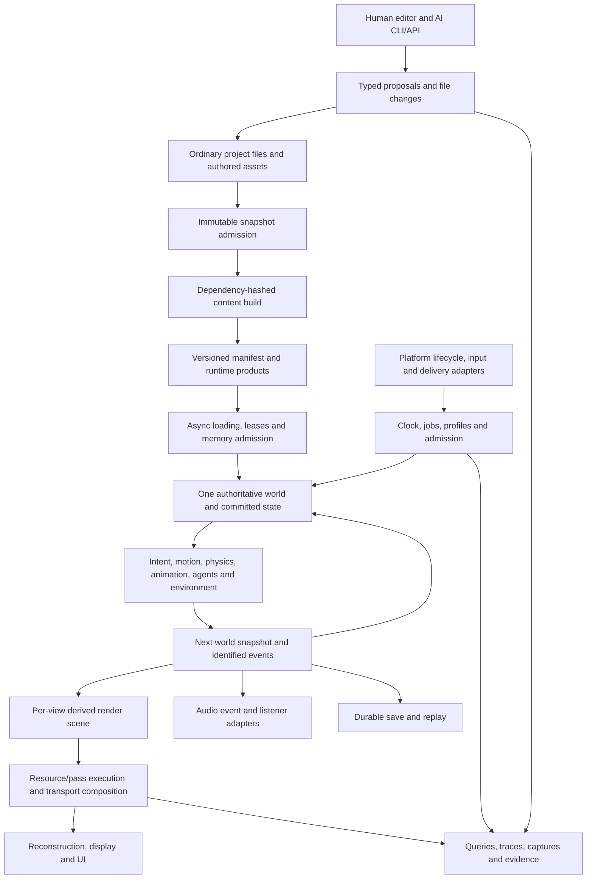

# Custom 3D engine — integrated design

31 October 2026. High-level engineering recommendation for the [confirmed brief](ARCHITECTURE-BRIEF.md).
Custom host and the platform ambition are user decisions. Mechanisms below are reasoned design recommendations;
detailed commissions and empirical qualification remain explicitly tracked in [maturity](MATURITY.md).
The [shared contracts](CONTRACTS.md) own cross-module semantics and override a contradictory local description until
both documents are reconciled. The engine serves interactive teaching demos first and games later ([purpose](../plans/BRIEF.md#purpose)), not a water or forest engine.

**Selected revision, 1 November:** [architecture decisions](ARCHITECTURE-DECISIONS.md) resolve the five audit boundaries
and whole-plan findings at architectural scope. C4 retains first-class networking and reconciles file-first source, restart-first play and explicit action/state publication.
[BASELINE-SPEC](BASELINE-SPEC.md) now fixes G01–G10 mechanisms for the initial admitted set; all runtime/device/quality evidence remains unfinished; historical reviews certify only their
recorded scope.

## Architectural position

Make developer flexibility explicit through feature selection, useful extension points and deliberate subsystem
boundaries. The [scenario walkthroughs](SCENARIO-WALKTHROUGHS.md) recommend explicit static game setup, direct typed
game components/systems and named target profiles. Optional reusable packages use the same contracts; no universal
plugin registry or general provider optimizer is required. [ENGINE-EXPERIENCE](ENGINE-EXPERIENCE.md) is the concise
developer model; [composition](COMPOSITION.md) gives the integration rules. The selected source/session/shader/model contracts constrain every such extension. Responsibility families below do not prescribe packaging.

Own the engine's world/runtime composition, content contracts, feature policy, renderer integration and authoring
operations. Reuse suitable platform, graphics, codec, physics, animation, text and audio libraries after a dependency
and target audit. Other engines are design/source references, not runtime dependencies. A copied idea is not a copied
implementation; any copied code needs exact source revision, license/notice provenance and a maintenance owner.

Select Rust for shared runtime and tools, a custom host, winit where its platform integration fits, and wgpu as the
GPU substrate, reaching each device's hardware through recipe-selected native features. Native mobile shells remain explicit adapters. These libraries do not select our architecture
or guarantee device parity. Platform SDKs own signing/package integration; runtime code does not assume filesystem,
threads, surface or audio access is always available. [Platform reasoning](modules/PLATFORM-RUNTIME.md).

[Performance investment](AI-PERFORMANCE.md#performance-investment-from-the-first-design) applies across these owners:
derive cost and scaling before committing representations, investigate frequent small work as well as expensive
operations, and allow deeply specialized internals where their benefits and correctness can be established. Preserve
clear public semantics while using AI to absorb implementation effort. Runtime/game quality and stability remain
requirements; the small first slice exercises the architecture without setting its eventual performance ceiling.

The design separates three graphs: a content build DAG, a CPU task/authority schedule, and a GPU resource/pass graph.
Each has different nodes, lifetime and dependency meaning. Versioned products, committed snapshots and submission
leases connect them. A universal graph/event bus would conceal those differences and is not selected.

Arrows show data/lifecycle handoffs, not arbitrary synchronous calls or permission for cyclic crate imports.

## Responsibility families and decomposition

| Family | Responsibility and meaningful children | Governing design |
| --- | --- | --- |
| Foundation F1/F2/F3 | Platform lifecycle; clocks; bounded jobs; profile resolution; stable IDs; versioned schemas | [Runtime](modules/PLATFORM-RUNTIME.md), [tools/composition](modules/TOOLS-DELIVERY.md), [world/schema](modules/WORLD-CONTENT.md) |
| Content/world F4/W1/W2/P7 | Import/cook; manifests; residency; entity registry and specialised stores; hierarchy; regions; procedural recipes; saves/replay | [World/content](modules/WORLD-CONTENT.md) |
| Play P1–P6 | Actions/focus; camera policies; collision/rigid bodies/locomotion; animation/IK/root motion; navigation/agents; game rules/interactions/sequences | [Play systems](modules/PLAY-SYSTEMS.md) |
| Networking N1 | Server/standalone authority roles; typed peer intent; replica baselines/interest; bounded correction and transport adapters | [Network sessions](modules/NETWORKING.md) |
| Rendering V1–V5 | GPU resources and passes; render scene/visibility/LOD; material/light/shadow/indirect/reflection transport; reconstruction/display; visual effects | [Rendering](modules/RENDERING.md), [temporal/media derivation](research/TEMPORAL-COMPOSITION.md) |
| Environment E1 | Weather/wind; atmosphere/sky; cloud source and projections; terrain/surface response; vegetation; region-specific water dynamics | [Environment](modules/ENVIRONMENT.md) |
| Audio/UI A1/U1 | Audio clocks/mixing/spatial voice lifecycle; text/layout/focus/accessibility/localization and output | [Audio/UI](modules/AUDIO-UI.md) |
| Creation/delivery T1/T2 | Shared operations/inspection; undo; diagnostics; reproducible build/capture; packaging; evidence/maturity | [Tools/delivery](modules/TOOLS-DELIVERY.md) |

These are ownership boundaries, not a rule to make every row a crate. Shared infrastructure has one owner. A module
may publish multiple capabilities; a game may select constant, baked, authored or dynamic providers as appropriate.
Game rules and authored content remain outside the engine core. Future multiplayer is a confirmed first-class requirement. N1 selects server authority and typed replication now;
the first local slice preserves its contracts while networking-off removes avoidable network work. No deterministic
lockstep, automatic multiplayer conversion or currently functioning network runtime is claimed.

## Why these representations fit together

World objects have durable IDs; runtime slot generations prevent stale access; content hashes identify products rather
than objects. Reflection/schema data supports authoring and persistence while hot tables and physics/animation/nav/GPU
stores keep their own efficient layouts. Recommend f64 CPU world positions with local f32 representations and explicit
origins, not a second camera-relative physical world. Choose origin range from positional error requirements. W1 owns a small public identity/access layer over selected private hecs 0.11.2 archetype storage;
specialized stores stay separate. No generic sparse ECS or backend handle is part of the public contract. [World representations](modules/WORLD-CONTENT.md#selected-representations-and-authority).

One fixed tick per authoritative world commits game state. Initial gameplay closure is preloaded; substantive edits
restart and level changes use explicit stop/load. Qualified later streamed changes obey the pre-tick admission barrier; queries read that state. Intent and root motion request one body movement; physics resolves it and returns achieved/residual motion;
animation adapts the pose; the world commits one snapshot and identified events. Render views interpolate/evaluate
their own presentation samples without stepping the world. Audio maps identified events to its own sample clock.
This prevents duplicate transforms, camera-dependent simulation and double event emission. C02/C03/C11 own the details.

The portable renderer uses clustered forward lighting with explicit geometry/coverage, conventional shadow maps,
energy-accounted material closures, low-frequency indirect/probe fill and explicit reflection fallbacks. Projected
error drives LOD for both perspective and orthographic views. This provides a coherent baseline across tile/bandwidth
constrained and desktop devices; specialised deferred, ray-based or virtualized providers extend the baseline when
their complete contracts justify them. It is a quality floor, not the desktop ceiling. [Derivation and alternatives](modules/RENDERING.md#analytical-closure-for-the-baseline).

Transport uses one light registry and depth-ordered surface/media composition. Participating intervals expose
transmittance and in-scattering; overlapping media combine extinction/source before integration. V3 owns that meaning,
V1 executes its graph, and V4 reconstructs/displays the composed image. Geometry/deformation producers supply the
point correspondence for each view's retained history sample, or explicit invalidity. Spatial AA remains a valid
profile; temporal reconstruction is an optional estimator with known disocclusion/transparency limitations. C07/C08
and the temporal leaf prevent independently plausible effects from making an incoherent composite.

Environmental providers share physical location, time and source fields, not one universal solver. Wind feeds plant,
cloud and water response operators. Cloud optical depth can project into lighting without visible cloud rendering.
Surface liquid/solid stores conserve phase transfers; material appearance and friction read the same state. Water
supplies force/query surfaces, while P3 alone integrates bodies. Approximation domains and authored artistic overrides
remain visible. No demand for photorealism prevents stylised shading, but a style choice cannot silently change physical
query semantics. [Environment operating model](modules/ENVIRONMENT.md).

## Profiles and simultaneous budgets

Use a finite, validated set of profile recipes. Camera, capability, provider and budget are separate axes. A top-down
profile may omit sky/cloud pixels while retaining attenuation, environment reflections and indirect light. A first-person
interior may exclude weather while retaining window light. Mobile may use simpler shadow/cloud/indirect representations
and fewer resident assets without changing game authority. Browser demos run the portable recipe at showcase quality
with explicit download/startup limits and never cap native. A showcase can select advanced providers without making them universal dependencies.

V1 targets the [build plan](../plans/BRIEF.md#goal-and-exit-rule)'s 120 Hz M3 Max and 60 Hz Chrome rows; other
profiles set targets after V1. The [runtime budget table](modules/PLATFORM-RUNTIME.md#whole-scene-budget-proposal--all-unmeasured)
is the post-V1 numeric envelope source. It covers the whole scene, not each module independently. For CPU work, the
critical path and work/parallel-capacity lower bounds both matter. GPU time is bounded below by dependent work and
traffic/effective-bandwidth; concurrent features compete for the same bandwidth and memory. Reference content fixes
object/light/volume/animation counts, screen coverage and resolution before assigning module shares.

F4/V1 account for live products, decode/upload staging, old/new overlap, transient targets and safety reserve. Profiles
have admission and overload policies; optional work is bounded before queues grow. Mobile thermal steady state and
browser startup are first-class qualification dimensions. No theoretical bound is labelled measured performance.

## AI-oriented structure and development surface

The [AI development design](AI-DEVELOPMENT.md) distinguishes engine-contributor and SDK-game workflows. Keep task
guidance concise and version-matched; encode mechanically checkable boundaries in public types, dependency policies,
registration/schema validators and scoped checks. Shared human/agent operations expose bounded state and exact run
provenance. Skills and structured reports improve contribution reliability but do not establish runtime determinism,
visual acceptance or platform qualification. The selected A01–A05 rules govern implementation; the baseline specifications now supply the named initial mechanisms; extensions need their own complete designs.

The [performance campaign design](AI-PERFORMANCE.md) gives agents broader implementation freedom within explicit
semantic/quality constraints: algorithms, layouts, schedules, cooked products and finite target specialization.
Trusted evaluation, reproducible candidate builds and independently qualified integrated results belong to T2/F4;
they do not add a runtime optimizer or freeze internal representations behind a universal plugin interface.

Proposed source domains for the new implementation, to be mapped onto a dedicated checkout during construction:

- `core`: stable IDs/units/schema/value types; no platform or renderer dependencies.
- `runtime`: clock, jobs, lifecycle/composition; explicit commands and publication barriers.
- `world` and simulation families: authoritative state and specialised stores; no GPU handles or editor state.
- `network`: optional session/replication/transport adapters; validated intents and immutable projections, no second gameplay authority.
- `content`: schemas, build/cook tools and runtime source/residency services separated by deployment features.
- `render`: derived scene, transport, GPU execution and display; reads committed world products.
- `platform`, `audio`, `ui`: device/application adapters with declared main/realtime-thread restrictions.
- `tools`: editor, CLI, inspection, capture, diagnostics, packaging and maturity checks; runtime excludes editor-only work.
- `games` and `examples`: policies, content and reference scenes composed through public engine surfaces.

This is a dependency plan, not an instruction to reorganize the current worktrees. Cross-module imports use named public
surfaces; core contracts remain small. Code/schema ownership and explicit versioned messages let agents work locally
without maintaining competing definitions. Do not wrap every utility or build an all-purpose service locator.

The same operations serve editor, CLI and agents. Queries expose schema, dependency closure, working files, selected snapshot, running build and saved checkpoint
identity, provider plan and pending failures. Edits produce reviewable file changes, admit an immutable snapshot and cook its products; substantive changes start
a new run. Qualified visual preview uses its own publication boundary. Captures/traces bind to exact build/content/profile identity. Headless scenarios exercise
semantics without a GPU; visual review uses rendered motion, automated image checks and [agent review](AI-DEVELOPMENT.md#visual-review-and-human-steering). No runtime LLM is required.

## Integration and next stage

The coordinator reconciles the scenarios in [CONTRACTS](CONTRACTS.md#active-integration-scenarios) as a whole,
including low-quality/disabled states and adverse transitions. [Review dispositions](INTEGRATION-REVIEW.md) preserve
actual corrections and outstanding limits. The [construction plan](CONSTRUCTION-PACKAGES.md) separates remaining detailed
design from implementation and prediction-specific qualification. The engine is not ready merely because these
documents exist: each dependent implementation waits for the mechanisms/contracts it needs, and every claim of
working quality must be backed by its own evidence.
