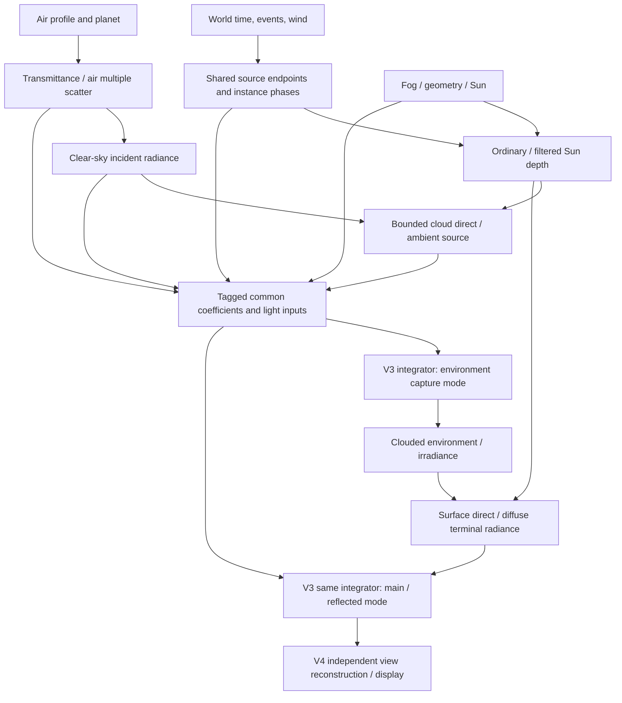

# Cloud and atmospherics migration build plan

2 November 2026. **Reviewed build plan; implementation of this migration has not started.**
This is the tracked queue for cloud rework. [CLOUDS](CLOUDS.md) owns the module scope;
[capabilities](CLOUD-CAPABILITIES.md) own required outcomes; [technique selection and pinned source map](../research/ATMOSPHERICS-TECHNIQUES.md)
justify this plan. Existing work is evidence and reusable material, not a constraint on the replacement.
The user explicitly prioritizes the best result over minimizing rework.

Each POC must have a documented launch command/URL, pinned scenario, visible clock/build/status and usable controls.
Every checkbox records its artifact/evidence when completed. A screen that merely opens, an unobserved export or a
numerical report without the required visible effect is not a completed POC.

## Progress and rules for updating it

A checkbox means the named deliverable and its stated gate passed. Every completed build stage links an evidence
record with source/build, fixture/reference, actual images and motion, numerical findings and measured scope.
Use `not started`, `in progress`, `blocked by <dependency>`, `failed <gate>` or `passed <scope>` in the status table.
A rejected candidate is a recorded outcome, not a completed capability. Tests, reviews, visuals, performance and user
acceptance are separate. Update this file, the owning capability rows and evidence at each logical commit/push.

| Stage | Dependency | Status / evidence |
| --- | --- | --- |
| D0 Research and current-code reconciliation | Original brief | Passed research/audit scope; [retained studies](../../evidence/atmospherics-migration-2026-11-02/REVIEW.md) |
| D1 Hardened architecture and proof plan | D0, independent reviews | Passed planning scope; [32 finding dispositions](../../evidence/atmospherics-migration-2026-11-02/REVIEW.md); docs checks passed |
| P0 Observable proof bench and contract seam | D1 | Baseline preserved in a124167; new harness not started |
| P1a One-source lifecycle/control feasibility | P0 | Not started; no accepted new master |
| P2a Bounded validated air/sky reference | P0 | Not started; Sun-only WIP is narrower |
| P3a Minimal multi-source/light/view seam | P1a + P2a/versioned clear-sky reference | Not started |
| P4a Spatial coupled sentinel + early scaling | P1a/P2a/P3a minimums | Not started; must precede content expansion |
| P1b/P2b/P3b Branch content / full LUTs / production renderer | P4a | Not started |
| P4b Reconstruction and full overlap sentinel | P1b/P2b/P3b | Not started |
| P5 All isolated families and variants | P4b | Not started |
| P6 Weather/combined layers | P5 | Not started |
| P7 Scale, adverse cases and device admission | P6; cost screening throughout | Not started |
| P8 Thrum runtime integration | Accepted proof + I1/I2/I3 dependencies | Not started; Rust runtime does not exist |

Execution order is **D1 -> P0 -> P1a/P2a/P3a minimums -> P4a -> P1b/P2b/P3b -> P4b -> P5 -> P6 -> P7**.
P2a may run alongside source work; P4a does not wait for full atmosphere qualification, Cb, far rendering or history.

The old implementation continuation is suspended while this migration is planned. Source work still needs tool/content
qualification; the plan explicitly executes those bounded choices before dependent production work. No old queue or persistent goal
automatically restarts. This document commissions no purchase, bulk asset campaign or automatic engine promotion.

## Why the existing path stalled

The existing system has useful finite optical and consumer proofs, but its defining source/content and production
schedule have not passed. One Q1 Cu clip shows some formation/breakup with static maturity; two procedural Cu
replacements failed appearance. Other families and world weather remain unproved. Scrolling detail, invertible warp,
uniform scale/fade and a better scattering calculation cannot supply missing formation or renewal.

The view fixture owns source preparation, light cache, camera, Sun, exposure, mirror and output in one coordinator;
the shaders assume one local box, constant sky and analytic geometry. It does not yet implement the complete
cloud/air/fog/environment system. The selected crop still measured about **12.976/17.075 ms GPU p50/p95** for a local
one-source graph, already over the 5 ms cloud target. The extra depth-index experiment failed to show repeatable
whole-graph gain. The old A0/deep-query ceilings bound excessive work rather than predict an economical frame.

The practical correction is to choose content production, world/source ownership, shared lighting and per-view
sampling together. Preserve the valid transport/oracles and diagnostic witnesses; replace the viewer-shaped
architecture. Do not add another layer of fitted mathematics to postpone the missing source and scaling decisions.

## Target system and code ownership

Use Thrum's existing F2 composition and C01/C02/C04/C05/C07/C08/C12 contracts. E1/W1 owns world/environment state;
F4 owns cooked products/admission; V1 resources, V2 view extraction, V3 optical transport and V4 display retain their
engine responsibilities. No new clock, cloud-specific final upscaler or plugin framework. No speculative crates.
During proof construction these boundaries are plain files and data structures in a standalone harness.

Proposed proof package: `scripts/atmospherics_proof/` with a thin `viewer` and one explicit pass scheduler.
Keep the old `scripts/cloud_sky_proof/` as a frozen comparison route until its useful witnesses migrate. New default
logic does not import old viewer globals or shader text by replacement. Proposed private modules:

| Module | Owns / outputs | Forbidden coupling |
| --- | --- | --- |
| `world` | Immutable weather/source snapshot, stable event/layer IDs, source time, wind/front tracks, source-group semantics | No camera, texture handles, exposure or renderer-driven births |
| `content` / offline `cook` | Editable master recipes, optical remap, clip phases/branch markers, source/detail/bounds/LOD/velocity products and exact hashes | No opacity inferred from a displayed image; no discarded required master |
| `source` | Coefficient query, representation/demand selection, source/index generation and correspondence validity; requests pooled residency from V1 | No one allocation per logical cloud; no main-frustum-only event lifetime |
| `air` | Profile-only transmittance/multiple scatter, per-altitude/Sun sky, per-view aerial and stable segment queries | No cloud density hidden inside altitude-only LUTs; no display grading in medium coefficients |
| `lighting` | All-layer Sun depth, cloud source closure, clouded ambient/environment generation and update keys | No recursive ambient solve; no unbounded per-sample secondary march |
| `views` / `transport` | Bound ray intervals, ordered media integration, geometry and independently projected main/reflection/probe views | No main-view color/depth reused as reflected world radiance |
| `reconstruction` | Per-view prior sample time/transform, depth/moments, motion, invalidity, fresh-sample policy | No history reuse for newly created structure or across cuts/epochs |
| `gpu` / `schedule` | Explicit pass inputs/outputs, leases/generations, lifetimes, submission, counters and retirement | Helpers encode work; they do not secretly submit or publish half-built generations |
| `viewer` / `evidence` | Controls, responsive Mac gestures, diagnostics, immutable build ID, captures/replay/timing receipts | No authoritative weather, private lighting constants or custom material display transform |

This layout is proposed, not directories/crates already built. Rust promotion follows actual public consumers and
construction dependencies; translate the selected interfaces, not a JavaScript object graph or prototype bitfield.
Share documented WGSL mechanisms/fixtures where useful; do not create duplicate Rust and JS authoritative weather.

### Required handoffs

`SourceSnapshot` carries world/epoch/time, event/group identity, recipe revision, phase/trajectory/support and weather
revision. `MediumSample` supplies nonnegative extinction/scattering in m^-1, liquid/ice phase parameters, support,
footprint/representation/error, group-partition provenance, optional correspondence and explicit validity; valid zero differs from unavailable. `PathOptics` has endpoints/time/groups, ordinary tau/T and admitted
footprint/error. A filtered shadow/radiance approximation cannot silently answer an exact point query.
`ProductGeneration` names every upstream revision and its data time. `ViewRequest` names projection, viewport,
physical sampling time and actual retained prior time. `OpticalSegment` contains scene-linear premultiplied RGB S and
RGB T over a stated interval. These are semantic contracts, not final SDK signatures.

Weather/source facts survive view culling. Main-off retains shadow/reflection/environment work if requested; no
optical consumers means no cloud GPU allocation/dispatch. CPU semantic weather can remain headless. Swap complete
compatible generations after preparation; retain in-flight leases, reject late results from old epochs and rebuild
from admitted inputs after device loss. Unexpected capacity/unsupported domain is reported, never fabricated clear.

### Resource ownership and publication

| Product | Owner / key / readers | Dirty work and retirement |
| --- | --- | --- |
| Master/cook bytes | F4; source/tool/cook hash; source and recovery | Immutable admitted CPU bytes remain recoverable; edits create a new revision. No unbounded decoded CPU mirror. |
| Current field/bounds/index atlas | V1 allocates pages/fences/device epoch; source requests representation/time/group; lighting and views read | Rebuild changed unique field groups; retain old pages until every reader finishes. Source owns no separate allocator. |
| Sun/ambient cloud products | V3 lighting; source generation, Sun, air/fog/geometry, footprint/profile | Changed source/light regions; no per-camera duplicate. Retire through V1 fences, not source lifetime alone. |
| Air LUTs | V3 air produces, V1 allocates; profile-only or explicit Sun/view key | Profile edit dirties T/MS; camera/Sun edit dirties appropriate sky/aerial. Resize leaves profile LUTs intact. |
| Environment/irradiance | V3 lighting; position/region, source/light generation, directional footprint | Changed sectors; strict current generation first, bounded approximation only after a latency/quality gate. |
| Main/reflected histories | V4 reconstruction, V1 allocation; view ID/projection/viewport, actual prior time and generation | Cut/resize/epoch/invalid correspondence rejects history; views never share history textures. |
| Upload/readback staging | V1 with F4 leases; upload transaction/device epoch | Bounded concurrent slots; release after copy/readback fence. Evidence readbacks excluded from quiet timing. |

The scheduler prepares a **candidate** source generation, not a visible publication in frame step2 below. It submits a
`FrameOptics` transaction with `(world epoch/time, source revision, air profile, Sun, fog/geometry revision,
quality/device epoch)` and the matching source, direct-light, shadow, ambient and requested view products. Publish only
when required dependencies are complete; unchanged profile products can be shared by exact keys. Default POCs allow
**zero stale source/light reuse**. Birth, seek, edit, cut and epoch changes invalidate affected consumers immediately.
If preparation misses its deadline, the last complete image may remain displayed with its old timestamp and an explicit
missed-frame/capacity counter; never label it current, freeze world phase, or count the miss as successful cadence.

**Regional validity:** global FrameOptics/source snapshot revision is distinct from immutable product-region content
revision. A cached tile records a conservative dependency read-set: source/group region revisions, swept supports and
light-path influence, air/fog/geometry revisions, Sun, footprint and transform. An unchanged tile may enter a new
FrameOptics manifest only if all relevant input values/revisions remain valid; retaining identical inputs is exact
reuse, not stale-light allowance. Invalidate the union of old/new source supports and their directional light influence;
include offscreen blockers and ambient/environment direction cones. If influence cannot be bounded conservatively,
dirty the entire affected product. Source phase/time changes that alter a region invalidate it even if the global
change looks small. P3a chooses the concrete tile/index layout and proves read-set invalidation; it does not invent
this validity rule later. Never relabel an old tile with a current timestamp to manufacture coherence.

Slower environment/shadow cadence is a later radiance approximation, not an implicit exception. Before enabling it,
record the consumer, maximum physical-time age, projected motion/radiance error, changed-region invalidation and
current-generation fallback cost. First show the current-generation reference. Device loss invalidates V1 resources
and view histories; rebuild from F4 inputs. Quality changes stage a new compatible graph and account old+new peak bytes.

For one condensate, Cb core/anvil or Sc/St representations publish nonnegative partition weights summing to one;
independent source groups add coefficients. Near/far products substitute with the same partition, never add a second
cloud. P3a tests this accounting with tiny low-layer/ice fixtures, not accepted family artwork. Point/headless queries
read the declared source representation/time; they do not infer coefficients from a filtered shadow map.

A bounded direct all-layer coefficient integrator supplies reference point/path queries, with declared max step,
validated integration error, support and request cap. Outside its admitted domain/capacity it returns unavailable.
Production filtered Sun maps advertise a different footprint/error. Do not reuse K48's failed lateral point result or
require unbounded exact-path service for every radiance sample.

### Mathematical and content closure

For disjoint front A and rear B, compose `(S,T)=(S_A+T_A*S_B, T_A*T_B)`. In overlapping air/fog/cloud intervals, sum
extinction and source coefficients before integration; independent finished images are not equivalent. Use stable
homogeneous Beer steps with the zero-extinction limit. Integrate local shadows where spatially uniform LUT assumptions
fail; use a directly evaluated/re-anchored clear-air segment at ill-conditioned LUT-ratio/subtraction boundaries.
Do not divide by nearly zero throughput to reconstruct a tail.

A cloud source is an optical proxy, not necessarily conserved water mass. The scalar example `sigma_t=k*rho` assumes
fixed phase/albedo. Mixed masters store liquid/ice weights or separate extinction/scattering channels; the cook declares
where absorption, phase function and albedo live, including any qualified constant-per-family approximation. Include
these extra fields in actual byte/LOD/optical error accounting.
For each genus, editable staged masters explicitly change local support/density/connectivity. Advect material with
shared height wind once; bake wind is removed before adding runtime wind. Between prepared frames the baseline is positive interpolation of adequately sampled **final optical frames**,
qualified against the continuous/direct master. Flow-assisted reconstruction is an unproved storage/quality challenger,
not a prerequisite or published guarantee. If either interpolation loses structure, increase authored cadence or revise
the producer before rendering; invalidating history alone cannot repair the source. Interpolation cannot invent a missing tower/anvil/filament. Independent detail
must be limited to a qualified morphology/optical band with support expanded by its maximum displacement.

The selected production route is offline VDB-compatible authoring/simulation -> fixed optical master -> portable
cooked fields/bounds/detail. First inventory available tools/licenses and create **one** recoverable sample, not a
large library. Houdini field/model tools and EmberGen export are demonstrated routes; neither application or paid
license is presumed installed. A Blender/open tooling route may substitute only with the same source/quality gate.
The exact executable tool/version/recipe and phase-complete sample remain P1 deliverables; no unseen master is passed.

Cu needs persistent body/base, new heterogeneous billows, mature renewal and ragged fragments; Cb needs the same
cell deepening into towers, cap-limited lateral anvil growth and unequal core/anvil decay. Sc/St use coherent evolving
low-layer organization with local holes closing/opening, finite thickness and a common base. Ci uses high thin
wind/shear-aligned fibres with local deposition/loss and persistent tails. Prepared layer/filament products may be
2.5D where that regime passes; near towers use true volume. The same source and error-qualified LOD feeds every
consumer. A generic Perlin/Worley type slider is not the five-family producer.

**Prepared-content control contract.** First source controls are birth time, persistent event ID, phase rate,
wind/shear trajectory and a cooked continuation branch. Phase is monotone within a branch; slowing it does not freeze
internal mature renewal. A branch may be entered only at a declared compatible interval with matching source geometry,
optical calibration and material correspondence. Cook both continuations from the same boundary state, or use a
transported local residual with independently measured continuity error; a global endpoint blend is not accepted.
For baseline interpolation at time fraction `a`, each nonnegative optical coefficient channel satisfies
`q_j(a)=(1-a)*q_j0(x)+a*q_j1(x)` at the same unwarped cooked coordinate and LOD. Channels include extinction and
liquid/ice **phase-weighted scattering coefficients**; derive albedo after mixing, with a defined zero-extinction limit.
Do not interpolate normalized phase parameters as if that were coefficient mixing. The scalar `rho` equation is only
the fixed-optics special case. Convex mixing preserves nonnegativity and sigma_s<=sigma_t when endpoints satisfy it; traversal uses the **union** of both endpoint supports.
New/lost local matter comes from actual endpoint differences, not a whole-body opacity curve. A flow-assisted challenger
may replace x with bounded endpoint maps Phi0/Phi1 only after validating every required optical/shape/continuity cue
against that direct baseline and the master, expanding support for mapping displacement. Regions with births/tears or excessive correspondence error reject history. Validate quarter,
mid and three-quarter times against the authored master; shorten frame intervals when interpolation destroys cues.

Direct prepared frames at a finer verified cadence are the fallback if the flow candidate fails; their memory/cook
cost is measured rather than assumed free. P1a changes phase/loss forcing mid-life under one ID and checks continuity; P1b adds the explicit deepen-to-Cb branch.
An unsupported direction/control change is rejected at authoring/admission or begins a declared new epoch, not a
silent source replacement. Initial weather stories schedule compatible branch windows and persistent surviving
clouds; this is controllable authored weather, not arbitrary instantaneous morphing. If the required weather response
cannot be authored with a finite branch set, revise the content route before building the larger weather controller.

**Joint integration rule.** V3 transport is the sole view integrator. Build sorted entry/exit intervals from planet,
geometry, cloud supports and bounded fog. In intervals touched by cloud/fog or spatial shadow, evaluate total local
extinction and source (air single scattering using RGB Sun transmission plus Hillaire higher-order air term, fog and
cloud closure), and integrate once with common prefix throughput. Ordinary all-layer cloud/fog/geometry light depth
attenuates direct source at that sample. Hillaire's unshadowed air multiple-scatter term is an explicit low-frequency
approximation, not locally exact shadowed multiple scattering. In disjoint, spatially unshadowed clear-air intervals,
use the LUT segment affine operator; use bounded re-anchored direct integration when the cumulative-segment difference
is ill-conditioned. Clear sky is the correctly clipped atmospheric ray to the top boundary, not an extra full-distance
aerial overlay. Opaque terminals end the path; reflected legs start at the interface, with the eye-to-interface operator
applied once. Fog crossing cloud bounds stays in the joint interval, not a second finished fog image.

Sky-view output serves clear directions and external incident illumination. Environment capture consumes this same
transport pipeline without reading the clouded environment it is currently producing: air/space/ground and direct
cloud light -> bounded cloud ambient -> clouded environment/irradiance -> surfaces. Cloud ambient starts from clear-air
sky plus a coarse cloud-occlusion correction; it does not sample final surface irradiance recursively. Reference rays
cover clear, shadowed-air, two-fog overlap, cloud/fog overlap, horizon and near-water cases. P4a proves the bounded join;
P4b qualifies its extended LUT and reconstruction implementation.

### One frame and one weather transition

1. Sample one authoritative world time and wind/front tracks; resolve persistent source episodes/phases/trajectories.
2. Admit source residency and update changed local fields/bounds into an unpublished candidate generation.
3. Update atmosphere profile LUTs only on medium/planet changes; update Sun/camera-dependent tables on their own keys.
4. Build affected ordinary/filtered Sun-depth regions. Evaluate bounded direct/ambient cloud source products from
   that generation and the clear sky; prepare candidate clouded irradiance/environment without recursive dependence.
5. Extract main, independent reflection and environment requests. March coefficients with shared light products;
   integrate overlapping media and correctly placed clear-air tails. Geometry clips each view's own ray.
6. Reconstruct each view with its own valid history; give changed source/silhouette/disocclusion regions fresh samples.
   Water/opaque/transparency consume the same radiance/irradiance generation. Exposure/display occurs once in V4.
7. Atomically publish the compatible FrameOptics graph with its timestamp/receipts, then retire unused generations after GPU completion. Paused state reuses valid
   products; a camera change never rebuilds unchanged weather/shape or profile-only air tables.

For a growing storm, the front admits a persistent convective event; its prepared deepening branch develops towers,
then an anvil under upper shear while old core fragments erode. Dirty source regions update Sun depth, clouded ambient
and reflected/environment sectors. The default graph uses matching density/light generations; later radiance approximations need explicit age/error admission;
new births/cuts invalidate history immediately. No cache rebuild may hide a whole-frame stall or replace current time
with a held phase. On seek, recompute the same events/source facts, reject prior histories and publish coherent data.

### Pass and consumer boundary map

Both modes call the **same** V3 segment mechanism. During environment production its terminal is admitted
space/ground/direct-only reference, never E-dependent surface lighting. Ordinary views then consume E through surface
terminals. P0 represents these as separate ordered passes, with no environment feedback cycle. Sun disk is a boundary
source filtered once by air and cloud optical depth, not an extra unattenuated sky sprite.

| Boundary / owner | Public meaning vs private implementation; disabled/failure behaviour |
| --- | --- |
| Game weather/celestial/semantic provider (E1/W1/F2) | Public time/epoch/event/wind and optional precipitation/lightning causes; independent of visibility/GPU. Out-of-range edits reject/restart explicitly. |
| Content admission (F4) | Public capability/domain/source revision/lease; private clip/frame/atlas/compression. Missing required product fails admission. |
| Direct surface + Sun disk (V3) | Current RGB direct light times air/cloud/geometry T once; surfaces and disk have their own footprint. Main clouds off does not remove retained attenuation. |
| Surface diffuse + reflections (V3) | Current or explicitly age/error-qualified irradiance/radiance; environment and reflected rays use their own positions/projections. Clear provider supplies real clear sky. |
| Air/fog shafts and cloud view (V3) | Private coefficients/source/light inputs, sole joint segment integration, support/interval/validity. Unsupported paths do not return fabricated T=1. |
| Transparent/water interface (V3/V4) | Ordered premultiplied S/RGB T and terminal depth. Analytic mirror is P4 witness; rough BRDF/wave/depth consumers remain P8, no false water pass. |
| History/exposure/display (V4) | View/time/validity/pre-exposure contract; private temporal buffers. No cloud-owned final tone map/upscaler. |
| CPU optical/semantic queries (E1) | Optional declared CPU source domain/error/cap; unavailable differs from clear. Weather/rain is not inferred from optical darkness. No GPU readback in authority. |
| Save/replay/network and provider lifecycle (W1/P7/N1/F2) | Serialize causes, source IDs and revisions; rebuild derived caches. P0/P6 stubs/replay traces now, actual engine binding/recovery P8. |

Public provider declarations describe capabilities and causes. All `MediumSample`, packed fields, Sun-depth knots and
shader layouts stay private unless an actual engine consumer needs a narrow typed service. The standalone harness
neither installs an SDK nor converts prototype structures into an authority API.

## Migration disposition

| Existing work | Action / required evidence before reuse |
| --- | --- |
| `transport.js`, float64 optical references, finite slabs and mirror/zero-light tests | Retain mathematical semantics and independent oracle cases in V3; adapt interfaces/units. |
| `clock.js`, coalesced gesture scheduling, frozen server/build IDs and capture tools | Retain tested behaviour as proof utilities; world time and pass ownership move out of the viewer. |
| `scalar-field.js`, packing/probe fixtures | Adapt validated guards/half arithmetic to a shared bounded source atlas; replace per-event allocations and unqualified mean mips. |
| `prepared-cu.js`, Q1 master and comparison captures | Keep regression/reference input. Replace hardcoded URL/dimensions and static mature source as default; no automatic family acceptance. |
| `deep-sun.*` K48 compressor | Keep finite error witnesses; compare against BSM/short local rays. Retire as universal point-query answer; retain only if multi-layer footprint/cost gates pass. |
| `scatter-fit.*` | Keep bounded liquid comparator. Select final production closure only after thick/low-Sun/overcast/ice image+reference checks. |
| Sun-only `air.*` WIP | Preserve narrow RGB direct-light study; full atmosphere replaces its implied role. No full-sky/overlap/ambient pass is inferred. |
| `cu-preview.*`, one-box prefixes/five-axis ambient, shader-string/bitfield coupling | Freeze comparison then retire as default coordinator/architecture. Replace with explicit source/light/view graph; no permanent compatibility wrapper. |
| Rejected coarse/hierarchy morphology and depth-index speedup | Preserve compact failures/oracles, not production fallback or further local polishing. |

Keep old and new comparison modes explicit with one source/light authority per run. Do not delete old unique inputs
until adopted witnesses and recipes are recoverable and linked. No Broadsides code/assets are imported.

## Budget account and reductions

Targets remain browser M2-class WebGPU1280x720: clouds<=5 ms, whole GPU<=16 ms, whole browser<=512 MiB;
native clouds<=3 ms within10 ms. No device admission is claimed. The cloud allocation includes source prep, shadows,
cloud light, main/reflected/environment cloud work and reconstruction; clear-air work is additional in the full frame.

Initial **allocation objectives, not predictions** for the 5 ms cloud envelope: source0.45, shadow0.55, light0.45,
main1.90, reflection0.35, environment0.25, reconstruction0.65, reserve0.40 ms. Clear-air/composition objective0.8 ms
leaves10.2 ms of the16 ms frame for other rendering. Native must get its own measured ledger; scaling browser numbers
by a constant does not certify it. Revise allocations from measured assembled POCs, not to conceal overruns.

Work model: `W=sum_views rays*occupied_steps*(density+cached_light+local_light_steps*density) + source_updates +
shadow_columns*steps + environment_rays*steps + reconstruction_pixels`. At720p, a320x180 current-ray target is57,600
rays;64 steps imply3.69M primary density visits before lighting. Half-linear640x360 is4x that. Budget changing regions
and full-coverage/cut refresh explicitly; 1/16 interleaving cannot be the only response to64x growth. Reflection/probe
rays count separately. Counters must reveal occupied/empty steps, local rays, fallback/direct queries, dirty source
voxels, uploaded bytes and history rejection, not only view resolution.

Initial **resource reservations**, not measured process residency: encoded working library64 MiB, decoded current
source pool48, bounds/index8, shared cloud light/shadows8, view/history products32, upload/staging16, clear-air/env8
(total184 MiB). The accounting remainder328 MiB is **not measured available headroom**; it must cover browser/JS or Wasm/compiler/scene/driver and peak duplication. Exhaustion
rejects admission; it does not silently kill retained clouds. A128^3 R8 frame is2 MiB;16 frames already32 MiB per
unique clip before flow/guards/mips. A full512^3 R8 field is128 MiB. These arithmetic examples reject blind full-world
storage; P1 must demonstrate actual temporal/spatial compression and peak bytes within the selected library.

P1 measures simultaneous retained encoded CPU/GPU bytes, decoded CPU cache (if any), physical GPU texture/guard/mip bytes,
old+new generation overlap, staging and histories at cold load, seek, quality switch and recovery. Reservation arithmetic
is rejected if simultaneous lifetimes exceed it before browser overhead. Real process/driver memory is still a separate gate.

At source rate q (1/16/64), delta_source_time=q*delta_display_time. Source evaluation at the exact requested time can
interpolate resident frames; it must not replay every skipped display frame. Master intervals, interpolation/reference
error, current-field cache misses, unique changing groups and all dependent dirty work determine cadence. Log decoded/
upload bytes and source/light work **per displayed frame** at each q, plus missed deadlines and history rejection. A source
route that only fits1x is not admitted as64x; use a qualified spatial/detail tier or report capacity failure without phase holding.

**Selected multi-instance sampling baseline:** share immutable decoded/cooked endpoint frames by `(master revision,
frame knot, LOD, optical layout)`, and keep each event's phase fraction/transform as small instance data. Interpolate
those endpoints at sample time; do not rebuild a full field merely because every event's continuous age changed.
Linear interpolation and linear filtering commute per optical coefficient channel at the same coordinate/filter/LOD,
**not** through Beer exponentiation, half rounding, optical-flow warps or varying LOD. Thus independent ages can reuse
the same endpoint products without holding phase. Validate half/quantization/support error separately. Keep low-LOD
frame chains resident where bounded; high-detail endpoints use a bounded admitted cache with exact seek deadlines.
A shared *current blended field* is a specialization only when its preparation is cheaper than repeated two-frame
reads across the actual consumers. The early stress matrix must compare both. Flow maps are not assumed to commute
with filtering and remain a separate challenger.

First compare bounded **resident short clips/shared immutable detail** with decoding into pooled endpoint/current fields.
Do not assume per-frame/network streaming exists. If masters exceed the pool, P1 must select and specify bounded
paging/upload/seek deadlines or revise the source cook before P3—not defer it to engine integration. Portable R8/half
packing is baseline; optional sliced-3D compressed formats require adapter and filtered-error qualification.

Reduction order to qualify: remove duplicate/unchanged preparation; conservative empty-space and footprint LOD;
shared low-frequency light/shadows; independently budget reflection/env cadence; mixed view resolution with fresh
change masks; temporal reuse where valid; then reduce high-order/ground-bounce/shaft detail. Keep family identity,
local lifecycle, current world time, horizon continuity and consumer coherence. Every reduction states actual saved
work/bytes, affected cues and a held/moving comparison. Neither a cost ceiling nor an isolated fast helper is a pass.

**Far-source candidate before architecture freeze.** Enumerate stable world cells intersecting the finite curved
atmosphere/light-receiver domain, using source-support and swept-wind bounds; camera affects demand/LOD, never event
birth. For unresolved far footprints test a coverage-conditioned transfer summary. For cloud-only operators,
`Tbar=(1-c)+c*T_occ`, `Sbar=c*S_occ`, where `T_occ=mean(exp(-tau_j))` and S_occ is mean premultiplied source over
occupied subrays; never use exp of their mean tau. For combined air/cloud bins use
`Tbar=(1-c)*T_clear+c*T_occ`, `Sbar=(1-c)*S_clear+c*S_occ`. Cook directional/footprint/depth bins from the same source
IDs, source time, reference origin, air/light generation and integration contract. This is an approximate **filtered radiance** product, not point/semantic tau.
Averaged operators generally **cannot be chained across correlated depth bins or varying terminals**. Preserve joint
subray identity and compose along each ray before averaging, or provide one whole-interval summary for the admitted
terminal class. Add correlated clear-gap/blocker and varying-background counterexamples; an independent mean per depth
bin fails if it loses this covariance. Include joint storage/traversal cost or reject the summary.
A first bounded candidate uses16 subrays/bin; work is `dirty_bins*16*source_steps`, with bytes for c/tau/S/depth/keys
included. Compare16 against64 subrays and direct held source queries for silhouette, T/S and camera/parallax changes.
The exact bin/pool sizes and acceptable error must be selected from P3a before production adoption; failed summaries
refine/switch to resolved source or report capacity failure. Offscreen Sun blockers remain in the light domain.

**Scenario update worksheet required before P3b selection.** Pin the existing FAIR/BROKEN/OVERCAST/STORM workload
recipes from CLOUDS, then record active event IDs, unique endpoint `(master,knot,LOD)` groups, demanded source cells,
changed bounds, shadow columns, ambient/env bins and fresh main/reflected rays for each1x/16x/64x path. Include a
source birth, cut/seek and quality swap burst. Calculate endpoint-cache misses/decoded bytes, host decode/upload,
physical staging+old/new peaks, GPU critical path and displayed latency from P1/P4 measurements. Store expected
steady/burst values alongside observations before selecting cache resolution/cadence; no blank count is treated as zero.
Useful structural screen:512 independently changing32^3 current fields would rebuild16,777,216 voxels per display
frame before lighting. Shared immutable endpoint sampling removes that particular rebuild floor; it adds two-frame
sample/cache costs, which must be measured. Full-cover steps and source/light changes are still not free. This is a
reasoned representation choice, not a5ms prediction.

## Checked build queue

### D0/D1 — research and design before code

- [x] Reuse retained cloud/water/temporal research and failures; inspect modern primary talks/papers and accessible source.
- [x] Save independent source/system recommendations before reconciling the current design; disclose prior exposure.
- [x] Audit actual proof files, ownership leaks, content failures and complete-graph budget failure.
- [x] Write selected stack, handoffs, migration disposition, combined cost model and progressive POC queue.
- [x] Review source applicability/recency, architecture/interactions, performance/residency and visual/POC coverage independently.
- [x] Resolve every consequential finding in the [retained disposition record](../../evidence/atmospherics-migration-2026-11-02/REVIEW.md); revise this plan and canonical scope/status.
- [x] Run docs/link/hash checks:221 Markdown files/1266 local links, maturity hashes and crate policy passed.
- [x] Deliver the reviewed planning checkpoint on `codex/cloud-system-design` and push it to origin. No migration shader/content building in D1.

### P0 — observable comparison bench

- [x] Preserve old build/source/evidence and paused WIP status in earlier evidence plus [a124167 Sun-only checkpoint](../../evidence/cloud-air-sun-2026-11-02/README.md); this is preservation, not a new renderer.
- [ ] Create thin proof runner, immutable scenario/source/view manifest and explicit source->light->view pass graph.
- [ ] Implement a minimal authored world event/front track immediately: stable IDs, birth/loss controls, height wind,
  one timestamp and deterministic seek. P6 expands this provider; it does not introduce world authority for the first time.
- [ ] Pin a small visual board: family stills, watched lifecycle spans/time ratios, clear/hazy/low-Sun horizon, broken/
  overcast ambient, fog and reflection comparators; record exposure/FOV/time matching limits and cues.
- [ ] Define FrameOptics transaction and resource owners from this plan; test delayed preparation and stale async results.
- [ ] Add main, reflected, shadow/irradiance and diagnostic panes sharing timestamp/generation; main-hidden/all-off modes.
- [ ] Carry stable Beer/clock/packing oracles; add no-consumer and stale-generation/in-flight product witnesses.
- [ ] Verify trackpad orbit/pan/pinch, paused idle, resize and controls while work is running; prevent unbounded event queues.
- [ ] Inspect actual old/new native-size images and matched small timing runs; reject changed comparison inputs or hidden work.

### P1a — one source before content expansion

- [ ] Select/verify executable authoring tool/version/license; preserve editable recipe and exported master. Blender is
  present on this host; Houdini/EmberGen availability/licensing is not verified. Do not assume purchasing them.
- [ ] Watch/pin actual motion references with spans/time ratios, then build one Cu with local birth, mature renewal and breakup.
- [ ] Render world-locked/cloud-locked neutral beauty, density/slices and tracked features at1x/16x/64x.
- [ ] Cook fixed optical remap, liquid/ice/scattering layout, phases, endpoint differences/correspondence/support and portable
  products; start with direct-frame interpolation and compare the optional flow candidate separately. Compare authored
  quarter/mid/three-quarter interval samples. Change phase/loss forcing mid-life while retaining ID and continuity.
- [ ] Compare this prepared route with a bounded controlled implicit/2.5D challenger on the same source/lighting/cues;
  record expected morphology, sample/rebuild/bytes tradeoffs. Rework the selected route if the challenger wins complete fit.
- [ ] Screen tiny low-layer and ice inputs through the same coefficient/support/time/group contract, including core/anvil
  partition accounting. These are conformance fixtures, not family appearance passes.
- [ ] Measure cadence, exact source-time advance, decode/cache misses, upload and peak bytes at1x/16x/64x; choose a bounded
  resident source policy. If paging is necessary, define request/window/seek deadlines before the later production path.
- [ ] Reject prefigured faint shape, static maturity, balloon/cut erosion, broken local interpolation or driver-induced reset.

### P2a/P3a — minimum air and multi-consumer seam for P4a

- [ ] P2a: validate bounded Sun/finite clear-air RGB T/S plus clear-sky incident radiance under pinned Sun/profile against
  direct/reference calculations. A direct reference path is allowed; full fast four-LUT/altitude qualification is P2b.
- [ ] P3a: accepted one-Cu coefficients and bounds plus P2a/versioned clear-sky reference feed main, independent reflected
  rays, receiver Sun depth and environment;
  explicit scheduler/owners/FrameOptics keys. Preserve numerical and zero-light references; no new one-box public ABI.
- [ ] P3a: test the bounded far transfer candidate against direct samples, silhouette/T/S, correlated depth gaps/varying
  terminals and camera/parallax changes,
  including horizon and offscreen low-Sun blockers; select bins/error/pool or reject before P3b.
- [ ] P3a: run nonacceptance stress1/2/16/64 plus regional source groups with shared versus independent ages, sparse/full
  cover, overlapping layers, far/offscreen blockers and low Sun. Use accepted source or labelled synthetic conformance
  fields; count actual unique fields/voxels, Sun columns, view/light samples, dirty bytes and memory. Synthetic fields
  screen architecture cost; they never pass family appearance. Stop before allocation exhaustion.

### P4a — spatial-only coupled sentinel, early hard gate

- [ ] Show **one renewing Cu**, bounded validated clear air, one overlapping fog interval, ground/analytic water interface,
  common Sun/shadow, clouded ambient/environment and an independent reflected view. No history, Cb or variant library required.
- [ ] Move a cloud shadow across **clear aerial perspective and local fog** as well as cloud/terrain/reflection under the
  same Sun state. Show each direct/ambient contribution; qualify the low-frequency unshadowed air-MS approximation.
- [ ] Inspect actual normal/accelerated motion and native images for source, shadow, reflected and environment changes.
- [ ] Save paired same-point/time receipts: medium coefficients, Sun depth, receiver irradiance, ambient/environment,
  main/reflected ray and clear-air segment; toggle main visibility/camera while holding the source. Reject stale or
  different source generations, double medium, missing offscreen shadow, frozen renewal or detached reflection.
- [ ] On actual M2/WebGPU if available, measure matched assembled graph CPU/GPU/cadence and memory scope. Otherwise
  label target unqualified and screen measured host work with no extrapolated certification. Separate diagnostic direct
  air/reference cost from candidate production cost; do not claim this reference path meets5ms.
- [ ] Combine measured source/cached-light/view costs with early P3a stress multipliers and full-cover limits. Record
  **viable bounded reduction path / representation revision / unavailable target measurement** before content expansion.
  Irreducible work already beyond the envelope triggers rework here; unmeasured parts stay explicit risks.

### P1b/P2b/P3b — complete the production choices after the sentinel

- [ ] P1b: author a compatible Cu->Cb deepening branch from the existing boundary state, cap/outflow/anvil and unequal
  core/anvil decay. Change the permitted driver mid-life; reject global blended replacement, faded disk or discontinuity.
- [ ] P2b: implement the four-LUT family with Rayleigh, Mie scattering/absorption, ozone, planet/ground blocking and
  ground-albedo multiple scattering. RGB finite-segment/aerial T is **our extension** to the author's mean-alpha fast AP;
  select/measure an extra RGB field or stable segment equivalent, including its storage/composite cost. Use explicit
  profile/Sun/view dirty keys. Show empty sky, horizon, grey terrain/depth, Sun disk, altitude and fixed-exposure sunrise.
- [ ] P2b: drive direct surface light, ambient irradiance and reflection sky from that same profile/Sun generation; inspect
  images/moving Sun and compare independent reference. Reject horizon/scalar-alpha hue errors or duplicate aerial transport.
- [ ] P3b: pooled source atlas/bounds, footprint LOD and conservative occupancy/SDF versus fixed-step reference. Test temporal
  support union, quantization/erosion displacement and near/far transition without density duplication or lost gaps.
- [ ] P3b: select filtered Sun/shadow plus short local rays and bounded cloud source closure using held front/back/side,
  thin/thick/low-Sun/inside/above cases. Keep point queries separately capped/admitted; compare old fit/deep alternatives.
- [ ] Fill the per-scenario steady/burst worksheet above using measured P1/P4 terms, including host seek/decode/upload
  and simultaneous old/new resources. Resolve structurally impossible cases before selecting expensive caches.
- [ ] Re-run the early stress matrix with production paths, independent ages and1x/16x/64x. Resolve source/light rebuild,
  far/offscreen access, full-coverage, peak memory and fallback slopes before broad P5 asset production.

### P4b — extended overlap, reconstruction and net cost

- [ ] Extend the accepted sentinel to cheap low layer, two overlapping fogs, spherical/horizon and water-interface routes.
- [ ] Add per-view temporal reconstruction against the spatial reference: actual prior time, motion/depth/moments,
  source-change/reactive masks, cut/seek/disocclusion rejection and fresh-sample scheduling at1x/16x/64x.
- [ ] Watch continuous native-size beauty/motion and diagnostics; reject lagged shadows, halos, smeared births or reflected
  main-history reuse. A contact sheet cannot establish motion. Compare net cost and quality to the spatial reference.
- [ ] Measure assembled timing/cadence/dirty work and memory during change/cuts; update the ledger and reduction decisions.

### P5 — each isolated family, then its variants

Each row needs **one mechanism screen -> four genuinely different formations -> full lifecycle/lighting/shadow/
independent reflection/view acceptance**. Four is the planned inspection sample, not an unlimited library promise.

- [ ] **Cu:** local billow birth, persistent base/body, mature renewal, ragged fragmented breakup.
- [ ] **Cb:** continuous tower/cap/anvil development, sheared fibrous outflow and distinct core/anvil decay.
- [ ] **Sc:** connected shallow cells/rolls, local merging/renewal and moving/changing real gaps.
- [ ] **St:** finite-thickness coherent low sheet, revealing edge and local closing/opening holes without puff ceiling.
- [ ] **Ci:** high thin fibres, shear/stretch, local head/tail creation/loss and persistent dissipating tails.
- [ ] For **each** family retain four-variant native stills and watched normal/accelerated sequences with reference cues,
  thickness/lighting and near/distant/inside/above routes where relevant; record failures independently by CF ID.
- [ ] Reconcile CF01–CF05/CL evidence and combined cost after each acceptance; no family borrows another's transport pass.

### P6 — weather and multi-layer interactions

- [ ] Expand the P0 world-event provider into world-seeded spatial fronts/populations, staggered births, persistent survivors,
  compatible branch schedules and height shear. No second authority or renderer-owned reseeding.
- [ ] Prove clear->scattered, increasing cover, Sc->St overcast and growing/approaching storm without sky-preset crossfade.
- [ ] Check local/group overlap ownership, source birth/death/culling, low/high layers, horizon continuity and changing Sun.
- [ ] Publish typed precipitation/lightning causes to observable stubs; no actual rain/lightning effect is implied.
- [ ] Inspect all consumers together at ordinary/accelerated speed and test same-location/time query receipts; log surviving
  event IDs and actual local topology changes throughout every transition, not just endpoint coverage/counts.

### P7 — complete skies, stress and admission

- [ ] Build FAIR/BROKEN/OVERCAST/STORM scenarios from accepted families and canonical workload/coverage recipes.
- [ ] Scale progressively1->few->regional->full sky; record actual active unique sources, decoded fields and all-view work each step.
- [ ] Test repeated renewal, dense overcast, far horizon/low Sun, independent mirror cuts, fast orbit/pan, teleport/seek and64x change.
- [ ] Exercise cold load, upload peaks, long run, all-off/main-hidden, resize, quality changes and resource recreation/device loss.
- [ ] Inspect beauty/motion first, then exclusive benchmark runs: exact device/browser/backend, viewport/DPR, warmup,
  time series p50/p95/p99/max, display cadence, source/upload/light/main/reflection/env/reconstruction work and real memory scope.
- [ ] Qualify M2/WebGPU5/16ms and512MiB; if unavailable report unqualified, do not substitute M3 or estimate certification.
- [ ] Retain failed assumptions and choose corrective architecture/quality work without erasing required lifecycle or consumers.

### P8 — production handoff and Thrum integration

- [ ] Map accepted interfaces to actual F2/F4/E1/V1–V4 APIs when I1/I2/I3 construction dependencies exist.
- [ ] Integrate one provider and shared WGSL/resource contracts; retire adopted prototype globals/duplicate paths after parity review.
- [ ] Exercise headless semantics, provider omission/replacement, admission/restart, save/replay/network facts and device recovery.
- [ ] Integrate actual rough-water BRDF/depth/transparency consumers; a perfect mirror remains only a scoped proof.
- [ ] Run native workload and3/10ms qualification on actual native host; keep browser/native/engine maturity separate.
- [ ] Deliver recoverable source packages, exact references/tool/license pins, selected runtime products, capability evidence and cleanup.

## Visual and review discipline

For every consequential change, inspect a native-size ordinary image promptly, plus the diagnostic that can reject its
model. Observe continuous motion at normal and accelerated speed before making a motion claim. Compare controlled
lighting/exposure/camera and source times; include cloud-relative and world-relative views. Preserve raw or lossless
key evidence and a compact moving witness, not hundreds of unreviewed renders. Record exactly what was watched versus
sampled. Agent judgement advances engineering gates while the user is away; user aesthetic acceptance stays distinct.

Review battery: independent capability/POC discovery; actual-code migration audit; primary research/source-portability
check; complete architecture/cost challenge. Review the written plan, not only separate components. Findings need
severity, affected stage/contract, evidence, disposition and remaining gate. If a reviewer invents a new mechanism,
another reader checks it before adoption. Retain disagreements and access gaps. See the [dated review/disposition record](../../evidence/atmospherics-migration-2026-11-02/REVIEW.md); no unchecked review box is a ceremonial approval.
