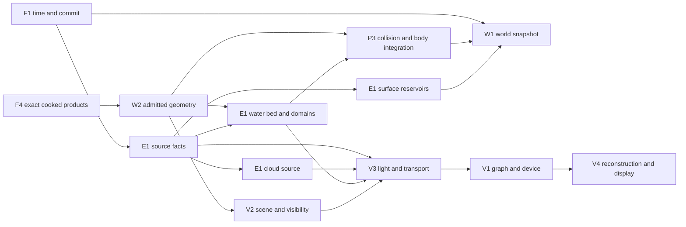

# Render, shared environment and terrain — integrated research decision

2 November 2026. **Research and design recommendation, not an implementation or
quality/performance qualification.** Read with the separate [render](RENDER-RESEARCH-2026-11-02.md),
[environment](ENVIRONMENT-SOURCE-RESEARCH-2026-11-02.md) and
[terrain](TERRAIN-SURFACE-RESEARCH-2026-11-02.md) studies. The owning
[contracts](../CONTRACTS.md), [baseline](../BASELINE-SPEC.md),
[render specification](../RENDER-SPEC.md), [water designs](../modules/WATER.md)
and [build plan](../../BUILD-PLAN.md) remain authoritative. Broadsides was
inspected read-only as a candidate and source of counterexamples; it is not a
Thrum dependency or a transferred qualification.

## Joint decision

Keep Thrum's selected Rust/wgpu/WGSL render foundation and its independently
selectable E1, W2 and water capabilities. Tighten the **executable boundaries**
before implementing them: one committed source/time and world state; immutable
geometry/product closure; one physical query owner per water domain; one light
registry and transport path; one device/graph owner; and one identity and history
per view. Preserve separate proofs for R0's first rendered game, R1/R2's assembled
portable scene and R3's optional coast. Full volumetric clouds, interactive lakes
and broad terrain content are subsequent profiles with explicit admission; they
must not be assumed to fit the first whole-scene budget.

The coordinating review accepted narrow additions to [C02, C05 and
C07–C09](../CONTRACTS.md): F1-derived phase maps; common admitted geometry
revision and source-patch mapping; camera identity independent of quality
profile; named light units/attenuation constituents; and typed field/flux,
absence and exposure semantics. These are boundary decisions, not a selection
of the unresolved optical event, cloud-volume or interactive-lake operators
below. They create no implementation or target-quality claim.

The architectural relationship is:

This graph is a responsibility map, not a new runtime API. W1/F1's committed
snapshot and product leases determine the exact sampled version at each arrow.
The graph has no render-to-physics feedback. An optional richer water/body solver
needs a jointly selected E1/P3 schedule and authority contract before adding
such feedback; a water shader or private GPU clock cannot provide it.

## Decisions across the boundaries

| Boundary | Integrated recommendation and rejection rule |
| --- | --- |
| Time and environmental cause | F1 defines simulation time and commit; E1 publishes unit-bearing, versioned fields with spatial/time support and typed absence. Constant/keyframed providers suffice initially. Sun, wind, cloud optical depth, rain, temperature and air inputs can be authored without falsely claiming a coupled meteorological simulation. Authored day/weather phase maps can have separate rates but derive deterministically from the same F1 time and stored parameters; a provider's private animation clock cannot change authoritative world samples between two views. |
| Light and media | E1 publishes source and medium facts; V3 alone evaluates incident illumination, cloud shadow, air/fog/water transport and ordered transparency. V4 alone handles exposure and display. A cloud is visible presentation plus a shadow/optical-depth projection of the same committed source when it claims physical alignment. Avoid a second Sun shadow or air term when a reflection/refraction path crosses media. |
| Geometry and surface | F3/F4 give source identity and immutable products; W2 admits coherent render, collision, navigation, bed and shadow-receiver products. Tiled heightfields are useful for single-valued landscape, meshes for caves, bridges and vertical faces. Bounded multi-layer columns are an optional dynamic source; parametric patch tessellation is a candidate render product. Neither changes the source/patch or physical-product contract. E1 surface reservoirs attach to stable source patches and survive view LOD. A visual terrain height or water edge cannot replace a missing physical product. |
| Water and body | E1 water owns named domains, query support, flow/surface and exchange ledgers; P3 owns one body integration. R3's selected prescribed sea/finite shallow profile and one-way reservoir/body response remain distinct from a proposed fully interactive lake. GPU visual detail may not displace CPU-owned or analytically reproducible headless physical queries. A GPU-authoritative lake would require a joint F1/W1/E1/P3/P7/N1 change, not an isolated optimization. |
| Scene and history | V2 converts committed geometry to per-view visibility and current/prior material-point motion; view identity includes camera and epoch, not just a shared quality profile. Cloud/water/vegetation histories retain their own valid sample times and reset on cut, source change, missing correspondence or device/profile change. V1 owns target lifetimes and retirement. |
| Composition and absence | F2 validates combinations: physical water can stay without visible water, cloud attenuation can stay without visible clouds, and no consumer removes both work and resources. Missing required products refuse admission; optional presentation can load later with an explicit transition. Quality tiers change presentation, never authoritative wetness, depth, weather or body state. |

## A complete interaction to prove

At tick `n`, F1 selects one committed environmental source revision and W2's
admitted geometry set. E1 supplies wind, Sun/cloud optical depth, precipitation
and water support at declared times. P3 samples the tick-`n` water/surface state,
integrates the body once, and emits identified reactions/deposition. E1 advances
its reservoirs and finite water domain, records signed external exchange, and
W1 commits tick `n+1` atomically. Views independently interpolate that committed
state. V2 derives visibility and motion at each view's retained history time. V3
evaluates one incident Sun path and composes air, cloud and water at the actual
ray/interface depths; V1 submits the declared passes; V4 reconstructs and
displays. A headless authority follows the same physical tick without V1–V4.

The proof scene should have a sloping and a shallow bank, an overhang/roof, a
river mouth with an explicitly prescribed sea boundary, a floater, wet/dry
surface patches, moving cloud shadow, one fog overlap, vegetation in shared wind,
and two cameras with different history rates. This is a **target fixture design**,
not a claim that the current R3 operator supports every listed interaction.
Where the selected model has no physical crossing or runoff mechanism, the
fixture must expose a visible blocked/unsupported condition or be split into
separate admitted cases. No image can substitute for the flux/contact checks.

## Whole-system performance screen

The selected [whole-scene envelope](../BASELINE-SPEC.md#budget-allocation-and-failure-rules)
is desktop CPU 5 ms/GPU 10 ms at 60 Hz and browser CPU 8 ms/GPU 16 ms at 30 Hz;
mobile CPU 7 ms/GPU 16 ms at 30 Hz. These are unmeasured planning allocations,
not each module's allowance. At 30 Hz, two 60 Hz physical ticks share the one
callback CPU allocation. R2's 512 MiB browser plan leaves 51.2 MiB for **all**
transient GPU targets and 51.2 MiB for staging/overlap; persistent GPU products
share 179.2 MiB. Each proposed cloud, reflection, water, shadow and second-view
buffer must be counted concurrently at its actual pixel format and peak lifetime.
The render study's illustrative 720p image plus two full-resolution 16-byte
optical-event records uses 47.46 MiB of the transient share, leaving only
3.74 MiB before output, scratch or VFX. That is a design warning, not a device
allocation measurement; a selected R3 recipe needs smaller/classified event
storage, a different lifetime schedule or an explicitly rebalanced whole-scene
budget with measured peaks.
Do not sum pass-local GPU timers as a frame if work overlaps; record the full
critical path, bytes and p95/p99 cadence.

Cost grows along several different axes: active physical cells × substeps ×
stencil/iteration work; body query points × ticks; source-field evaluations ×
consumers; active geometry × views/shadows/reflections; shaded pixels × lights ×
layers; histories/targets × views; and old/new products plus staging at a
transition. Share source and geometry preparation where semantic identity
permits, use persistent change-tracked scene storage, and bound view-dependent
work separately. Specialized GPU layouts and prepared products are welcome
when a reference implementation establishes equivalent visible/physical
semantics and the assembled profile shows a net win.

## Decisions still requiring a joint design

The research supports the ownership map above but does not yet select every
operator. These are design gaps, not tasks to solve by measuring an arbitrary
implementation:

| Gap | Decision needed before its dependent build |
| --- | --- |
| Two optical events in R3 | V3/V1/F4 must choose storage, depth/interface order, overflow behavior and exact pass roles for the baseline two-layer transparency limit. Refracted receiver lookup and incomplete coverage have distinct statuses. The wider [water optics design](../modules/WATER-OPTICS.md) has stronger regional visibility requirements; a screen hit alone does not satisfy them. |
| Source-to-receiver visibility | V2/V3/E1 must enumerate which geometry shadow, canopy, cloud optical depth, air/fog and water terms apply on each light path, with one owner for each. A shadow map missing offscreen support or an already-attenuated Sun value cannot silently count as complete visibility. |
| Terrain and surface error budget | W2/P3/P5/E1/V2 must choose source/proxy error envelopes for shoreline, contact, nav clearance, plant placement and wetness attachment. Refined mesh samples or an LOD threshold alone are not supremum bounds or topology proof. |
| Rich cloud source | A planar optical-depth source is adequate only within its light angle, altitude and receiver support. A full 3D cloud source needs jointly qualified visible, shadow, environment/reflection and history projections, with one committed density/phase revision and physical versus art-only claims explicit. |
| Interactive lake authority | A pressure-driven GPU lake requires a canonical headless physical query, compatible body step/force law, source/save/replica closure and measured coupled cost. Without those, retain R3's selected smaller provider and keep the lake candidate a separate profile. |

By contrast, selected operators still need empirical checks for shader ABI, cold
pipeline readiness, visual appeal, source projection error, two-view ghosting,
cost tails, logical and physical residency, device loss and sustained mobile
thermal behavior. A failed measurement can reopen a choice; it cannot turn an
unsupported physical boundary into a visual approximation without naming the
changed contract.

## Recent-source audit and effect on selection

The three owners made a second, dated sweep of primary work from 2024 through
2 November 2026 after the user asked for current publications, white papers,
production presentations, engineering posts and accessible code. The detailed
source locators, inspected sections, versions/commits, licensing observations and
access failures are in the linked module studies. This was a decision-directed
audit, not a claim to have read every publication in the period. No external
example was built or run; speaker-noted slides were not called watched videos.

| Study | Substantive recent evidence and changed decision | What remains separate |
| --- | --- | --- |
| [Render](RENDER-RESEARCH-2026-11-02.md#follow-up-source-audit--2024-through-2-november-2026) | 2024–2026 SIGGRAPH production notes, including [PSSR](https://www.advances.realtimerendering.com/s2026/content/siggraph2026_advances_dcraig_v1_0_publish.pdf) and retained [Smolder](https://www.advances.realtimerendering.com/s2026/content/AlexanderMueller_Smolder_Siggraph26.pdf) speaker notes; ReSTIR-LOD paper; official Apple talk transcripts; versioned Bevy/Filament render, OIT, atmosphere and history code. These sharpen C06 lifetimes, C07 conditional LOD correspondence and V4 input conversion. Smolder's shipped mixed-media integration is explicitly approximate, and linked-list OIT storage has a large 720p cost even before resolving layers. | Portable clustered forward remains the selected first family. Native neural/ray/virtual-geometry successes do not prove WebGPU/mobile fit, and a code read does not qualify Thrum's image or frame cost. |
| [Shared environment](ENVIRONMENT-SOURCE-RESEARCH-2026-11-02.md#follow-up-primary-source-sweep-2024-through-2-november-2026) | 2024 Mie-atmosphere and NeuralGCM papers, 2025 CAMS air-quality methods, 2026 precipitation/HDRI successors, Smolder and Enshrouded production decks, and pinned CosmoScout/NeuralGCM/Bevy source. Imported forcing now needs interval and model-cycle identity, dry/hydrated aerosol basis, and explicit velocity/irradiance units. Visible precipitation fog or a roof mask is not a mass-deposition operator. | Bounded authored source remains first; optical rendering, meteorology, physical exposure and accumulated surface/water response retain separate owners. No weather solver or GPU lake authority is inferred from reference code. |
| [Terrain and surface](TERRAIN-SURFACE-RESEARCH-2026-11-02.md#recent-source-audit--2024-to-2-november-2026) | Recent layered-heightmap erosion/rendering, HPG GPU trees, SIGGRAPH/EGSR 2026 adaptive geometry, [Hable's portable WebGPU code](https://filmicworlds.com/blog/adaptive-compute-tessellation/), a 2026 six-method editable terrain study, meshoptimizer v1.3 and pinned source examples. These add bounded multi-layer columns and parametric tessellation as alternatives and strengthen two-view source correspondence, seam and edit-peak proofs. | Known-seam welding and sampled screen error do not certify arbitrary shore/contact topology. Work-graph/mesh-node results are native-only candidates; generated vertices and repeated preparation must fit the whole-scene memory/time budget. |

The audit found no reason to transfer Broadsides' cloud or water proof into Thrum
as a module. It strengthens the quality and performance rejection gates, while
the unresolved joint decisions above remain open. The accessible source record
is reproducible by links, hashes and commit pins; large temporary downloads
were not promoted into the repository.

## Broadsides reconciliation and evidence limits

The [first reconciliation](../../evidence/integration/BROADSIDES-MODULE-RECONCILIATION-2026-11-02.md)
inspected older TypeScript paths. Current Rust worktrees add a more relevant
render/cloud foundation; the standalone water-system build supplies a separate
lake candidate. The three module studies document exact paths and revisions.
Retain tested ideas and proof fixtures; adapt them only through Thrum's contracts,
source/product admission and Rust runtime. Broadsides' own water alignment says
the interactive lake is **an additional profile proposal**, with a different
body timestep, light-unit adapter and unqualified solver/body integration. Its
subgate results do not establish a complete active lake. Its cloud production
profile shows coherent bounded presentation work, but the stated lifecycle
appearance and native presentation qualifications remain open. The dirty cloud
slice worktree is an in-progress candidate, not a released proof.

## Ordered decisions and proof

1. Resolve exact source/sample/absence and light-path ownership across E1, V3,
   water, cloud and surfaces; specify per-view identity and pass/target lifetime.
   Review the producer and every consumer together before changing C07–C09.
2. Complete I2a admitted source/cook/save, then build R0's finite material,
   pipeline and pass closure from one pinned revision. Prove one camera, opaque
   and masked geometry, shadowed Sun/local lighting, depth/motion convention,
   display and device loss. R0 does not wait for terrain streaming or clouds.
3. Prove E1 headlessly with constant/keyframed fields and two-view Sun/cloud
   attenuation while visible clouds are off. Add a moving shadow and test
   source revisions, weather seeks, retained histories and zero off-state work.
4. Cook one shoreline and roof geometry closure with render/collider/nav/bed/
   receiver products. Compare source-level geometry and water/physics queries
   over LOD and stream transitions; bound both vertical and horizontal shoreline
   error. On a 1:20 bank, 2 cm of combined vertical error can move the local
   waterline about 40 cm; near-flat sills also need connected-area and capacity
   checks because a vertical bound alone does not constrain flooding topology.
   Qualify precipitation occlusion and stable surface-state identity.
5. Run R3's prescribed sea/finite shallow/body/fog case with its exact selected
   model and ledgers. Treat any fully interactive lake as a separately reviewed
   E1/P3 proposal; require its corrected reconstruction, whole coupled-tick
   cost, same-force-authority and save/replica proof first.
6. Add visible clouds, reflections and vegetation through the common graph,
   then qualify R1/R2/R3 simultaneous quality and sustained costs on the named
   desktop, browser and mobile targets. An attractive still, isolated kernel
   result or short paused interval cannot close these gates.

Research can close a representation decision; it does not change the
[maturity ledger](../maturity.json)'s implementation, visual or device fields.
