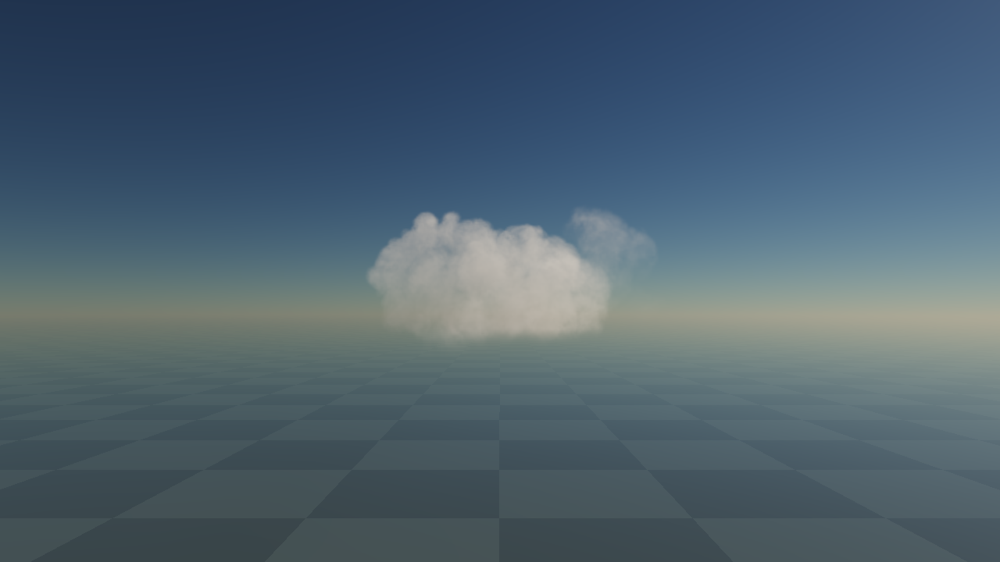
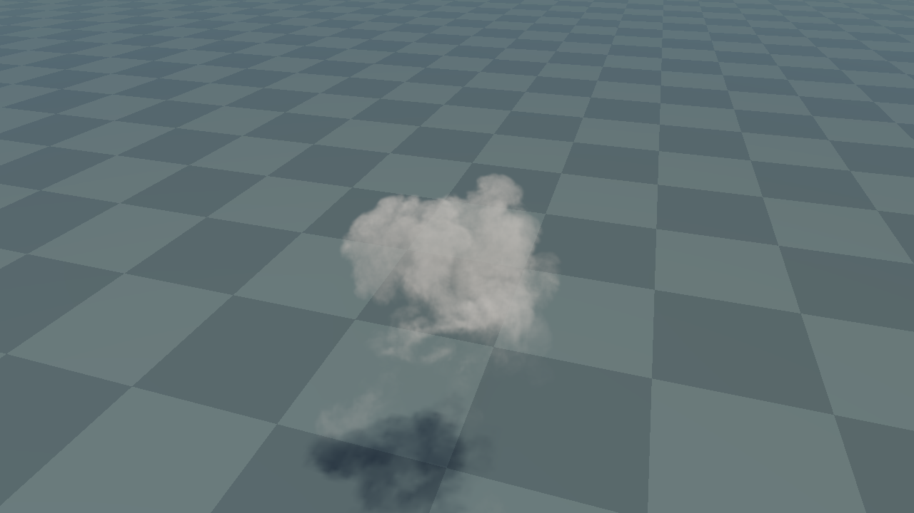

# Authored 3D source ingredients through shared optics

3 November2026. **Static input path qualified;03 is a usable Cu ingredient, not a complete cloud/weather producer.**
[Governing source status](../../design/modules/CLOUD-PRODUCTION-BASELINE.md#source-status-after-the-front-normal-proof),
[single queue](../../design/modules/CLOUD-MIGRATION.md#p1b--representative-live-source-regimes-before-layoutlibrary-freeze).

## Source, rights and recovery

Selected static VDBs03/08 come from [JangaFX's official CC0 Cloud Pack](https://jangafx.com/software/embergen/download/free-vdb-animations).
[Exact license](inputs/LICENSE.txt), [publisher README](inputs/README.txt), [acquisition provenance](inputs/provenance.json),
[selected master archive](inputs/selected-vdbs.zip) and [member hashes](inputs/selected-members.json) are retained.
The complete109,761,538-byte download was inspected; only two source volumes, rights/readme and optional original
EmberGen preset are retained here. The sources can be used/converted without installing Houdini or EmberGen.
The preset is provenance/optional authoring input, not a runtime dependency or a claim to an application licence.
No lifecycle movie was selected; these are static ingredients.

[128cook](cook/cook.py), [preserved original](cook/cook-128-frozen.py), [128/256cook](cook/cook-resolution.py) and
[tool/output hashes](cook/resolution-256.sha256.json) are retained. The available converter is Blender5.2's bundled
Python3.13 with NumPy2.3.4 and OpenVDB: invoke the Python binary directly, not the Blender application, whose startup
failed on this host. Extract selected-vdbs.zip into an owned input directory, then run the resolution cook with
`--input-root INPUT --output-root OUTPUT --side 256`. Exact compressed runtime payload restoration is independent
of converter availability; cross-hardware recook bit identity is not certified.

The source has no semantic up-axis tag. The recorded Z-up interpretation follows the publisher/default export,
domain/ground and thumbnail; target(X,Y,Z)=(sourceX,sourceZ,-sourceY) is right-handed. Preserve this explicit inference.
The cook performs separable native-voxel overlap averaging, not point sampling or max normalization. Raw linear
nonnegative density becomes little-endian scalarR16F. Each authored local cube is512m; the inspection fixture scales
it4x to2048m, worldpitch16/8m at128/256. The128pose/centroid is pinned across qualities so switching cannot move it.
All faces have an empty collar. Full transform, means/percentiles, half/integral and radiographic errors are in the
[instrument metadata](instrument/assets/cloud-03-256.json). Physical size/opticalκ are art calibrations, not original atmospheric units.

## Exact instrument and actual GPU

[Restore and run](instrument/README.md), [exact identity](identity.json):adb13e8a53d0bd95.
Lossless gzip stores all four scalar inputs; restore-assets.py checks each payload and the complete loaded build.
Selected VDB recovery was independently checked against original member hashes. The relocated master test passes.

Default03/256,3km oblique, Sun30deg,κ.019/m,full1280x720/96rays. Front/side/high presets,κ,Sun and128/256/96–384
references are explicit. Sourceclock0/render0ticks: no noise motion, automatic lifecycle or background source loop.
The server caches exact bytes/hashes and excludes captures from identity. Shader and asset responses are build scoped.

Baseline6045d1ce1c9ccebe integration is retained. Exactly two renderer-line changes declare already prepared density
and bypass its earlier procedural remap. Every cloud/light/shadow/reflected query sees rawq*κ. Other optical math is
byte-checked against the baseline; these stills do not independently establish lighting accuracy.

The scalar provider uses one sampledR16FLOAT texture aliased as current/previous; it does not assume portable R16
storage writes. Pre-initialization1³ dimensions prevent allocating full PDE/advection/rest scratch. Unused compiled
pipelines, dummy buffers and~3MiB noise/curl remain charged. Actual GPU receipts for03/128,03/256 and08/256 show
bit-exact scalar uploads, shaderG0/B0/A1 defaults, no invalid values and correct aliasing. Original raw data and phase
calibration are unchanged by this storage correction. Main shader completion is checked for device errors before receipts.

## Images and independent review

03/256 has unequal rounded lobes, crest breakup, a broad lower body and real depth across front/side/high views.
It is a useful static Cu ingredient. It remains squat/soft, with a diffuse base: it is not tall convective/Cb anatomy.
08 is a complementary bank with uneven heads from the side; front is a softer, nearly rectangular wall. At5degSun
it is a fairly uniform orange mass, with weak interior shadow depth. Do not accept these as final hero art.

Independent review viewed all nine selected native comparison images, not only thumbnails. Matched03/128 versus256
at3km/384rays visibly loses lobe separation and edge detail at128. Increasing256view96→384 changes little. Spatial
source resolution/soft density is therefore the stronger current limit; this is not a source-independent performance
comparison or proof that128is adequate at another distance. Ground footprints are plausible with no obvious grid/box
inside the source. The captures do not clearly establish a recognizable cloud reflection; retain that consumer's
specific visual witness as open despite the shared query and mirror-enabled metadata.

Read-only code review also checked full adapter/server/cook changes: asset validation, scalar alias/disposal,
quality-independent transforms, bindgroup invalidation, capture attribution and payload identity. No findings.

## Cost scope and next discrimination

Fresh256 logical renderer resources44,908,556bytes(~42.83MiB), including32MiBsource.128=15,548,428bytes(~14.83MiB),
including4MiBsource. Requested GPU upload verification temporarily adds32MiB/4MiB staging and retires it. CPU holds one
raw source; swaps/hash computation have additional transient cost. The development server retains~72MiBasset bytes.
These are logical resource accounts, not measured browser/process residency, GPU timings or full-sky budgets. No
5ms/16ms/512MiBadmission or per-cloud allocation strategy follows. The adapter's native info object serialized as{},
so this checkpoint does not provide a device-specific benchmark identity.

- [x] Retain selected CC0 masters/rights/recipes, exact scalar cook/transforms, source-resolution comparator and actual GPU upload proof.
- [x] Inspect actual static front/side/oblique/high and low/high Sun; independently review usable ingredients and shortcomings.
- [ ] Falsify local geometry evolution on one master before building another full source model: compare support-distance
  erosion, density subtraction and an integrated-extinction-matched alpha control at identical map/light/sampling.
- [ ] Require peak-normalized topology/contours, actual zero-density gaps, persistent readable remnants and interior
  density retention; numerical component counts at fixed absolute thresholds alone cannot distinguish an alpha fade.
- [ ] Then qualify1x/16xmotion, complete broadCb anatomy/attached growth/ice/material/filtering/recovery contracts and all
  five-family/full-sky/budget gates. No source-art or runtime lifecycle acceptance transfers from these stills.
