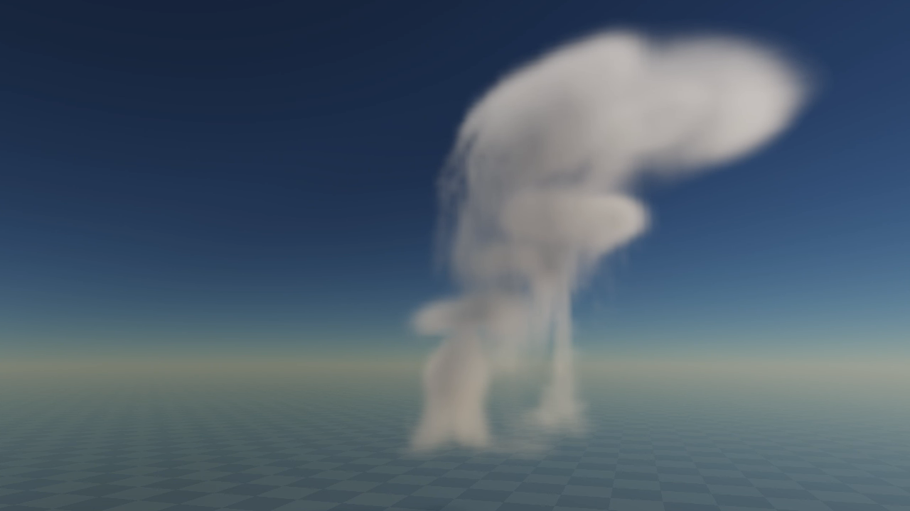
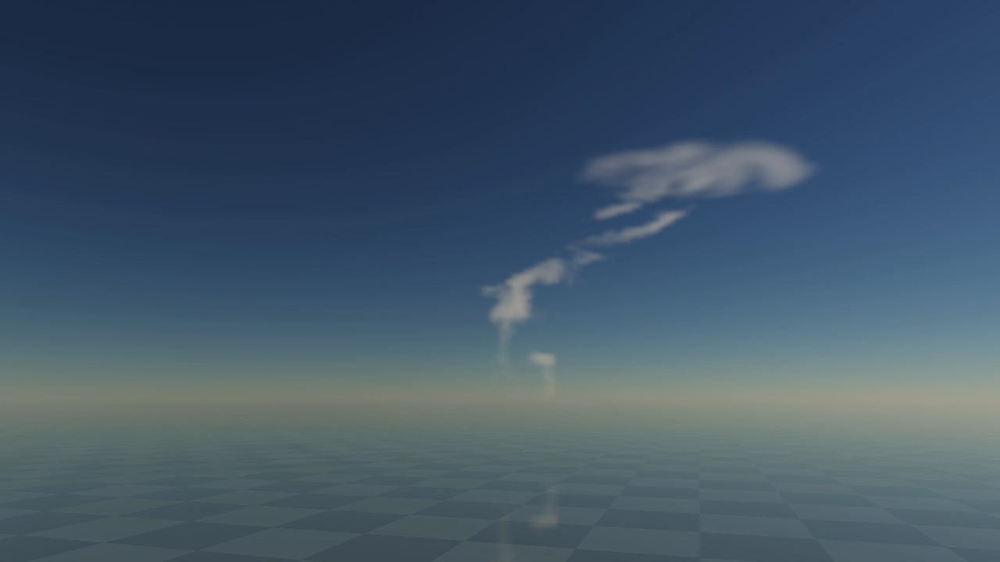

# Storm billowing and local breakup proof

2 November2026. **Coupled source improvement; full storm billowing/art remains unaccepted.** The [canonical queue](../../design/modules/CLOUD-MIGRATION.md) owns next work. This is a standalone WebGPU proof, not a Thrum engine runtime/API.

## Reproduce exact source

The selected [instrument](instrument/) is optical build `ebbb321b0ed2b253`, pinned in [identity](identity.json). Copy to a fresh tmp directory, run `node --test PATH/tests/*.test.mjs`, then `python3 PATH/serve.py --port 8147`. Development server remains8146. Choose Cumulonimbus, pause, Grow from clear and advance180/480s; thermals default on. Full resolution, Inspect billows/Frame cell, ray steps and legacy thermal-off reset remain explicit comparisons. Start normal/accelerated playback before Record12s motion. Pause after recording: the recorder does not pause playback itself.

Earlier9d84 observations deliberately remain as counterexamples. Their exact instrument is the original directory at commit `be0d565`; [its original identity](identity-9d84ac657834807f.json) is retained. Do not attribute those images/clips to the later source.

## Selected complete interaction and research

The [execution card](instrument/billowing-proof.md) contains derivations, cost bounds, predictions and rejected trials. [Thermal chains](https://www.pnnl.gov/publications/thermal-chains-and-entrainment-cumulus-updrafts-part-ii-analysis-idealized-simulations) motivate organised wet growth and dry-air entrainment; [resolved dry thermals](https://cimes.princeton.edu/publications/entrainment-resolved-dry-thermals) motivate expansion. [NWS](https://www.weather.gov/safety/lightning-science-electrification) describes upper winds carrying ice into anvils. These support cues, not our exact VFX coefficients. [Nubis research](../../design/research/ATMOSPHERICS-TECHNIQUES.md) supports the renderer lineage, not a disclosed production native lifecycle. This prescribed optical-proxy model is an explicit deduction, not a claim that an engine shipped this exact code.

- Finite base pulses share membership/2× seeded horizontal offsets with persistent thermal controls. Heads survive source emission, integrate committed weather and have deterministic seeded poses; no rendered lobe geometry or separately sourced anvil.
- A serial-seeded area-preserving horizontal transform and unequal satellite roll vary each head. GPU q, phase/age and material carrier use the same composite velocity. Occupied rising wet q can condense; empty space cannot.
- A prescribed upper-wind profile (+18X/−5Z m/s above5.5–9.5km) is shared by CPU head motion, GPU q/carrier and environmental dry-pocket phase. This is an optical recipe under committed weather, not another weather clock or public engine wind API.
- Cap spreading inherits arriving head positions/anisotropy.400m radial regularization and smooth2R→3R support avoid axis NaNs and a hard ring at the force cutoff. The previous permanently pumped fixed-center radial cap was rejected.
- Local finite evaporation removes thin q in finite time before conservative liquid→ice transfer. Source/birth attribution compares against the same phase-loss/evaporation survivor. Main, light, receiver and independent mirror keep the same coefficient source. No opacity, lighting or renderer trick hides the source change.

## Actual pictures, motion and correctness

- [x] Four Node test files pass: weather/replay, reset intent, half/air reference, isolated roll/divergence, finite neck loss, bounded2400s control packing, post-emitter head survival, held-jet integral and recorder validity. Final GPU finite checks pass, including positive reaction, vacuum/no-source, mixed-phase zero phantom birth/age and optical/transport references.
- [x] Real1280×720 VP9 canvas clips and exact receipts in [observations](observations/): final growth1x180.25→192s /16x279.5→471.75s; source-off1x480.25→492.25s /16x510.5→702.5s. Requested capture15fps, not displayed cadence. Primary inspected decoded native frames at0/5/10s normal and0/3/6/9/11s accelerated plus live states. Independent reviewer inspected sampled frames, not continuous video playback.
- [x] Primary and independent reviews find actual asymmetric rising growth, bending feed and irregular source-off cap/wisp breakup. The earlier9d84 concentric ice disk persists at96/384 ray steps and is rejected; the final sampled breakup no longer contains that circular plate.
- [x] Same480s body, no source reset: set moist/lift0,dry.7 and advance120/240s. See quantitative limits below.
- [ ] Full active-cloud billowing acceptance: native/1x views still have soft mushroom/oval tiers and thin curtain-like connectors. Local split/replacement and edge erosion are weak at normal speed. Numerical success, disappearance and a nicer cap do not close that experience.
- [ ] Regional exchange, material correspondence/renewal, complete families/air/environment/TAA, target-device/full-sky and engine integration.

## Matched shutdown: evidence and its boundary

Proxy sums are normalized optical state, not physical water mass. Topology is6-neighbour q>=.08; substantial means>=8voxels.

| Source time | Liquid sum | Ice sum | Substantial components | New source | Occupied faces |
| --- | --- | --- | --- | --- | --- |
|480s before command|2760.212|366.248|2|3.83146|all0|
|600s,120s shutdown|105.391|212.362|7|0|all0|
|720s,240s shutdown|0|60.131|2|0|+X83; others0|

At600s,0 emitters and0 occupied faces support finite local loss/splitting without chart exit as its explanation; upper ice remains in separated streaks. At720s, upper wind reaches the finite chart: **that late result is clipped, not a complete decay/lifetime pass.** The16x breakup clip extends into this approaching limit; do not use its end alone to prove total material loss. Extended active1071s also has554 occupied+X cells. No box fade is introduced to hide either failure. Regional exchange remains required.

## Available-host cost screen

Apple M3 Max / Apple metal-3 browser,1280×720 full-reference output,96 view steps, direct flow, main+independent mirror+receiver, same Sun/default wet storm.10s recordings are separate from quiet timing.

| Quiet run | Queued source progress | Submitted image graphs/s | CPU submission p95 | Source age at end |
| --- | --- | --- | --- | --- |
|1x, around480s|10s|42.55|.140ms|.083s|
|16x, around660s|157.75s|7.36|.420ms|3.36s|

These are graph submissions, not completed-GPU/display FPS. The16x screen fell slightly behind and is not a capacity pass; the fixtures differ in source age/extent and are not a controlled direct/cached or old/new comparison. Whole-GPU totals remain rejected due cross-pass timestamp overlap/reordering. Thrum5ms/16ms, M2/native/full-sky and process/driver memory are unqualified.

Normal Cb logical resources53.3MiB; bounded24 head/band upload slots add~.196MiB plus~.008MiB zero bindings. Lazy GPU observers raise the measured logical inventory to63.4MiB. CPU topology scratch is~16.25MiB and tens of milliseconds only on requested probes, excluded from quiet runs. Every direct q/carrier query loops band-local heads; each adds a satellite exponential and cap-only exponential/algebra above9km. Cos/sin/aspect are CPU-prepared. No per-frame CPU voxel traversal/readback. Optional float32 velocity precompute remains exposed (+20MiB on Cb); full-sky quality/equivalence/cost A/B stays mandatory at P7. The earlier Cu oracle does not qualify this Cb/head workload.

## Review and remaining delivery

[Review dispositions](REVIEW-DISPOSITIONS.md) distinguish mechanism, recorder, source/render frames and actual device evidence. Independent mathematical review caught axial overlap cancellation, hard cutoff/axis risk and CPU/GPU wind mismatches; final code closures are scoped, not art acceptance. `./dev check` and retained-source tests pass.

The remaining active tiers need a source/bandwidth diagnosis before another cosmetic change: inspect3D q/head cross-sections and source/condensation support against the187.5×181.25m native grid and filtered material bandwidth; discriminate thin transported fronts from a filtered-away shell. More identical heads or image sharpening cannot establish turbulent growing volumes. Keep this full billowing gate open while retaining the working finite breakup/causal cap.

A separate observed long-background-return bug remains: CPU weather advances beyond retained forcing and optics faults. New optical-epoch recovery/chart anchoring is open, not claimed fixed. Same-ID live Cu→Cb transfer and complete target-system integration remain unbuilt.
