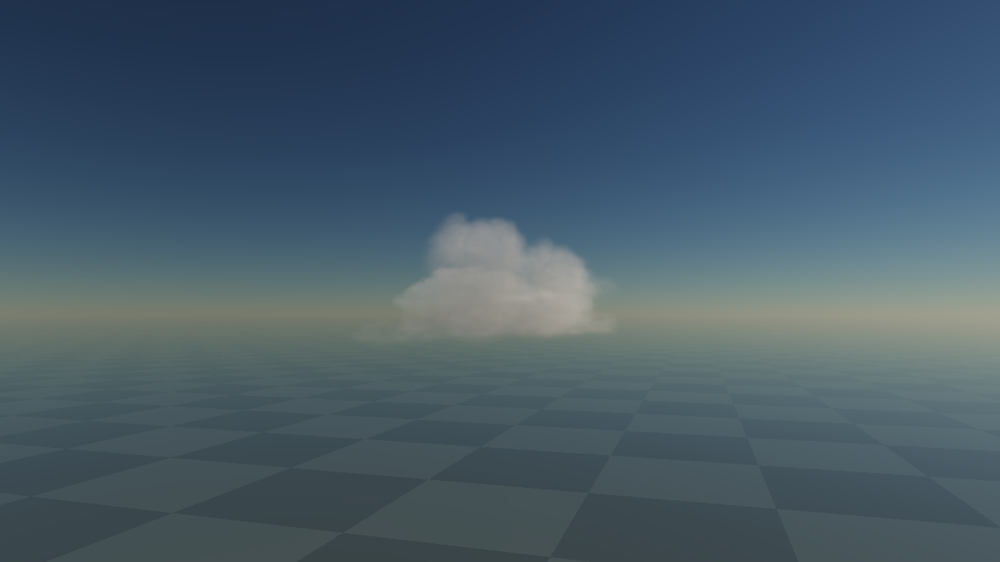

# Finite cloud components: held growth and integration inputs

3 November 2026. [CLOUDS](../../design/modules/CLOUDS.md) governs; [migration](../../design/modules/CLOUD-MIGRATION.md) is the single queue. **Component mechanism witnessed; v1 content rejected; v2 inputs provisionally selected for a complete running Cu prototype.** No live lifecycle, CF01, storm, full-sky or device-budget acceptance follows from these held images.

## Reproduce the held views

```sh
python3 docs/evidence/cloud-component-proof-2026-11-03/restore.py --output tmp/cloud-components-review --variant v2 --test
python3 tmp/cloud-components-review/serve.py --port 8155
```

Open `http://localhost:8155/`. Choose BODY, half-grown first crown and two full crowns at the same fixed camera. Native captures belong to build **1e446a5adeda974c**. [Build v2](build-v2.json) pins all26 served files and four losslessly retained R16 fields. `--variant v1` restores **0ec8c1463e8dcccb**, whose [build identity](build.json) pins29 served files and six fields. Restorer refuses an existing destination and verifies package, decoded inputs and served bytes. These are frozen static instruments, not the live integrated system.

The preparation ZIPs preserve exact recipes, metadata, staged cost logs, failed screens, provenance and reviews. Required density masters and original CC0 JangaFX attribution remain in the [authored-master evidence](../cloud-authored-masters-2026-11-03/README.md); this package retains the derived fields needed to run both viewers. Gzipped lower bounds/core masks are engineering evidence, not runtime textures.

## Visual selection

Root inspected actual native images at fixed front/side/oblique cameras for v1, including a true2km/384-ray near comparison and an isolated crown. Compact crown growth creates a new visible head, unlike the failed whole-cloud replacement. However, the clipped BODY roof and crown crop wedges were plainly visible. Numerical attachment and query agreement did not qualify those shapes. **Do not adopt v1 content.** Its GPU/CPU probe has289 positive points, no invalid values and maximum absolute q error.00025558 under the declared experimental .002 tolerance; this is not portable precision or lifecycle proof.

V2 retains the natural BODY roof through baked vertical compression about its local root (eta=.6), and replaces rectangular crown crops with one rounded varying-radius capsule ingredient at unequal scales6/5. BODY runtime scale4 does not apply eta again. Exact overlap averaging preserves the declared compressed raw integral, without density compensation. Fresh distance fields use the resulting density. Frozen metadata's taper-description erratum is retained: local halfwidth8 maps to world8*b, not a universal32m. Integration uses annotation-corrected copies with new hashes, preserving the original payloads.

Root inspected actual v2 native BODY, half-crown and full two-crown images at1280x720,3km,96 rays, oblique, Sun30 and the selected additional-scattering triple(.5,.5,.5), liquid kappa.019. The flat cut is gone and distinct rounded crowns emerge above an irregular lower body. The half-grown crown remains largely buried. Additional actual2km/384-ray front, side and oblique captures retain distinct rounded heads and a natural BODY roof. The shared GPU/CPU probe samples1,760 points,309 positive, no invalid values and maximum absolute q error.000198884 within the declared experimental .002 envelope. This qualifies a **provisional integration input selection**, not continuing billowing or a production visual pass.



Preparation reports positive post-taper root balls, connected crown necks and a robust BODY core; two held crown placements separately pass their offline novel-area and3D reach screens. The source pipeline uses process-separated EDT signs to avoid retained allocation peaks. Those geometric checks do not establish repeated runtime admissions, turnover, moving breakup or art. Preparation-v2 retains the full numerical conditions, logs and rejected control selectors. The earlier v2 viewer startup rejected fixture version2; its exact failed loader and correction history are preserved in the viewer archive. The corrected real-asset loader accepts the commissioned version and rejects incompatible versions.

## Assemble the complete interaction

The [integration commission](INTEGRATION-COMMISSION.md) specifies the bounded source/weather programme, authoritative quarter-second clock, material maps, attachment/exposure contracts, preallocated controls, consumer sharing, resource ownership and completion proof. It is a supporting implementation record under the canonical design, not a competing queue.

The next result must run complete birth, local growth, two BODY turnovers, continuing unequal crowns and spatial breakup with retained moving remnants. Actual1x/16x motion, same-time GPU/CPU queries and retained shadows/reflections with main hidden are required. The runtime catalogue must support repeated births against **all** older loss-free potential; a successful pair of held crowns does not prove that. Source off/on recovery, changed wind/fronts, clock backlog and bounded allocations remain explicit gates. Full atmosphere reconstruction, mixed-phase Cb and full-sky budgets remain later gates.

[Independent artifact review](REVIEW.md) verified exact restores, source retention and claim scope. V1 held logical GPU allocations are27,462,000 bytes; v2 held allocations23,923,024 bytes. These are resource inventories, not measured residency, dynamic source costs, GPU execution timings or an M2/5ms/512MiB admission. No performance gain is claimed from this static comparison.
