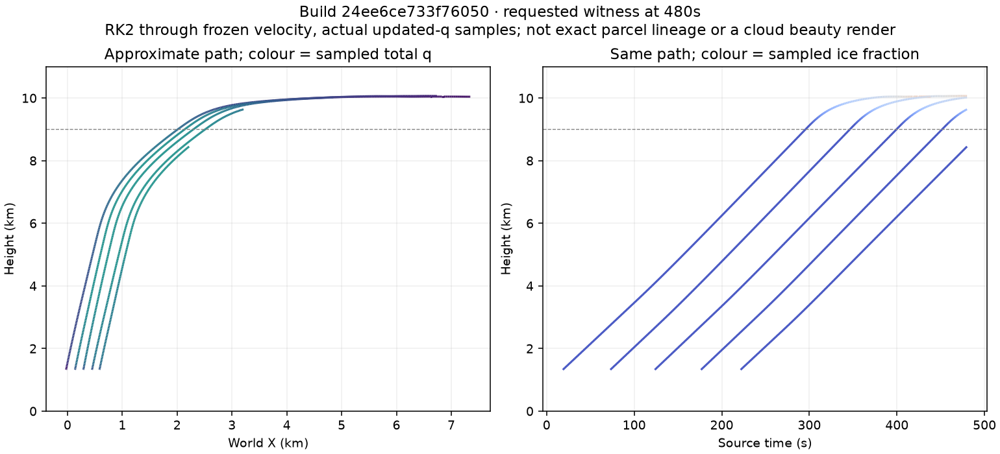
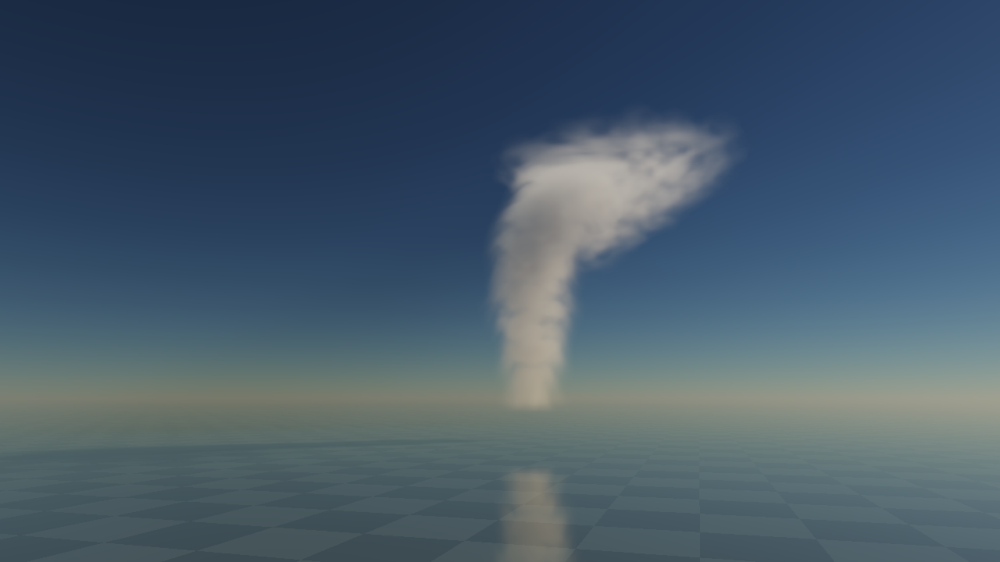
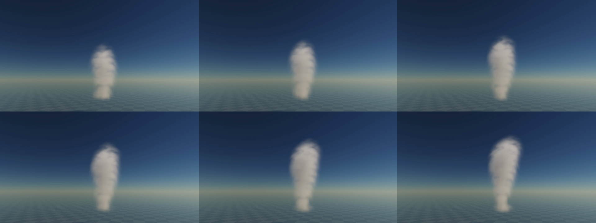

# Causal feed, real optical connectivity and supplied-path proof

3 November2026. **Transport/seeding interaction proved within the bounded fixture; visual lifecycle still rejected.** [Governing design and next normal-front candidate](../../design/modules/CLOUD-PRODUCTION-BASELINE.md#close-material-supply-and-transport--next-candidate), [single queue](../../design/modules/CLOUD-MIGRATION.md).

## Mechanism and exact instruments

Every finite base pulse now contributes at1/5amplitude while head controls retain every-fifth cadence. This preserves mean integrated linear supply, not nonlinear q. Cb pulse offsets are bounded to200m in the shared-cell catchment. A narrow curved conduit supplies each rising head; its horizontal velocity is the derivative of the time-dependent cubic centre, not vertical uplift under unmatched shear. Head bands extend to the root. Complete head+stem protection releases after normalization as lift declines; overlapping controls cannot keep suppressing environmental motion. Shared source velocity, q/ice transfer, material, light/shadow/reflection queries retain one cause/state.

[Retained source/instructions](instrument/README.md), [identity](identity.json):24ee6ce733f76050. Apply [long-recording.patch](long-recording.patch) with `patch -p1` to a copy for6a4a22dc8669ff65/[identity](long-recording-identity.json); [initial-source.patch](initial-source.patch) reconstructs06ba911ab8f46f8a/[identity](initial-source-identity.json). All three byte hashes verified. Source physics/optical shaders are identical across these; observer/control/debug differences are explicitly versioned. The long-recording observer used source-held weather instead of current weather only for the world-coordinate comparator; recorded default advected results are unaffected. Current instrument fixes that mismatch.

Pause; select Cb; expand controls; full1280x720/96rays; Grow from clear; Inspect billows. Defaults moist.85/lift1/dry.08/wind3m/s/Sun32deg/seed71, connected feed/core/mix/renewal/material/filter ON, cached velocity OFF. Advance30/180/480s. Frame cell at480s. Source probes read native q, phase and current shared shaped extinction; they are separate from quiet timing.

## What actual state establishes

At30s the first head is19.5s old:197native voxels in its.65plateau,62atq>=.08, all62connected to the actual500m root catchment; meanq.0644, peak.2456, centre.1116. The shaped-extinction threshold.00036/m admits25plateau voxels, allroot-connected; centre.000311/m falls below that threshold. This is partial actual seeding, not a filled control ellipsoid. At180s later heads have meanplateau q≈.21–.33 and stronger shaped connections. An unrelated low cloud does not count as this root; unit fixtures cover that rejection and threshold-dependent necks.

At480s, top10831.25m, liquid-proxy sum3531.275, ice548.616, all six chart-face counts0. Traced and untraced180/480native XY planes are exactly equal. All7Node files and actual GPU checks pass, including assembled cubic target against independent finite differences, one/four/six-control shutdown release, phase/age/capacity and existing renderer regressions. `./dev check` covers repository correctness, not art/device admission.

To reproduce trajectories, enable Trace supplied material (explicit new optical epoch), Grow from clear, Source-only diagnostic, advance180then300s, probe at each endpoint.20seeds were admitted with positive updated-q/reaction tags;8paths reached>=9000m while sampledq>.02, no boundary exits or velocity-cap steps, max sampled internal speed29.96m/s. Two tracks ended at the420s witness-age limit; others remain active. Cap samples contain ice fractions about.28–.68. These are approximate paths through frozen quarter-second velocities, not exact parcel/material ancestry through diffusion. No source birth or geometry is inferred merely from head coordinates.

The optional witness adds.5MiB state/history plus requested staging, no CPU voxel traversal/readback in ordinary frames. Batched witness updates lost the tested Metal device in a graph spanning the first seed/integration. Isolated18.5s seed and18.75s integration completed; all accesses/barrier are valid under code review, so no illegal-barrier diagnosis is claimed. The retained workaround limits traced graphs to one source tick. That completed180/480s with no GPU errors and exact untraced source planes. It is a debug scheduling limitation, not a production optimization or an E1 clock change. Its cost is excluded from quiet admission.

## Actual images and long normal motion still fail appearance

The90.003wall-second1x WebM covers source180.25→270.25s, fixed fixture,4.42MB. Its selected native frames show slow real evolution over multiple head events, but a soft shaft remains. It is not enough to have a correct moving source.

Independent visual/model review inspected native180/480and selected long-motion frames, not continuous playback. Both parent and reviewer reject the chimney: broad affine interiors and occupied-q condensation throughout the shaft maintain nearly flat condensate plateaus. Five source columns support the diagnosis beyond image softness. A continuous centre is required; the missing cue is bulging outer shoulders and depleted wakes, not arbitrary holes through the feed. The positive material map cannot manufacture absent topology. More noise/light or resolution alone is not the selected fix.

## Review, cost and next gate

Read-only Sol High review-agent inspected complete producer/consumer changes and oracles, CPU/GPU packing, curved transport, extended bands, overlap shutdown, observers and optional witness.2400s CPU stress stayed within19live pulses/13heads,200m catchment and root-band admission. One P2: the optical observer used an old weather snapshot for world-coordinate detail; fixed to the current query WeatherFrame. Threshold/plateau results detach from scratch before optical reuse. Witness layout/barrier/slots/cache keys are bounded; actual GPU execution and artifact/visual judgement were parent-owned. No review approved the art.

Fresh normal logical resources≈55.9MiB; traced/requested observers≈66.9MiB. No new target-device or whole-GPU admission. Earlier [quiet material-renewal screen](../cloud-material-renewal-2026-11-02/README.md#cost-screen-not-admission) is not relabelled as this profile's performance. Source/material working-set and submitted cadence are distinct from process residency or displayed frame rate. Optional velocity-cache full-sky A/B remains mandatory.

- [x] Base/head temporal and spatial support, assembled curved velocity, overlap-aware release and actual young-core/optical connectivity.
- [x] Actual root-supplied path to ice-bearing cap, numerical checks, exact builds and independent code/model review.
- [x] Long1x native motion and explicit failed-appearance evidence.
- [ ] Front-normal candidate: local isosurface growth, finite exposed/trailing erosion, narrower radial protection; numerical sphere/ramp/phase bounds, native shoulder contours,1x/16x replacement/fragments and cost. The written candidate is not implemented by this checkpoint.
- [ ] Regional exchange, multi-cloud coupled lighting/air/reflections and all Thrum device/full-sky budgets remain open.
