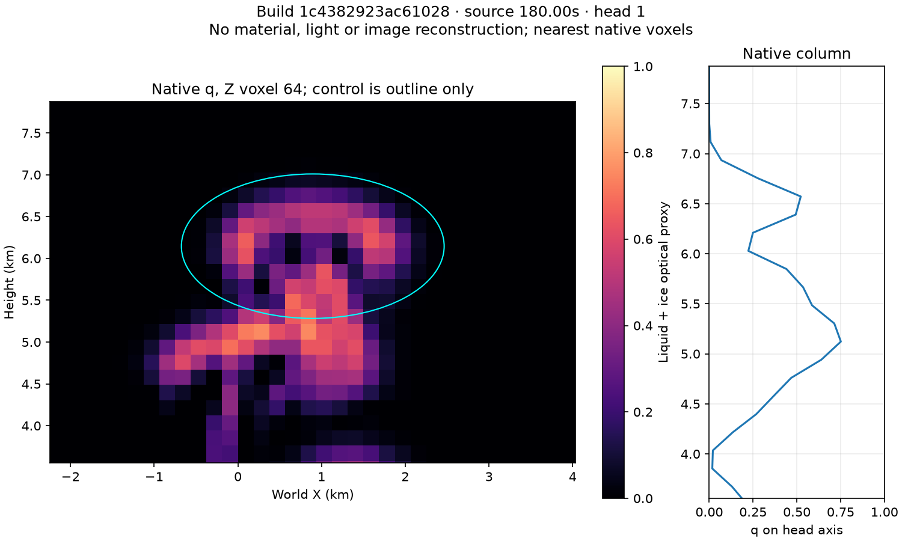
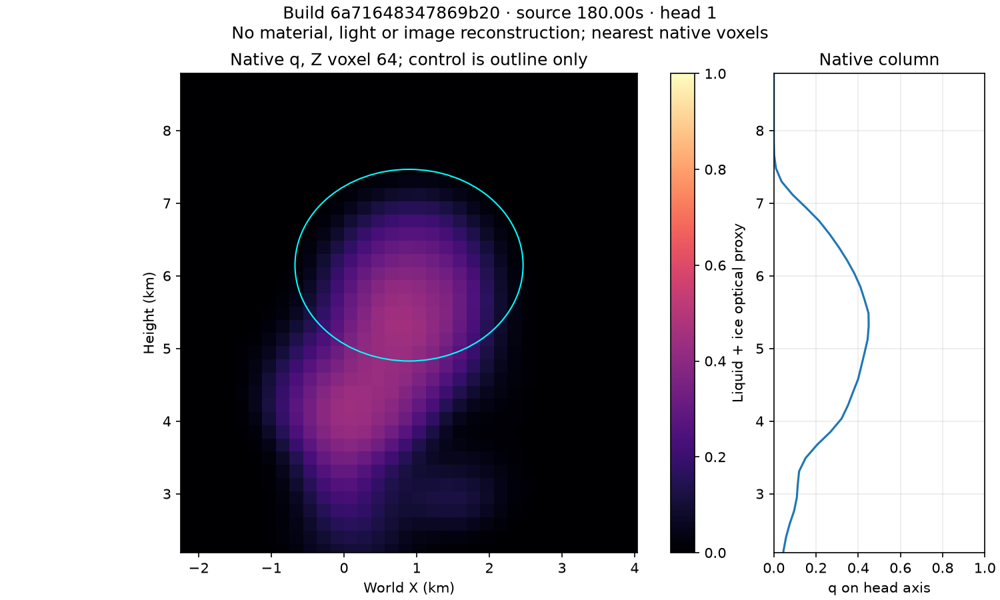

# Convective material-core growth proof

2 November2026. Source correction implemented and numerically checked; art/performance acceptance still open. Governing mechanism and cost are in [the production baseline](../../design/modules/CLOUD-PRODUCTION-BASELINE.md#convective-interior-correction--under-proof); [build queue](../../design/modules/CLOUD-MIGRATION.md) owns completion.

## Diagnosis checkpoint

Diagnostic build1c4382923ac61028 changes only observer code/tests from [Ci base62167671ff19b5a3](../cloud-cirrus-2026-11-02/README.md). Apply [diagnosis.patch](diagnosis.patch) to that reconstructed instrument; [identity](diagnosis-identity.json) pins optical bytes. Raw-q opacity, material opacity and native density sections at clear-start180s share source/camera/Sun. They show the same thin hollow head tiers: no lighting/material change explains their volume.

Independent analytical review derives a moving-frame upper stagnation in the Gaussian/Stokes roll: axialstrain−2a, radialstrain+a,+a; atU28,A24,bg5,H800m, a≈.0246/s. Thickness e-fold≈20s. It compresses a carried feed into a sheet even at arbitrarily fine grid pitch. Current q-gated growth amplifies existing support; q=0 stays0 aloft. Increased control radius is not increased material volume. The plot's cyan control outline demonstrates why broad head-overlap counters do not prove filled heads.

A Node regression independently checks the old stagnation and finite-difference strain. Plot regenerated from selected JSON by `uv run --python /opt/homebrew/bin/python3.14 --with matplotlib plot_sections.py INPUT.json OUTPUT.png` (Matplotlib3.11.2). This scientific plot is raw data, not a rendered beauty image.

## Correction under proof

An independently verified expanding interior with unequal vertical/radial growth replaces the core sheet-making flow; rolling remains in shoulders. Separate lifetime from cap fade, add positive conservative neck mixing using retired reverse scratch, retain real base feed, weather, paired ice transfer and common optical consumers. Exact overlap necks can compress and shared wind shears; positive strain everywhere is not claimed. Whole occupied thickness, actual merge/split and cap arrival—not control geometry—must decide acceptance. No additional volume or water-mass conservation claim.

- [x] Baseline raw/material/native sections and analytic failure regression retained.
- [x] Independent mechanism proposal and second mathematical review; overlap, window, immutable-uniform, stride and cap risks incorporated into governing design.
- [x] Implement and independently review the complete core/mixing assembly; retained exact build6a71648347869b20.
- [ ] Isolated/overlap growth, populated thickness, mixing positivity/phase/age/birth and real merge/split.
- [ ] Actual1x/16x lifecycle, cap/consumer continuity and available-host combined cost.
- [ ] Production devices/full-sky; no current promotion.

## Populated-source checkpoint

[Exact instrument](instrument/README.md), [identity](core-identity.json). Run `python3 docs/evidence/cloud-core-growth-2026-11-02/instrument/serve.py --port 8147`, open loopback8147, pause, select Cb, expand Proof controls, enable full resolution, Grow from clear, Inspect billows, advance180s. Default core/mixing/structure checked. Source inputs moist.85/lift1/dry.08/wind8, Sun32deg. No physics/water-mass claim.

All five Node files pass. Actual GPU assembled isolated-core Jacobian matches the prescribed internal diagonal within8.4e-7; positive mixing matches independent CPU stencil and preserves phases/age moment within declared F16 bounds. Two isolated slabs bridge after160mix steps; this does **not** establish actual runtime cloud merge/split. The failedfe60birth check is retained: arbitrary.001sum tolerance rejected legitimate half conversion. WGSL [floating conversion](https://www.w3.org/TR/WGSL/#floating-point-conversion) allows either adjacent binary16 value. Final oracle derives the sum of local one-ULP store bounds plus conservative f32 arithmetic allowance, records absolute/relative drift and checks exact zero birth remains zero through160passes. It does not claim exact GPU conservation.

At clear180s native q occupies the interior instead of the baseline's hollow tiers. At480s, top10650m, upper40% ice-proxy sum441.46, one substantial q>=.08component, all six boundary-face counts0. These demonstrate fed-cap arrival at this point only; the available chart does not prove unlimited travel. Source controls and storage remain bounded.

Held180s full-resolution384-ray-step comparisons isolate remaining material failure: [advected filtered](observations/cloud-1-18000-e3-v1280x720-f103-6a71648347869b20-96a4e66d.png), [advected unfiltered](observations/cloud-1-18000-e3-v1280x720-f105-6a71648347869b20-96a4e66d.png), [world-coordinate diagnostic](observations/cloud-1-18000-e3-v1280x720-f107-6a71648347869b20-96a4e66d.png). More rays do not repair it. The lifelong advected map turns detail into streaks; filtering removes the streaks and much of the structure. Wind-following world coordinates restore rounded detail but cannot establish coherent internal motion. This is a failed material-lifecycle gate, not accepted art. Next prove bounded map renewal against this comparator before motion/coupled acceptance.

The480s close camera crops the upper plume: retain it as diagnostic, not a full-silhouette acceptance view. No new candidate quiet timing or target-device result yet. Default steady state53.4MiB logical textures/buffers, requested observer63.4MiB, excluding process/driver overhead. Previous available-host timings belong to older builds.

Independent read-only Sol High review inspected complete source/mix/stride/optical changes and callers using review-agent. One actionable issue: morphology observer discarded transport-active terminal heads when roll amplitude reached0. Fixed to union of roll/transport activity in morphology and sections; terminal regression passes; follow-up no findings. Reviewer did not execute GPU/browser/art/performance. GPU and actual images above were checked by parent. Canonical P1b/CF02 remain open.

Oracle follow-up review: no findings; independently calculated birth budget.0031545(.0771% of initial proxy), compared with actual drift.00190163(.0465%). GPU execution remained parent-owned.
