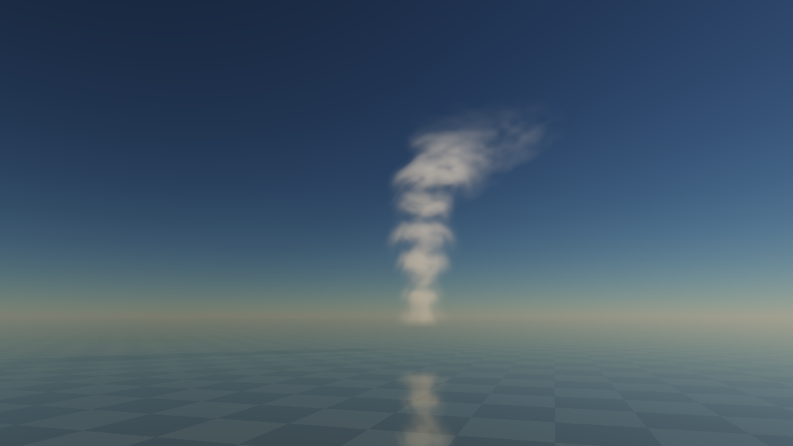
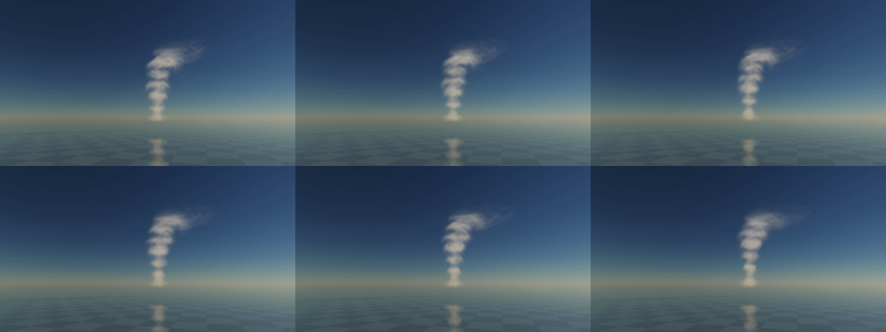
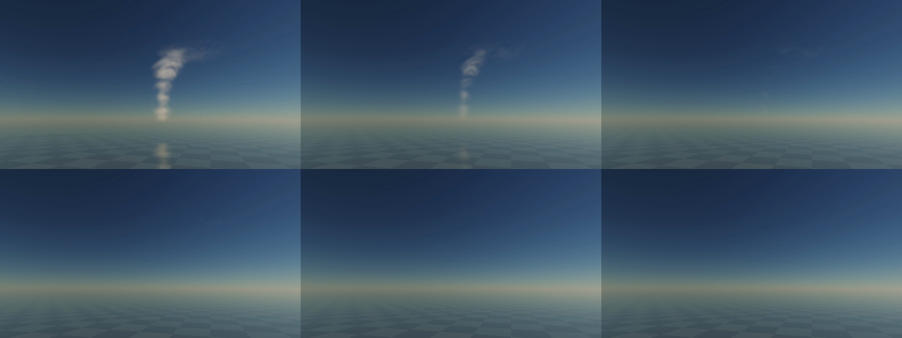

# Native front motion: operators pass, source anatomy rejected

3 November2026. **Do not promote this source as the cloud morphology baseline.**
[Governing design](../../design/modules/CLOUD-PRODUCTION-BASELINE.md#frontal-normal-growth-and-trailing-erosion--flag4-candidate),
[single active queue](../../design/modules/CLOUD-MIGRATION.md#p1b--representative-live-source-regimes-before-layoutlibrary-freeze).
The renderer, shared source/phase query and reference tools remain useful.

## Rebuild and actual fixture

[Instrument](instrument/README.md)/[exact identity](identity.json):1eee046cd9b523bd.
[Comparator patch](mask-comparator.patch)/[identity](mask-identity.json):eaa525ce756ea651.
All hashes independently reconstructed. The comparator changes only the requested source-mask oracle; physics/render shaders are identical. Apply [observer-fix.patch](observer-fix.patch) after the comparator for6045d1ce1c9ccebe/[identity](observer-fix-identity.json).

Pause; Cb; expand Proof controls; full1280x720/96rays; Grow from clear; Inspect billows; advance180s, capture/probe;
advance300s, Frame cell, capture/probe. Defaults seed71, moist.85/lift1/dry.08/wind3/Sun32, expanding cores,
connected feed, normal front, mixing, dual rest and structured/filtered material ON, cache/trace OFF.
At480s record90wall seconds at1x, auto-pause. Then384rays/Sunlit face held capture. Return96/baseline;
set moist/lift0,dry.7, record12wall seconds at16x. Controls are live changes; source epoch stays3.
Receipts bind controls, source clocks, loaded byte hashes, host and submitted camera/image identity.

## What passes

All8Node test files and actual GPU checks pass. The independent scalar oracle covers vacuum, uniform fields,
ramps, liquid capacity, differential liquid/ice erosion and surviving age/birth attribution. Uniform total across
phase boundaries has no false normal front. No isolated empty-neighbour cell births.

Actual40x.25s ball tests at20m/s predict±200m isocontour displacement. At187.5m pitch, growth measured174.5/177.4m
(axis/body diagonal), erosion−199.9/−209.3m. At93.75m pitch, growth191.6/185.7m and erosion−198.7/−211.7m.
Those are finite-grid errors, not exact normals or a billowing proof. Existing assembled flow, positive mixing,
phase/capacity, material-reset, light/air/reflection regressions pass.

The new source-support mask uses exact compact base injection rather than Gaussian-tail rounding. Whole-field
profile4 differential covers36quarter-second ticks: clear birth, existing source, brick-edge/chart-boundary birth,
changed wind/lift and shutdown; actual source stages followed by normal/mix. All4decoded RGBA16F channels agree
exactly, no invalid values. Active bricks40–182of2560: genuine skipping. The oracle owns/retire52,460,816logical
GPU bytes, with no source mutation or held fixture allocation. This does not test head-motion replay,
cached-velocity equivalence or carrier equivalence. The carrier's inactive-air fresh-chart convention is intentional;
its guarded-domain safety was independently derived, including trilinear donors and7velocity probes.

## Actual images and motion fail the required anatomy

This is a beaded stalk of soft umbrella shelves with a sheared crest. It is not a broad, irregular Cb. The384ray
sunlit view still shows the same construction. Sharper sampling and optical noise do not supply missing bulk.

The actual90s1x WebM covers480.25→570.25source seconds. Sampled decoded frames show repeated shelf replacement,
not a convincing cauliflower anatomy. The12s16x drying clip covers575→767source seconds. It shrinks/dissolves;
convincing separated moving remnants are absent in the sampled output. At767s all six faces remain0, liquid0,
ice1.673, maxq.00219: visible disappearance is not explained by chart clipping. Review inspected native images and
decoded samples; continuous human playback acceptance is not claimed.

At180s top6843.75m, qsum338.871. The oldest head's narrowed plateau has11/151cells≥q.08, meanq.0333,
centreq.0214/frontq.0198. At480s top10287.5m, qsum908.771, ice114.482, no occupied faces.
Local frontal replenishment depleted the previously filled interior. Correct positive growth did not repair content.

## Why this source construction fails

Independent model review traced actual predicted fronts to native peaks. F=headY+.45H travels at
U+.45*.14U=1.063U, exactly the affine core velocity at that relative height. The growth band stays on each
cohort's same material layer. A200m common root catchment plus roughly1.4–1.7km head spacing prescribes successive
horizontal shelves. A normal-offset operator cannot invent the absent organization of broad connected masses,
unequal towers, nested shoulders and wind-spread ice. This is a source-model failure, not a shader handoff defect.
Read-only review traced CPU packing/eligibility, shared front forcing, source/mix phases, guards, carrier scheduling,
per-tick immutable buffers and reset paths; one P2 observer mismatch found and corrected. When connected-feed was off but the front-normal checkbox stayed on, the historical observer used a narrowed plateau for the legacy full-radius profile. The fixed build shares one profile decision between CPU/GPU and suppresses inactive front metadata. Its actual legacy-profile receipt confirms radialScale1/frontPreparationnull, and a ninth Node test covers prerequisites. Recorded all-flags-on source/motion data is unaffected. Numerical success does not accept art.

## Cost screen, not Thrum admission

Fresh eaa instrument, same native grid/full1280x720/96rays, all pilot light/shadow/reflection consumers active,
cache/trace OFF, separate quiet10s windows, available Apple/metal-3 browser/DPR2:

| Requested rate | Source seconds | Submitted images/s | CPU submission p95 | End source age |
| --- | --- | --- | --- | --- |
| 1x | 10.0 | 38.57 | .210ms | .067s |
| 16x | 160.5 | 16.16 | .295ms | .133s |

These are graph submissions and queued source progress, not display FPS/completed-GPU cadence. All32/21whole-graph
query samples were rejected as unordered. No valid total GPU timing exists; individual view p95~36.44/65.54ms
are diagnostic only and cannot be added to other stage percentiles. Fresh logical created resources55.85MiB;
process/driver residency and peaks unmeasured. The isolated numerical fixtures retire resources but their old allocation
ledger is cumulative, so the earlier79.6MiB HUD is not a measured live-footprint claim. The fresh cost epoch excludes
those allocations. No equal-quality comparison to the old source or target-device/full-sky pass follows.

## Disposition and next proof

- [x] Preserve normal-front correctness, genuine source-work skipping, real1x/16x failed-art evidence, exact rebuilds and review.
- [ ] Replace the default morphology producer: first prove a convincing frozen broad3D formation through unchanged optics,
  using an authored field/static master or a visually qualified native cook. A full prerecorded lifecycle is unnecessary.
- [ ] Specify and prove spatial growth/erosion, persistent survivors, tower-fed ice/wakes, weather/wind edits and same-IDCu→Cb
  on that accepted anatomy before population/full-sky work. Do not repeat the rejected generic sphere hierarchy or q-PDE patch chain.
- [ ] Complete air/lighting/reconstruction and integrated Thrum5ms/16ms/512MiB qualification; optional20MiBcache full-skyA/B remains open.
