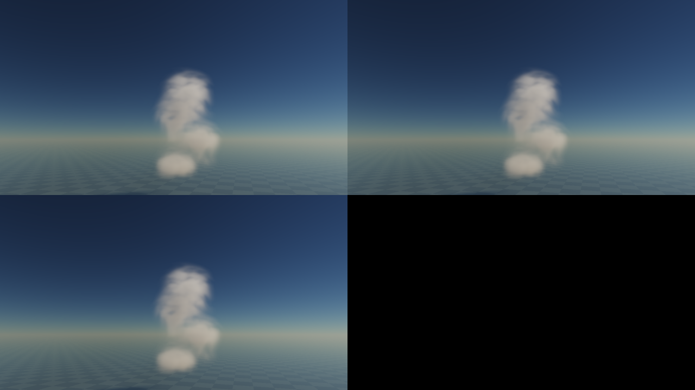
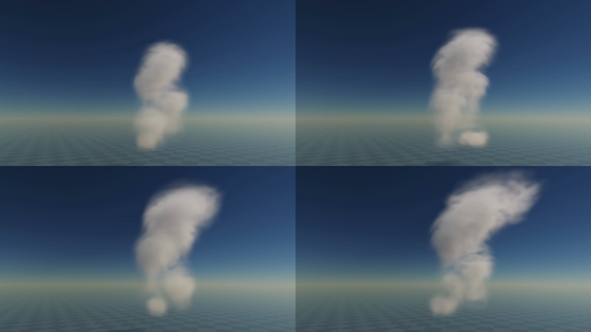
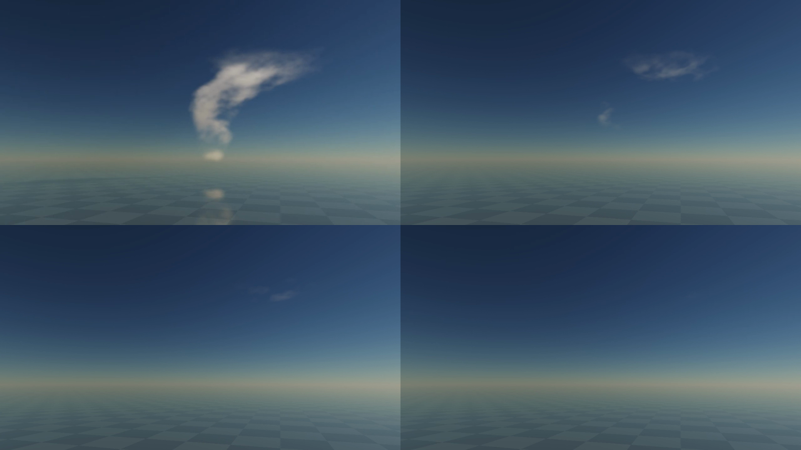

# Bounded coherent material renewal

2 November2026. A correspondence correction; **lifecycle art and production performance remain unaccepted**. [Governing mechanism/cost](../../design/modules/CLOUD-PRODUCTION-BASELINE.md#convective-interior-correction--under-proof), [single build queue](../../design/modules/CLOUD-MIGRATION.md), [preceding populated-source proof](../cloud-core-growth-2026-11-02/README.md).

## What changed and why

The lifelong advected map streaked; its isotropic filter erased much of the material structure. Two staggered air-coordinate maps now reset every64source-seconds with32s offset. At a map's reset its sinusoidal-squared amount weight and derivative are0. Both use the same full velocity; shaped amounts are blended, never A/B coordinates. A reset-crossing fractional presentation evaluates the two complete endpoint materials, avoiding coordinate interpolation across epochs. Every cloud/light/shadow/reflected query uses the same function. Renewal introduces no q/birth. This native implementation uses established [dual-rest practice](https://www.sidefx.com/docs/houdini/nodes/dop/pyrosolver.html) and [rest boundary considerations](https://www.sidefx.com/docs/houdini/nodes/dop/gasrest.html); it requires no Houdini app/licence.

One joint producer shares seven backtraces, reads/writes both half-resolution maps. Extra logical2.5MiB; ordinary material queries now four basis reads, fractional reset intervals eight. This improves correspondence at additional GPU cost. The64s horizon bounds age, not strain.

[Current instrument](instrument/README.md)/[identity](identity.json) build7ae24ff549ef3793. To reconstruct motion build200067a0b62b87a0, copy current instrument then apply [motion-build.patch](motion-build.patch) with `patch -p1`; [motion identity](motion-identity.json). From that result apply [held-build.patch](held-build.patch) for held-source buildfec4a2620aa5829d/[identity](held-identity.json). All three reconstructed hashes verified. Patches change instrumentation/controls/oracles; shared optical and carrier source is identical across these three builds.

## Actual evidence and reproduction

Pause; select Cb; expand Proof controls; enable full1280x720 reference,96viewsteps; Grow from clear; Inspect billows. Defaults moist.85, lift1, dry.08, wind3m/s, Sun32deg, seed71; core/mixing/structure/renewal/filter ON, cached velocity OFF. Advance180s for held comparator or192s for A reset. At192 select paused fraction0/.5/1 and Save image separately. Native images show no visible reset jump; full-canvas RGB code differences between adjacent fractions mean.0129/.0127, max2/255. [Difference data](observations/reset-image-differences.json) are supporting diagnostics, not optical error/quality bounds.

At192s, chart ages0/32s, weights0/1,1078occupied sampled carrier cells, potential filtered mean LOD1.148/1.430, max sampled-gradient metric1.73/3.33, no sampledLOD>=3 or nonfinite values. These are sampled gradient proxies, not singular values; diagnostics explicitly label potential filtered advected-map LOD even if the active profile changes.

Held180s renewal and earlier6a have exactly equal native XY planes, occupied7549, liquid-proxy sum1089.045, ice0, top7387.5m and all face counts0. Material shows more irregular volume. All five Node files and actual final GPU checks pass, including actual joint producer reset/non-reset cases at127/128/129/255/256/257ticks and shader weights0/1/0/.5. Old checks and phase-coherent shared material remain passing. `./dev check` passes; this does not qualify visuals or budgets.

Real canvas WebMs and exact receipts in observations: normal1x188.25→200.00s/12.002wall-seconds, accelerated16x213.75→405.50s/12.001wall-seconds, drying16x570.50→762.25s/12.002wall-seconds. All fixed-fixture. The drying fixture starts with existing565.75s q, then targets moist/lift/wind0,dry1; controls relax at weather barriers without resetting q. Frame cell provides the full silhouette. Recorder metadata identifies queued source time; these are not completed GPU/display cadence measurements. Current instrument automatically pauses after motion/timing proofs by an explicit checked control.

## Assessment and independent review

Parent and independent read-only visual review inspected native images and decoded temporal frames, not continuous playback. Renewal reduces the old material bands and accelerated growth is genuinely nonrigid: heads rise, bend and spread. It remains soft/stacked, with a separate low puff.12s at1x spans only336m ascent and under one native cell of prescribed R/H growth; it cannot prove sustained billow replacement. The cap still reads as a sheared crest rather than a broad fed anvil. Drying leaves some ragged remnants but chiefly removes opacity; convincing persistent fragmentation is unproved. Do not mark CF02/P1b complete.

Read-only Sol High review-agent inspected the complete delta/callers: joint producer, epoch branch, source/carrier ping-pong, bind/cache identity,176B uniforms/oracles, alpha capture, pause controls and observer. One P2: LOD counters misleadingly implied active sampling even when world/filter flags differed. Fixed to explicitly potential filtered carrier metrics plus recorded render settings; follow-up no remaining findings. Reviewer ran thermal CPU regressions; no GPU/browser/art approval. Independent visual reviewer sampled additional decoded native0/mid/end frames of growth/breakup and reached the failure assessment above.

## Cost screen, not admission

Available browser adapter reports Apple/metal-3, DPR2, canvas1280x720, full reference,96steps, cached velocity OFF. Quiet10s windows, no probes/captures during timing.1x:10.00source-seconds,33.66submitted-image graphs/s, CPU p95.230ms, end source age.071s.16x:160.25source-seconds,8.09submitted-image graphs/s, CPU p95.430ms, end source age.042s. These are submission cadence/queued progress, not displayed frame rate. Whole-GPU cross-pass timestamps were rejected in every sample; no valid whole-GPU total. Individual view p95 windows44.3/148.8ms are indicative costs, not additive graph totals. This is not a Thrum5ms/cloud or16ms/standalone pass.

Fresh normal logical resources55.9MiB; retained requested morphology observer makes timed working set65.9MiB; process/driver residency and M2/full-sky qualification unmeasured. Extra material reads cost real work; do not claim a performance improvement over old builds from unmatched windows. Preserve the optional20MiB shared velocity cache and mandatory full-sky A/B.

## Remaining active work

- [x] Bounded renewal, exact reset producer/weights/phase checks, held-q comparison, source identity and independent code review.
- [x] Native reset fractions, real1x/16x clips, requested deformation counters and available-host quiet screen.
- [ ] Separate material supply cadence from sparse head cadence; close the source-to-head support graph, not only control overlap. The existing shader discards4/5pulses and supplies22s packets39–59s apart. Derive source normalization, spatial catchment and transport connection before implementation.
- [ ] Prove long1x growth over multiple head events, actual native merge/split and persistent advected fragments; diagnose plateau capture and cap width.
- [ ] Coupled multiple formations/full-sky, recovery/regional exchange and all target-device budgets remain open in the governing queue.
