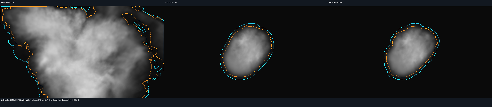

# One middle-scale envelope displacement — rejected partial screen

3November2026. **Root and author reject the available isolated front:** it remains one broad oval with modest scallops, without readable unequal billows/concavities. The sole native run also stopped at its required early memory-reservation guard. The other five perspective views are **unrun/unqualified**, not observed negative results. No rerun, recipe change, budget increase, EDT, native asset, runtime adoption or art/lifecycle promotion follows.

[Commission](frozen/COMMISSION.md), [exact reviewed recipe](frozen/recipe.md), [received independent design review](frozen/DESIGN-REVIEW.txt) and [pre-allocation cost plan](frozen/PREFLIGHT.md) were written/read before candidate allocation. Recipe SHA256 is6d4bd3a35c136808cecbbef9d410401d25bf4301cd8cef3f88660371b38d356e. The renderer's review found no blocking design defect; it did not inspect a generated candidate or certify hardware/art. The recipe is our adaptation of published displacement/shape-profile operations, not an exact major-engine or private lifecycle implementation.

## Actual available images



Left raw crop diagnostic / centre frozen broad v2 capsule rho / right pinned midshape v1 rho.512×288 rays displayed2×nearest;1200m actual220 ID5/root-head-midpoint camera,48°verticalFOV,8world-m midpoint quadrature,κ=.019. Gray is direct Beer opacity without lighting/scattering/display transform. Cyan projected peak rho≥.005, orange≥.041. These are projected-peak field contours, not recovered surface meshes.

[Native front](observations/native-front.png) and [native side](observations/native-side.png) use native2local-m axis sums at world scale6. These additionally retain the near-oval outline. The raw crop crosses domain/image boundaries and is explicitly unqualified. Old/new domains have empty faces and adjacent sample planes. The new amount is not empty: raw masked sum4401.509867 versus4410.992326 old, retaining99.7850%; rho>.041 native sites39394 versus39701 old. Fine edge perturbation alone did not supply the missing middle-scale anatomy.

Every B comparator is **rho before fresh distance taper**, an upper bound to eventual q; old also omits its fresh taper for matched geometry comparison. No new d exists. No actual composite projection completed. The planned composite would retain actual220 BODY q/d/age/material noise and pointMAX before Beer; this is implementation intent, not a completed observation.

## Executed correctness and boundary measurements

[Seven small math checks](observations/math-checks.json) passed before native allocation: independent hash/endian/tensor oracle, active-s envelope versus dense scalar reference, axis χ0/finite p0, cap/seam continuity, fixed-radial derivative bound, and inherited forward/inverse/trilinear checks. These are numerical tests, not art acceptance. During the native run, old masked rho matched the frozen R16 bytes; protected χ0 rho half bytes remained identical; new rho was finite/nonnegative. All six old/new faces **and their adjacent native planes** were zero, covering the interpolation cells at the domain boundary including the narrow upperY collar. Native affected-band D0(p0) residual passed the1e−9local-m assertion. Counts and measured residual maximum were not persisted before the guard; do not invent them from test tolerances.

[Partial result receipt](observations/partial-results.json) preserves emitted native-stage values. Raw6m cell-lower minima: root .0888062, primary .0624695, original path vertices minimum .0593872; upper .0333557 and depth .0596924. Thus the old upper6m raw witness is not automatically retained. Strong expanded-support screen is positive for root/primary and0 for upper/depth; these are sufficient pre-distance tests, not new post-taper certificates. Final fresh distance, actual guarded root/head/≤16-ball chain, native mapped resolution, burial/neck, finite endpoint, all-old exposure admission and1200s catalogue remain unrun.

[170 fixed radial profiles](observations/boundary-profiles.json), all matched old/new rho=.041 outermost crossings, measure the density geometry rather than whole-volume noise RMS. The finite procedure samples≤.25localm and bisects24times; sub-sample/tangent crossings can be missed. Profiles are unoccluded single-B radial probes, not an area-weighted surface or a composite silhouette. χΔ on actual old .041 crossings has mean−.317187localm, RMS1.735453, range−4.789539→4.784851. Signed rho-boundary displacement has mean−.338297localm, RMS1.582227, range−8.377032→3.673668. Actual mapped RMS is7.932worldm for scale5/ID4 and9.373worldm for scale6/ID5. A rho isocontour can shift more than the bounded6m potential perturbation because raw rho varies along the profile; no universal6m rho-boundary displacement theorem was claimed.

[Visible front contour measurement](observations/retained-visible-contour.json) recovers the exact painted orange contour from the saved PNG, undoing its2×nearest display. This is a small retained-image calculation, **not another native/ray run or EDT**. Old449/new466 edge pixels have directed mean nearest shifts2.032/2.104pixels, RMS2.555/2.631pixels; Hausdorff6.325pixels. At the1200m focus plane one pixel≈3.710worldm, so the latter is23.466m in that plane. This estimate is not depth-correct3Ddistance. The proposed actual2km camera would have≈6.184m/pixel at512×288 (native1280×720≈2.474m/pixel); no corresponding composite measurements exist. The measured visible perturbation still reads as a scalloped oval.

## Guard, cost and missing results

The sole native run stopped23.652s after process start, at `side rows0`: RSS111,493,120B (106.328MiB) plus the next12MiB reservation would exceed early112MiB. Actual sampled RSS did **not** itself exceed112MiB; the hard160MiB limit was not reached. [Original adverse receipt](observations/adverse.json) is retained. Before perspective work RSS was86,507,520B (82.5MiB). Planned total≤128MiB and working arrays<32MiB are pre-run accounts, not proved final residency/allocator bounds. No GC or budget raise was used after failure.

Native/whole-mask noise moments and final per-view aggregate results were to be written after all views; they were lost when the guard stopped the process and are explicitly unavailable. Required boundary-conditioned χΔ is available from the persisted170-profile receipt, and visible front contours from the actual PNG. Five perspective views and a six-view visual verdict are unavailable. Root's frontal rejection is decisive for this recipe's stated required view; it is not a claim about unseen images.

## Exact inputs and reproduction

[Frozen code](frozen/preflight.py), [operator](frozen/midshape.py), [independent small tests](frozen/test_midshape.py), [measurement helpers](frozen/measure.py) and [diff from the frozen v3 preflight](frozen/implementation.diff) survive. Hash/quintic values, seeds18431/93277, sizes16/8, amplitudes4/2, χ18→30 and profiles/κ were never varied. [Manifest](manifest.json) pins the package; [dependencies](dependencies.json) pin required original inputs. No R16 is duplicated here. Master03/license/provenance, v2 BODY/B and shared noise remain in the sibling authored-master/component/system-pilot evidence. Exact small input metadata and source220 cameras/tuples are retained; no live tmp checkout is required.

Dependency-only restore plus the seven small tests (no native/projection execution):

```sh
python3 reproduce.py --verify-only
/opt/homebrew/bin/python3.14 reproduce.py --output /tmp/midshape-review --test
```

[Verification receipt](verification.json) records checks actually run during packaging. Historical NumPy/Pillow interpreter is Python3.14/NumPy2.4.6/Pillow12.2.0; `ps` RSS guards/highwater scope is macOS-specific. Explicit `--run` reproduces the historical preflight in a fresh disposable layout; it is not permission to retry source authoring, and its memory outcome can differ by allocator/host. Default restore never performs it. Do not rerun CPU-heavy work during another owner's timing window. No cross-host PNG bit-identity, source-art, runtime-cost or fullsky qualification follows.
