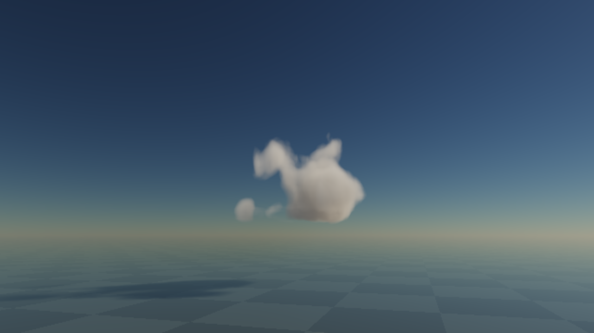
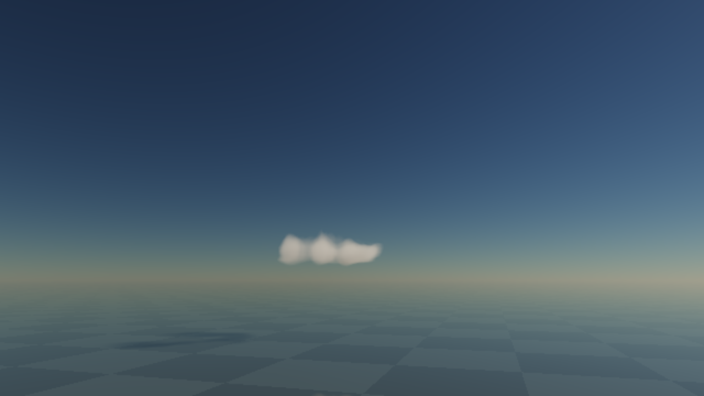

# Native live-cloud implementation checkpoint

2 November 2026. **P0/P1a in progress; no visual or device-budget acceptance.**
This is the first executable checkpoint of the [runtime migration](../../design/modules/CLOUD-MIGRATION.md),
following the [selected baseline](../../design/modules/CLOUD-PRODUCTION-BASELINE.md). It is a standalone browser
instrument, not Thrum engine implementation or an admission of the complete atmosphere.

## Run and reproduce

From the Thrum repository root:

```sh
python3 docs/evidence/cloud-runtime-pilot-2026-11-02/instrument/serve.py --port 8147
node --test docs/evidence/cloud-runtime-pilot-2026-11-02/instrument/tests/*.test.mjs
```

Open `http://localhost:8147/` in a WebGPU browser. The active development copy uses port8146 under
`tmp/cloud-production-proof/`. No install, paid software, imported asset, Houdini or network service is needed.
The server binds loopback only. It saves observations locally. Index/module/shader URLs include build
`0ab4062170f6d491`; requests fail if the hashed bundle changes. Each response serves the exact bytes used to
compute its manifest, rather than reopening the file after hashing. Receipts carry that manifest and submitted
optical time/generation. The Python server and tests are retained alongside it, outside the optical build hash.

Pinned defaults: seed71; Cu; moistening.85, drying.08, lift1, wind+3m/s; Sun elevation32deg/azimuth-.7rad;
observer yaw.3, pitch-.18, distance7500m, target(0,2200,0); 48deg vertical field; source bounds
(-5000,400,-4000)..(5000,5600,4000)m; liquid/ice kappa .0045/.0018m^-1; MS look(a1,b.25,c0).
Camera height is clamped above ground. Optical integration is640x360, displayed1280x720, with no temporal
reconstruction. Exposure multiplier.5 and display ACES-fit are pinned in source. This is intentionally observable,
not an accepted resolution or look. The MS look differs from the baseline starting values and is tuning, not a
new light model.

For the retained growth sequence: Pause; Grow from clear; save/probe0; advance60; save/probe60; advance120;
save/probe180; Send dry front; advance180; save/probe360; advance120; save/probe480. These are source seconds,
not animation rescaling. A front committed at181 starts3800m and moves-18m/s. Default input state persists through
the sequence. Seeded start is a separate prefilled initial condition, not evidence of growth from empty.

## What runs

- CPU weather, queued commands and rain/lightning-potential cause IDs use a fixed1s world barrier independent of
  GPU execution. Controls relax at committed barriers and are held on half-open intervals; known front position
  and wind integral advance causally inside the interval. A later command cannot change a past source input.
- A4Hz dense3D liquid/ice reference uses bounded MacCormack transport, donor-extrema limiting/invalid-donor
  first-order fallback and exact positive local source/loss reaction. Finite seeded injection pulses continue
  indefinitely; they are not rendered ellipsoids or a movie. Updraft and a generated coherent curl field transport
  the actual density and material-coordinate carrier. Source controls are sampled at the beginning of each step.
- One detailed coefficient query feeds the view, voxel Sun/ambient cache and ground Beer shadow map. Two local
  Sun samples precede the point cache. A reflected ray evaluates that same field independently, after the camera
  prefix has been integrated once. Clear air and local fog join RGB segment transport. Clear-air Sun transmittance
  has a small physical quadrature reference; the complete four-LUT air system is not implemented.
- Max3 in-flight graphs, bounded tick catch-up and deferred provider changes keep observations/resource retirement
  serialized. True all-optical-off retires the device/context; CPU weather continues. Re-enabling creates a new
  optical epoch under reset-optics. This is not continuous optical checkpoint recovery.

No existing Broadsides source/assets were imported. The production lineage and accessible-code inventory remain in
[the research index](../../design/research/ATMOSPHERICS-TECHNIQUES.md). The native source is Thrum's declared VFX
adaptation of standard transport/reaction methods; it is not claimed to reproduce Guerrilla's private lifecycle.

## Evidence and assessment

All retained PNGs are actual canvas output, not generated concept art. JSON beside each image records its build,
source time, controls and epoch. Source probes observe q directly and exclude capture/timing windows.

| Source time | Proxy sum | Occupied voxels | Young / old occupied | Assessment |
| --- | ---: | ---: | ---: | --- |
| 0 | 0 | 0 | 0 / 0 | Negative control is truly empty |
| 60 | 585.941 | 2,485 | 2,240 / 0 | Local base growth; too smooth and small |
| 180 | 3,219.349 | 11,705 | 3,478 / 2,248 | Taller body and detached local structures; mature replacement exists |
| 360 | 3,933.002 | 19,959 | 3,896 / 9,900 | Openings and upper remnants while base continues supplying |
| 480 | 867.992 | 6,562 | 2,912 / 545 | Front removes upper structure; renewed low remnants survive |

Occupied threshold is q>.015; young<30s, old>90s. These are optical-proxy diagnostics, not mass or meteorology.
All five probes have zero occupied boundary voxels. Aggregate counters alone do not prove topological quality.
The sampled images show local growth/loss and changing shadows; **soft, rounded morphology remains below the visual
reference**. They do not establish a personally watched continuous normal/accelerated motion pass.





CPU tests pass for committed-command validation, headless clock, stable live/delayed fractional replay, reaction
positivity/semigroup, provider rejection, indefinite bounded pulse generation, all non-NaN half-format codewords and
an independent spherical air reference. Browser [GPU results](observations/gpu-reference-checks.json) pass finite
interior advection, neutral/crossed-front reaction, lift-zero rejection, empty-field birth, constant-field optical
**depth**, air transmittance and phase normalisation. The legacy receipt key `analyticBeer` asserts tau only;
it does not prove the view's Beer source integral or reflected-view equivalence. Independent checks must expand
before P3 acceptance.

## Cost and implementation limits

The dense oracle allocates96x80x80 RGBA16F q current/next/forward/reverse,48x40x40 RGBA16F carrier pair,
64cubed base/curl ingredients,32x24x24 point light,128square receiver shadow and256x64 air transmittance.
Logical created textures/buffers are about25.1MiB including finite observation scratch. These are WebGPU formats,
not the selected sparse RG16F brick layout. No physical/process/driver peak was measured. The source performs
four passes/tick including the carrier; it is not yet a scalable sky representation. Light cache and receiver rebuild
at the presented coefficient state. Main and mirror each integrate up to96 cloud samples plus air; expensive
all-reader detail is explicit, not hidden in a black-box material.

Available-host quiet10s receipts separate callback cadence, CPU encoding, query intervals and source progress.
Cross-pass timestamp pairs overlap/reorder on this backend; all total GPU samples are rejected. **No5ms or M2/native
budget pass follows.** Individual query intervals remain raw observations, not additive whole-graph timing.
Normal1x:10.018s,10 source seconds,69.78 submitted callback frames/s; CPU encoding p95.115ms.
At16x:10.020s,160.5 source seconds,54.39 frames/s; CPU p95.170ms. These are short available-host
windows, not sustained/product qualification. Requested64x failed before its10s measurement completed: the source
fell outside the bounded weather history and explicitly became unavailable. CPU weather continued. No64x receipt
is presented as a completed benchmark. The current bench also needs an explicit aborted-measurement receipt and
benchmark cancellation on that failure; recovery must not reuse that pending measurement.

No claims about displayed refresh rate or input latency follow from callback counts. See retained measurement JSON.

Still unbuilt/unqualified: sparse support/halos/mips/occupancy; carrier strain/reset masks; multiple independent live
cells and regional exchange; same-ID Cu-to-Cb domain growth; accepted Cb/Sc/St/Ci recipes (selectors are exploratory);
current environment/SH9 (sky mean is an explicit approximation); complete air and shadowed-air transport outside the
cloud domain; thin-support/cache accuracy; temporal reconstruction; full skies; actual rain/lightning rendering;
Thrum engine bindings and target-device budgets. These remain in the single build queue.

## Independent review and corrections

[Source review](source-code-review.md), [closure](source-code-closure.md) and
[final causal review](source-final-review.md) caught reversed default dry-front masking, render-driven world time,
noncausal fractional sampling, invalid-donor behaviour and source-control issues. These were corrected and regression
checked. [Render review](render-code-review.md) and [delta](render-final-review.md) closed coefficient-detail mismatch,
reflection-prefix composition and direct Lambert normalisation; cache/air/visual qualification remains open.
[Lifecycle review](system-code-review.md), [delta](system-final-review.md) and
[addendum](system-closure-addendum.md) caught provider/observation races and duplicate rebuilds. The final code also
serves the hashed byte buffer directly, closing the addendum's hash/read race. These are scoped code reviews, not
reviewer claims to have watched the renderer or validated device performance.

Next: improve and judge source morphology at resolved reference quality, add explicit segment/cache oracles and
current environment, then exercise the small coupled sentinel before family/library expansion. Keep this checkpoint
as the reproducible baseline; do not promote its private coordinator or inferred qualification into engine APIs.
