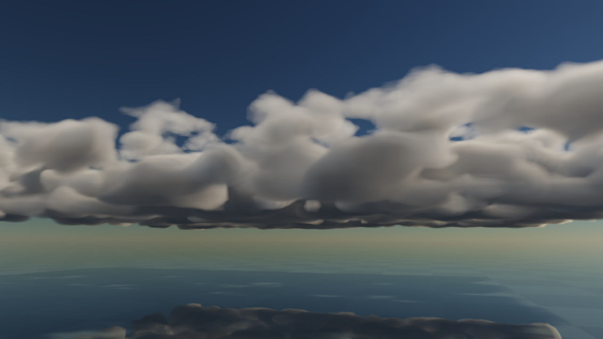
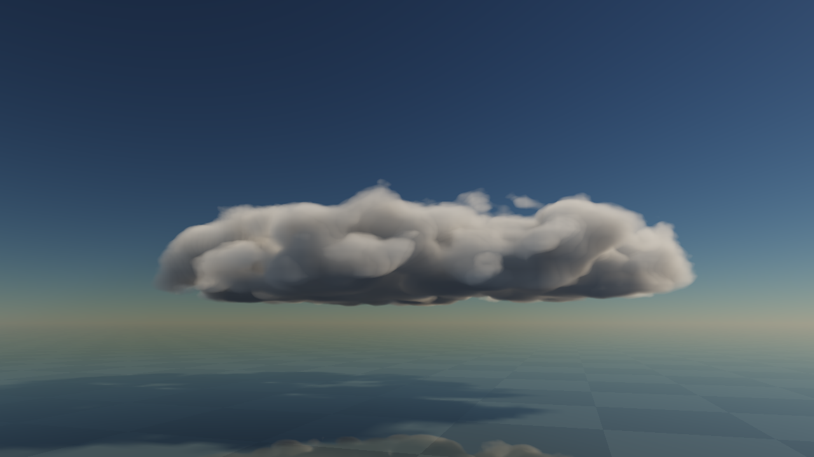
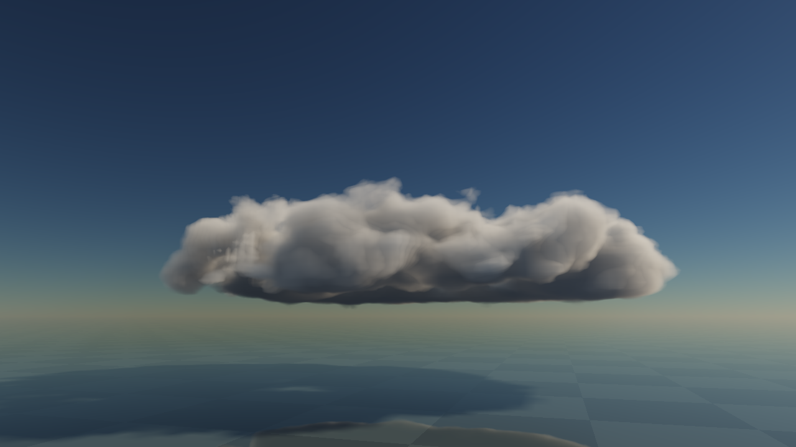

# Runtime source work, lifecycle and retained velocity options

2 November2026. Standalone P0/P1a checkpoint, following [the first pilot](../cloud-runtime-pilot-2026-11-02/README.md).
**Source appearance, complete atmosphere and device budgets remain unaccepted.**
The [build queue](../../design/modules/CLOUD-MIGRATION.md) remains the authority.

## Recover the selected code

The selected code is retained as [a patch](implementation.patch) against the first checkpoint's instrument, rather
than a second complete source tree. From the repository root, use a new destination:

```sh
cp -R docs/evidence/cloud-runtime-pilot-2026-11-02/instrument tmp/cloud-work-replay
# The destination must be new; do not nest a copy inside an existing directory.
git apply --directory=tmp/cloud-work-replay docs/evidence/cloud-runtime-work-2026-11-02/implementation.patch
node --test tmp/cloud-work-replay/tests/*.test.mjs
python3 tmp/cloud-work-replay/serve.py --port 8147
```

Open `http://localhost:8147/`. Selected optical build: `752b5eafbbe430ca`. The active development server is8146.
Reconstruction is checked byte-for-byte against the selected source, including the server/tests outside the optical
hash. Tests ran with Node24.16.0 and Python3.15.2. The shell host reports Apple M3 Max; browser adapter reports
Apple/metal-3 without a precise GPU model. This is not M2 or native-engine admission.

## Preserved execution choices

**Both direct velocity calculation and the float32 per-tick cache remain executable.** The advanced control exposes
the cache; it is disabled by default after an inconclusive/adverse short single-cell screen. This does not eliminate
it. The user's requested matched full-sky comparison is a required P7 checkbox, backed by the
[performance account](../../design/modules/CLOUD-PERFORMANCE.md#retained-velocity-evaluation-options): family/layer
mixtures, calm and storm transitions, CPU/GPU/memory/bandwidth/cache pressure, identical accepted images and motion.
More expensive motion fields may change the result. A single universal winner is not presumed.

At96x80x80, the vec4f cache costs9.375MiB. It replaces three repeated q-cell velocity evaluations with one preparation
and three reads; the half-resolution material carrier still evaluates velocity directly. This trades GPU arithmetic
for GPU storage/traffic and another pass. It does not establish a CPU speedup. The cache is allocated lazily and
retained until provider retirement once used; clean-device A/B runs must account for that lifetime and oracle scratch.
Source-less profiles do not allocate it even if the diagnostic checkbox is enabled.

The dense reference also has an optional conservative8cubed work mask. It scans all positive old q, adds prospective
Cu emitter support, dilates by one brick and writes zero to every inactive forward/reverse/result cell. It skips
expensive source calculations without claiming sparse physical storage. Other genera retain the full-domain path.
The900m prospective vertical bound contributes below half-float birth precision outside the band; transport plus
sampling reach fits the one-brick guard under the current velocity/timestep bound.

## Verification and corrected state

[Mask review](mask-code-review.md), [velocity review](velocity-code-review.md),
[scheduling review](scheduling-review.md), [render closure](work-final-render-review.md) and
[lifecycle closure](work-final-lifecycle-review.md) are scoped code reviews, not art/device acceptance.
The last lifecycle finding, headless world reset, was subsequently corrected and exercised in the UI.

The GPU oracle compares every decoded RGBA16F component against the direct/unmasked calculation. It exercises36
serial ticks plus24 ticks encoded into three queued eight-tick graphs, with separate upload slots and accumulated
mismatch counters. Fixtures cover empty birth, existing source, boundary birth and changed wind/lift/front. The
material carrier is unchanged by this optimization and is not newly qualified. A receipt may be reused only for
the same source time/optical epoch; GPU fixture allocations are pooled across resets and remain charged.

Independent finite optical checks now cover depth, Beer transmittance, homogeneous source integral, segment
composition, weak/vacuum limits, air transmittance, phase normalization and the analytic attenuation provider.
The zero/weak-extinction integral uses a stable Taylor limit; the earlier pilot's `analyticBeer` key asserted only tau.

A replay investigation found a separate source-controller bug: resetting did not restore the next renewal threshold.
With identical seed/controls, a reused old driver first emitted at11.25s versus10.5s for a fresh driver. After correction
both emit at10.5,22,33.5,44.75s in that fixture. CPU regression checks compare300s of packed emitter data/IDs after
both empty and seeded resets following450s of prior work. Thus a prior warmup no longer changes the source recipe.
The first checkpoint's images remain actual observations, but its reset sequence is not a golden fresh-start invariant.

World time advances only through rAF wall deltas and explicit deterministic advances; GPU observations/configuration
do not reset that delta. Reset while optics are omitted now creates a new CPU world epoch. Configuration and source
reset requests defer/coalesce across observations. Fixture changes cancel quiet measurements; capacity/device failure
saves an aborted receipt. Optical-only recovery preserves world weather; whole-optical-off retires the device/context.
Default reset-optics still makes a new optical epoch when enabled again; no continuous material recovery is claimed.

The independent analytic attenuation profile now uses one thin-plane query for receiver/direct/cache/fog visibility.
Its point checks include same-Sun-beam invariance and clear visibility above the plane. It is a diagnostic provider,
not a visible3D cloud family. CPU weather advanced with0 logical optical resources; source-less deterministic advance
and the no-velocity-allocation path were exercised. The narrow-window layout also stops the canvas from covering controls.

## Box-face defect and bounded correction

The user reported rectangular walls inside seeded stratocumulus. [Diagnosis](box-grid-review.md) traced these to Sc/St
source filling the finite storage box followed by a hard zero outside, rather than an authored cloud-bank boundary.
Both seeded q and continuing Sc/St injection now use the same world-anchored finite ellipse (4.0/3.2km radii),
with a smooth support taper and an outer drying rim. The footprint is independent of storage bounds. The shared
source correction reaches main, reflected and shadow queries; it is not a screen-space fade.

[Independent closure review](box-fix-review.md) compared the same seeded time, camera, Sun, extinction3 and1280x720.
Boundary-occupied cells drop from13,886 to0. At60s and300s the corrected bank still has0 occupied boundary cells.
The GPU finite-layer fixture checks both Sc and St seed support: zero edge peak, positive interior. These are
finite isolated banks; global overcast, regional exchange, high-wind/extended boundary survival and light-cache
accuracy remain open. No whole-family visual gate is promoted.

Before (actual build dc9a9efe9893ef97):



After (actual build752b5eafbbe430ca, same seeded state/camera; authored support changed):



After60s of fixed-tick evolution:



A separate300s fixed-tick run also retains0 occupied boundary cells (72,587 occupied total); its actual image
remains free of the broad storage-box wall. This is a sampled-image check, not a continuous-motion pass.

[Selected observations](observations/) retain the image receipts, source probes, unlit before image,
GPU finite checks and exact mask/cache comparison. The added unlit opacity mode integrates the same coefficient
query without air, fog or lighting, separating source support from light tone. Capture labels describe submitted
image graphs rather than confirmed display completion; legacy receipt keys retain their original spelling.

## Visual and cost limits

Full-resolution and optical-density comparison controls separate reconstruction softness from extinction. Inspecting
unchanged mature q at1x versus3x optical calibration improves opacity/contrast, but the close view still shows soft,
vertical/detached forms. No morphology gate is passed by increasing opacity. Baseline calibration remains the default;
the larger value is a held diagnostic. [The derived thermal proposal](source-thermal-proposal.md) is the next bounded
source-owned candidate; it is not implemented or accepted by this checkpoint.

At accelerated rates, the source still executes every fixed tick. The preview targets at most20Hz image submission
at16x and5Hz at64x, with explicit control/final-state refresh. Source-only diagnostics submit no interpolation-only
images. Counters distinguish queued source, image submission and pending graphs. They do not certify displayed
frames or GPU-completed time. Accelerated timestamp samples cover presentation graphs only; omitted source-only
work and overlapping/reordered timestamp pairs prevent total-GPU admission. No5ms/M2 result is inferred.

The original64x path failed its bounded forcing-history capacity; later source-only screens also failed to sustain64x.
The oracle/equivalent calculations passing does not close this throughput failure. Physical/process memory,
allocation/GC tails, full skies and actual target devices remain unqualified. The first pilot has the earlier1x/16x
short windows; later pacing measurements are separate workloads and are not an A/B speedup claim.

Still open: accepted Cu source/motion, representative other genera, sparse storage/occupancy/mips and scale,
carrier strain/reset handling, complete air/shadowed clear-air transport, current environment/SH9, cache accuracy,
reconstruction and actual Thrum/water integration. Follow the governing queue rather than expanding this instrument
into an engine framework.

## Validation of this checkpoint

`./dev check`, the two Node test files, current Apple/Metal GPU finite reference checks and the39-record whole-field
mask/cached-velocity oracle passed. A clean reconstruction from the retained patch matches all25 source/server/test
files byte-for-byte and reproduces optical build752b5eafbbe430ca. CPU tests pass from that reconstruction.
The observations folder also retains the later short cadence sample and three aborted64x screens under their own
older build identities; their source revisions are diagnostic history, not the selected reconstructed build.
