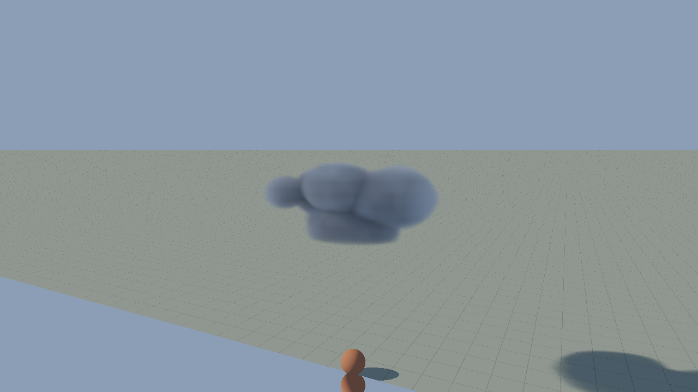

# R0 packed-field proof and rejected first Cu candidate

1–2 November2026. **R0 scalar/operator checks pass in the finite tested domain. The new Cu appearance fails.**
The [governing design](../../design/modules/CLOUDS.md) and
[capability ledger](../../design/modules/CLOUD-CAPABILITIES.md) retain the full commission.
This checkpoint does not qualify a family, full sky, Thrum runtime or device budget.

## Actual packed GPU result

The [final receipt](packing-receipt.json) records the loaded immutable host build, exact fixture/code hashes and
Apple Metal adapter. The independent [implementation review](review/review-packing-implementation.md) and
[closure](review/closure-packing-implementation.md) distinguish root GPU execution from the reviewer's source/receipt
checks. The last closure adds the translated anisotropic/odd-mip world-coordinate correction.

- 13 independent fixtures,39logical levels and1273sample queries; **zero packed texture/mip byte mismatches**.
- 16half codec cases include ties and subnormals. A deliberate texture fixture exercises actual stores/mip stores,
  both parity ties, the normal/subnormal transition and odd/group edges.
- 9 constant Beer GPU cases independently check tau/T/S/composed radiance, including zero extinction and finite source.
- Queries use a translated origin and anisotropic world voxel pitch. Odd ceil mips double pitch and keep a padded
  extent; they do not squeeze a final partial block into the old extent. The independently pinned last-cell witness
  rejects that wrong mapping rather than deriving both sides from production metadata.

The first implementation reported S/composition errors without gating them; it also lacked the actual-store tie
fixture, reliable executed-source identity and receipt-failure cleanup. Independent review found these gaps. The
corrected run gates coefficient/T/S/Lout, records one frozen source build, and restores resources/UI even if receipt
saving fails. A shader reserved-word compilation failure was corrected before the retained pass.

Reported maxima over the retained sample set: coefficient error1.52588e-5m^-1, T error0.000149377,
S error2.09430e-5 and composed radiance error0.000319682 in the fixture's units. These are finite measurements under
the declared numeric filter envelope, not universal exact filtering or optical coverage equivalence. Average-density
mips still require their separate unresolved-gap/coverage/transmittance qualification. GPU format/device recovery,
large atlas capacity, new deep-light curves and spherical air are unproven.

## First actual Cu source/image

The image is the actual1280x720 output at source650s, broad-shallow variant/seed1729,30degree Sun and an elevated
diagnostic camera. The [exact scene/recipe](rejected-cu/first.json), [frozen build](rejected-cu/build.json),
[loaded producer/render sources](rejected-cu/loaded-code/convective.js.txt) and
[original actual CPU/WGSL probe](rejected-cu/source-probe.json) are retained. The parent also opened the raw native
PNG, low-camera view and high-Sun view; the morphology remained conspicuously rounded. The
[independent native-image review](review/first-cu-image-review.md) rejects this as CF01 appearance evidence.

Observed failure: a small stack of smooth ellipsoid-like lobes, weak multiscale/interior relief, some horizontal
bands, a cushion-like lower body and an unconvincing blue-grey light response. A different view/light alone does not
supply the missing cloud structure. Scale/base/consumer/motion acceptance is not inferred from this image.
The previous Q1 renderer image is a qualitative comparator only; its inputs/view/light differ.

The candidate does produce explicit local births, staggered renewal and finite drying rather than a global alpha
fade. CPU checks exercise mature new/lost support, parent attachment and finite retirement. At650s, the original
actual WGSL coefficient probe agreed with CPU double evaluation within6.54459e-8m^-1 over212points. This confirms
that the rendered candidate is substantially the intended source, **not that the intended source looks convincing**.
The updated numerical-pose source is separately probed in the additional receipts; its650s error is6.02551e-8 and
its1e-20s birth query is exactly zero on both paths, with no invalid view paths recorded.

[Independent source review](review/review-convective-source.md) found two more issues: microscopic positive birth
times could pack infinite inverse radii, and rate changes could rewind to the last rendered age. The current source
uses a shared numerical support cutoff/finite upload policy with an explicit omitted-depth bound;260near-birth CPU
checks pass. A separate source clock retains elapsed old-rate time before switching speed, with pause/skip/replay/end
regressions. These corrections preserve the rejected morphology rather than presenting it as new accepted art.

## Failed assumption and concrete correction work

The first coarse cohort grammar does not produce sufficient medium/fine cauliflower structure. A normalized broad
density transition can also bury relief. The source producer needs a reviewed multiscale geometry/material-boundary
correction or a qualified prepared master; increasing a puff count or scrolling noise is not itself a mechanism.

The initial passive effective-light mixture overconstrains generated scattered power. Physical multiple scattering
can count many internal bounces while escaped energy stays bounded. Its strongly reduced side-scattered Sun source
and attenuated blue diffuse boundary help explain the dark body; cache/sampling effects remain separate hypotheses.
A source-side, reference-calibrated escaped-flux correction is under independent review. Neither arbitrary display
gain nor changing physical extinction is the proposed remedy. These corrections must pass native/thin/thick/low-Sun/
overcast and motion witnesses before another family or sky assembly is admitted.

## Checks actually run

The32Python packing/optical reference tests, focused Cu source checks (including260tiny-birth cases) and source-clock
regressions pass. `./dev check` passes the repository/link/hash/policy and Rust scaffold checks. The actual GPU receipt
and source probes above are separate from those CPU/build checks. None closes family appearance or performance.

## Costs, remaining scope and recovery

No performance pass is claimed. The first candidate's observed per-frame compute-bracket/queue figures are isolated
diagnostics with different air, light-cache, ambient and reconstruction work from the old Q2/Q3 instrument. They are
not an equivalent A/B or complete workload. Source/light/camera work and actual live normal/accelerated cadence still
need a measured run after visual correction. The earlier bounded Q2/Q3 allocation failure remains open; full-sky
memory, startup, target-device and complete-frame budgets are unproven.

Retained sources/recipes/tests live in `scripts/cloud_sky_proof/`; references reproduce the small JSON fixtures.
Required selected evidence is committed here, not left only in ignored scratch. The failed source's exact loaded
files are text snapshots so their historical imports/relative links cannot become competing live documents.
Owned scratch remains below its2GiB plan; no unrelated foundation, worktree or Broadsides work was modified.
The best verified proof remains paused at `http://localhost:8142/scripts/cloud_coupled_proof/`.
Next: resolve the concrete source/lighting proposal reviews, update the canonical mechanism, correct F1 and judge
normal/accelerated motion, then continue F2–F5, combinations/weather and full skies. The overall commission is incomplete.
