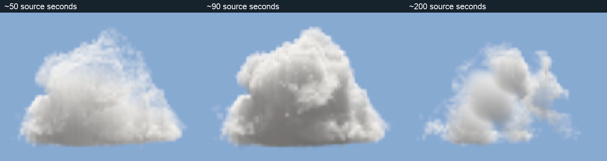

# Cloud source proof

The [result and limits](REVIEW.md) and [independent closure](reviews/RANKED-CLOSURE.txt) support one bounded authored
optical lifecycle for further Thrum integration. [Selected clip](selected-clip/cloudclip.json):6.260437MiB,
162 adaptive knots, unchanged R8 density, no runtime procedural noise or whole-cloud age fade.

The [master shape and provenance](authored-input/shape.json), [license](authored-input/LICENSE.md),
[authoring source](../../../scripts/cloud_source_proof/authored.py) and
[rebuild/inspection instructions](../../../scripts/cloud_source_proof/README.md) are retained.
[Legacy baseline](legacy-baseline.jpg) is historical renderer evidence, not lifecycle acceptance.

The governing [cloud design](../../design/modules/CLOUDS.md) and
[capability inventory](../../design/modules/CLOUD-CAPABILITIES.md) keep Q2–Q7 and user acceptance open.
Runtime source integration, shared projections/reflections, temporal reuse and complete platform budgets are not
qualified by this source instrument. Final moving-image and source-kernel receipts are retained separately from
source/codec correctness; sampled visual inspection is not a claim to uninterrupted real-time watching.

[Actual motion and component measurements](PERFORMANCE.md): [1x](motion/normal-1x.webm), [16x](motion/front-16x.webm), [64x silhouette](motion/silhouette-64x.webm).

