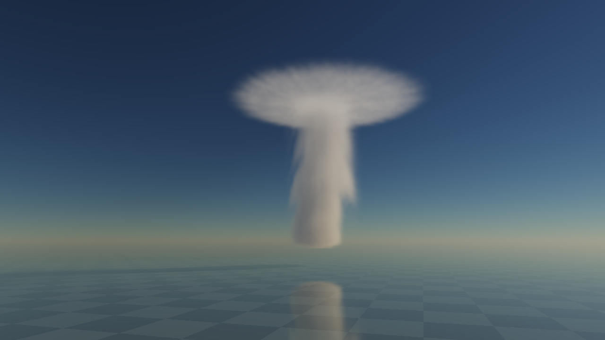
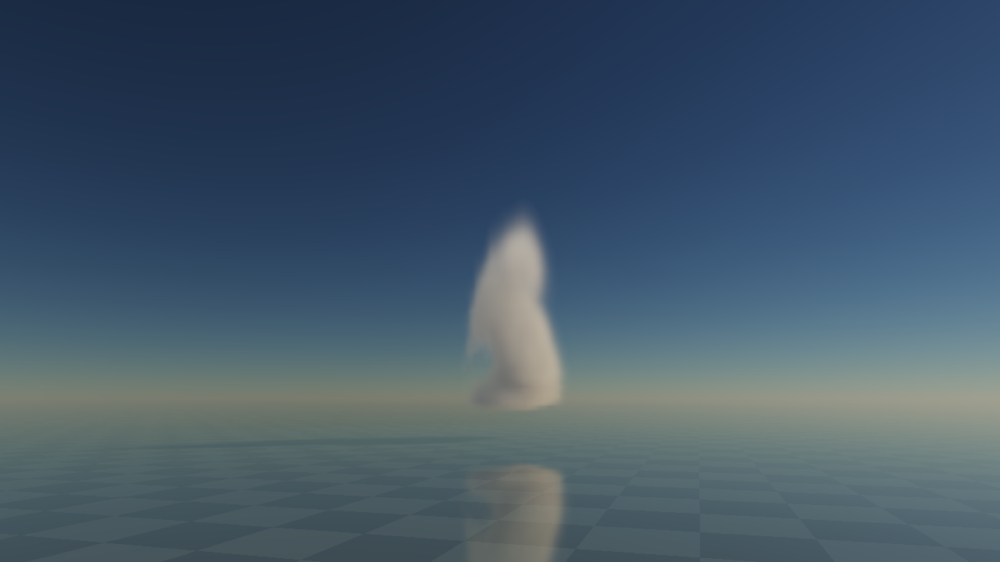
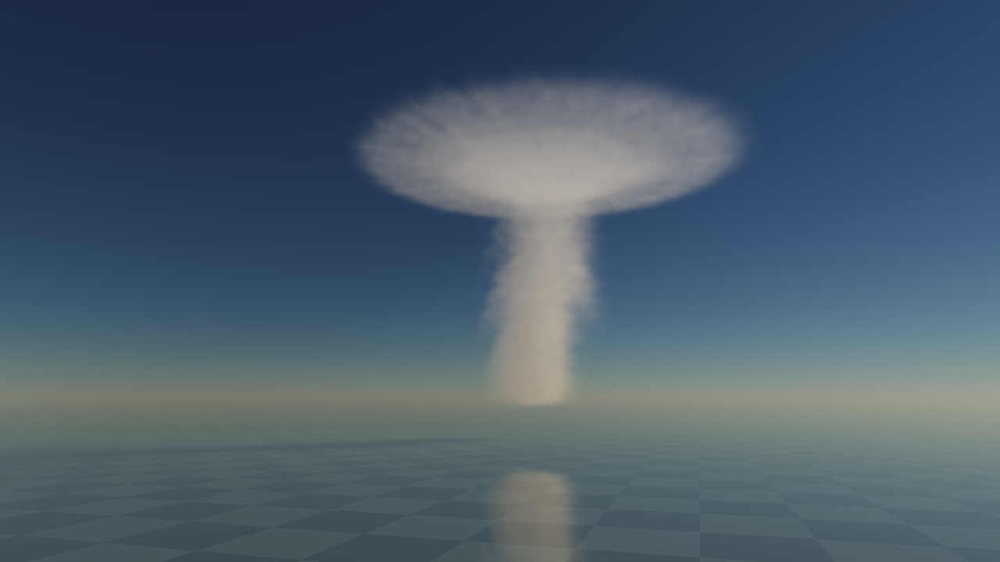

# Connected storm source and phase-coherent optics pilot

2 November2026. Standalone source-risk checkpoint for CF02/P1b. **The tower remains too smooth/columnar;
Cb family art, complete motion and production performance remain unaccepted.** The
[canonical queue](../../design/modules/CLOUD-MIGRATION.md) owns the next work. This is not an engine runtime/API.

## Recover the exact instrument

[Selected instrument](instrument/) has optical identity `baa0bb379adeb7f1`, pinned in [the manifest](identity.json).
Copy to a new destination, run its tests, then serve:

```sh
cp -R docs/evidence/cloud-storm-source-2026-11-02/instrument tmp/cloud-storm-replay
node --test tmp/cloud-storm-replay/tests/*.test.mjs
python3 tmp/cloud-storm-replay/serve.py --port 8147
```

Open `http://localhost:8147/`. The live development server remains8146. Source identity covers served HTML/CSS/JS/WGSL;
server and tests are retained too. Node24.16.0/Python3.15.2; shell host Apple M3 Max, browser Apple/metal-3.
The three diagnostic patches reconstruct prior unfiltered fixtures from this instrument; apply one to a separate
fresh copy using `git apply --directory=tmp/NEW_PATH PATH_TO_PATCH`. All reconstructions were verified byte-for-byte
and reproduce identities69ef9e9ceef15f61/e80016c3aad5bd37/cb526d8eeb4b3ae8. They are counterfactuals, not selected implementations.

## Selected complete interaction

- CPU Weather remains the sole1s authority; the optical source runs every.25s. Fixed finite base pulses supply q.
  Cb seeded start contains only a low1.1–2.8km body. Clear-start begins with zero liquid and ice.
- Cb injection is a broadened pulse mask in a280m Gaussian feed band, gated to zero below base−50m. Stronger inner
  uplift carries new liquid toward9.6km. The core/base follows the shared integrated wind; velocity adds wind once.
- Uplift tapers across9.0–10.3km while radial outflow ramps in the same band. Only arriving q feeds the anvil;
  there is no separately sourced disk. Bounded same-cell liquid→ice transfer preserves the normalized proxy sum.
  Core and ice have different loss rates. Below-base prescribed evaporation prevents a liquid tail at the lower box face.
- Cb morphology comes from native q. Its shared optical amount is
  `clamp(qLiquid+qIce,0,1)*(.65+.35*low)*(1-.12*(1-fine)*detail)`, partitioned by phase before distinct kappas.
  This lies between.572 and1 times the clamped total. It cannot erase all support solely by changing material phase.
  It is an authored optical-proxy profile, not measured water-density calibration. Cu/Sc/St retain their macro profile;
  Ci retains its strand profile. Every reader uses the same current coefficient function.
- Static64³ RGBA8 native noise now has7 mip levels. A Cb-only64m material bandwidth uses the sampled new-carrier
  Jacobian metric. Six neighboring backtraces include velocity variation; the metric is not a whole-cell strain/fold
  certificate. Filtered/unfiltered, world-reference coordinates, and96/192/384 view steps remain exposed comparators.
  No final-image blur or private reflected-cloud geometry is introduced.
- Cb alone uses128×80×128 q over24×14.5×24km, maintaining187.5m horizontal and181.25m vertical pitch.
  Other families retain96×80×80 and their previous charts. Grid-changing family requests retire/recreate the device
  through the serialized provider path. CPU world reset and optical-only reset remain distinct.
- Probe columns receive frozen current controls and CPU weather at the committed source time, independent of any
  submitted image. Reset clears stale submission records. Coalescing preserves Clear/New World through structural
  family/recovery requests; later explicit Seeded start overrides Clear. This is private proof coordination.

## What the images establish

[Selected observations](observations/) carry actual image/probe/measurement receipts, exact build and controls.
The clear-start fixture reaches a connected upper ice cap; at480s all six source faces have zero occupied cells,
with cap top10,468.75m. Five vertical columns show nonzero shaped cap optical depth, so positive ice counters are
not standing in for an invisible anvil. The wider chart removes the observed14km-chart face cut at this time.



This is a **mechanism proof with adverse art**: the lower tower is still a steady column, lacks organised rolling
heads/clustered billows, and remains soft. Do not label CF02 or P1b complete. The anvil is connected to transported
matter, but final fibrous top morphology, carrier validity/renewal, camera/lighting extremes and continuous-motion
acceptance remain open. The next source task is the already derived organised-thermal/head model, not further
lighting or opacity tuning to disguise this source form.

The earlier Cu-style subtractive macro profile hid real cap support and produced stretched rings/lattice.
Same-state raw-q versus shaped-opacity and96/384-step comparisons separated this from source birth and lighting.
[The diagnostic source patches](diagnostic-e80016c3aad5bd37.patch) retain that adverse path; the
[raw-source diagnostic](diagnostic-69ef9e9ceef15f61.patch) retains the first isolation. Noise prefiltering and the Cb
positive multiplicative profile are approximations; sampled-J filtering is not a replacement for valid material
correspondence or preintegrated extinction. Point-light-cache error remains unqualified.

The extended16x run continued to1060s and again reached the finite chart's+x/+z edges (293 occupied boundary cells).
This is retained failure evidence, not an indefinite-world pass. Regional source exchange/large-sky storage is still
required by P1b/P7. The later anvil also approaches/exceeds the fixed camera frame. Do not hide that with a box fade.

## Correctness and review

- [x] Three CPU test files pass: weather/source/replay, half/air references, reset-intent sequences.
- [x] GPU finite checks pass, including low-body storm seed, no birth below condensation base, same-cell phase sum,
  both material-profile fixed-total phase fixtures, native mip mean, transport/Beer/air/phase/provider cases.
- [x] Cu whole-field direct/mask/shared-velocity oracle passes39 records, including three queued eight-tick graphs.
  This does not qualify Cb cache performance or its full mixed-phase transport across every regime.
- [x] Independent [mechanism](storm-mechanism-review.md), [render diagnosis](storm-render-diagnosis.md),
  [filter audit/closure](storm-filter-review.md) and [grid lifecycle audit/closure](storm-grid-lifecycle-review.md).
  These are scoped reviews, not art/device acceptance; later parent images and receipts own actual observations.
- [x] `./dev check`; exact selected source retained, diagnostic reconstructions verified.
- [x] Final GPU family recreation, clear-start/empty probe,480s growth and zero-face-clearance observed in the UI.
- [x] Matched bounded source-off/unequal core-versus-ice observations; corrected zero-birth/age regressions and actual shutdown counters pass. This does not close breakup art.
- [ ] Accepted organised tower/billow source and watched normal/accelerated motion, independently coupled shadows/reflection.

## Corrected bounded shutdown result

On buildbaa0bb379adeb7f1, develop from clear to480s, then set moistening/lift to0 and drying to.7. CPU targets relax
at their ordinary12s rate; advance120s without resetting source survivors. At600s there are0 emitters,0 measured
last-step new source, and0 occupied cells on every domain face. Liquid proxy sum falls4617.066→1837.239; ice remains
present and grows886.277→1542.167 as existing upper liquid continues freezing. Those phase amounts do not isolate
loss constants: conversion and advection also contribute. The visible lower core weakens while the upper cap persists.
Age/source attribution is corrected; this still looks too soft and columnar, and it is not accepted irregular breakup.






These are actual native snapshots after fixed-tick advances and live1x/16x screens, not a claimed continuous-motion
art pass. Selecting another family still starts a new fixture/world; same-ID live Cu→Cb transfer/regridding remains
unimplemented. This separate Cb producer proof does not close that governing requirement.

## Phase-age/source observation erratum

After the first implementation commit, the600s source-off run revealed a diagnostic error: Cb reaction uses separate
phase losses, but the old new-source/age calculation still subtracted survival under one generic scalar loss. It
therefore reported9.15792 units of apparent new source with0 emitters. This invalidates Cb birth/age attribution in
buildcb526d8eeb4b3ae8; its liquid/ice geometry and actual images remain observations. The density operator is unchanged.
The corrected buildbaa0bb379adeb7f1 subtracts `sum(max(qAdv,0)*exp(-phaseDecay*dt))` before estimating added source.
A GPU mixed-phase fixture with zero source now requires zero birth and age100→100.25; paired phase transfer has its
own proxy-conservation fixture. Age remains a first-order diagnostic with a low-density reset, not exact mass age.
[Independent review](storm-age-review.md) confirms the equation and scope. The
[prior instrument patch](diagnostic-cb526d8eeb4b3ae8.patch) and [prior manifest](identity-cb526d8eeb4b3ae8.json)
recover that historical build. Do not reinterpret its old birth/age counters as corrected data.

## Available-host cost screen

Buildcb526d8eeb4b3ae8: three separate quiet10s windows,96 view steps, shared main/receiver/mirror enabled, advected filtered material:

| View / rate | Queued source progress | Submitted images/sec | CPU encode p95 |
| --- | --- | --- | --- |
|1280×720 /1x|10.0s|41.49|.145ms|
|640×360 /1x|10.0s|76.49|.105ms|
|640×360 /16x|160.25s|17.70|.075ms|

These are successful submissions, not displayed FPS or GPU-completed cadence. Accelerated presentation targets20Hz;
every fixed source tick still executes. The16x window ends with.0284s source age and2 queued graphs. Per-pass timestamp
intervals overlap/reorder; all whole-GPU totals are rejected. No5ms cloud/M2 or16ms full-system pass follows.10s
windows do not meet60s/tail/thermal admission. Normal/accelerated images are sampled witnesses, not a claimed
continuous-motion art pass. Process/physical residency and GC tails remain unmeasured.

Logical live resources are about53.1MiB for the larger Cb fixture versus30.5MiB for other-family baseline. The four
q textures alone cost40MiB, the two half-resolution carriers2.5MiB. Native-noise extra mips add149,796bytes once.
Cb deformation preparation adds6 velocity and rest evaluations per half-resolution cell:983,040 of each per tick
at this grid. It adds no per-view gradient evaluations. Actual shader/prefilter bandwidth still needs profiling.
The optional Cb float32 velocity cache would add20MiB and remains off; both paths are retained for the mandatory
matched full-sky P7 comparison. Device retirement releases the Cu oracle's logical scratch before the new Cb provider.

The corrected shader was rescreened in two further quiet10s windows at640×360/96steps:
1x queues10source seconds and submits71.13images/sec (CPU encode p95.120ms);16x queues160.25seconds and submits
17.90images/sec (p95.100ms). Source age at each window end is.0319/.0117s with3/1pending graphs. These are new
scoped receipts, not a paired speed comparison or displayed-FPS/whole-GPU admission. Whole timestamp totals remain rejected.

## Research and limits

This implements the [selected native runtime/production-derived rendering baseline](../../design/modules/CLOUD-PRODUCTION-BASELINE.md),
its [source proof contract](../../design/modules/CLOUD-PROOF-ACCEPTANCE.md), and
[performance account](../../design/modules/CLOUD-PERFORMANCE.md). The
[technique/source-code register](../../design/research/ATMOSPHERICS-TECHNIQUES.md) remains supporting research.
Prescribed convection/outflow/reaction and material filtering are declared deductions/authoring choices, not a claim
that a proprietary engine publishes or uses this exact lifecycle. No Houdini, paid tool or imported asset is required.
Full air/environment/TAA, sparse occupancy/storage, robust regional exchange, five-family acceptance, target devices
and actual Thrum/water integration remain unbuilt/unqualified under the governing queue.
