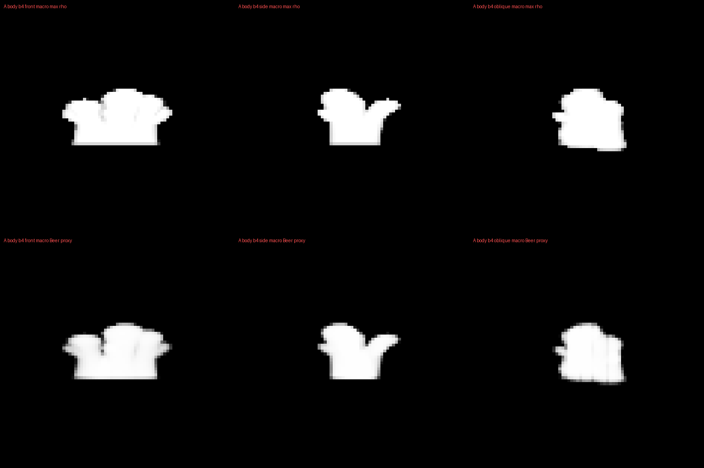
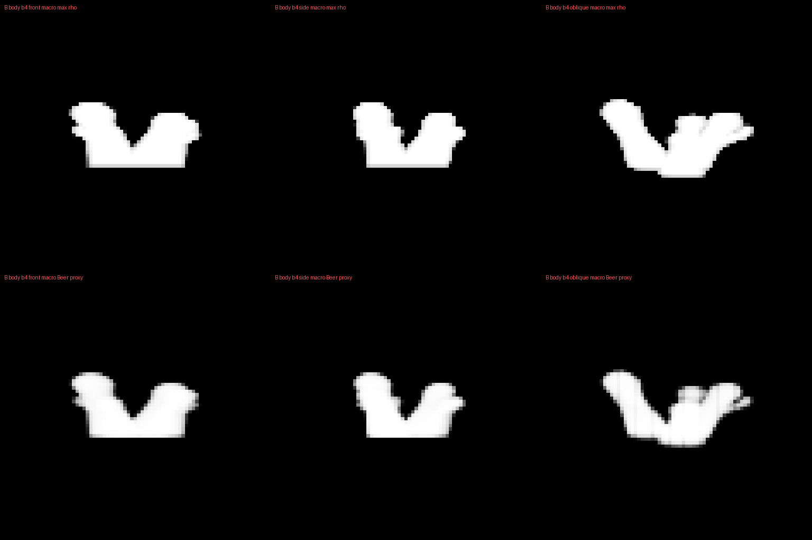

# Swept-loft macro screen — rejected before native cooking

3 November2026. **Actual source-only negative; no new cloud asset, detail field or runtime adoption.**
[The cloud queue](../../design/modules/CLOUD-MIGRATION.md) remains active. The renderer is retained.

The fixed v2 author used branching PCHIP lofts, noncircular sectors, a common base gate and an optical amount chosen
before sampling. Both authored variants were evaluated at4local-metre centres, serially with pinned front/side/oblique
projections and source-only optical probes. The exact decision, controls, commission, code, tool versions, frozen
checks, all images/slices and actual receipts are in source-and-observations.zip. No old raw guide shaped this candidate.

| Actual macro result | A BODY | B BODY | Requirement |
| --- | ---: | ---: | --- |
| Central-footprint valid narrow rises |99.595% |97.721% |≥80% |
|50% base-onset height range |44.117m |49.239m |≤16m |
|Distinct major heads front/side/oblique |1/2/1 |2/2/2 |3/2/2 and3/2/3 |
|Three readable shoulder witnesses |Fail |Fail |All three |
|Base connectivity, upper separation, collar, optical bands |Pass |Pass |Necessary, insufficient |

Both crown scalar/root/connection/optical screens pass. That does **not** accept their visible anatomy: root and
independent visual review reject smooth clubs/Y shapes. BODY views read as merged caps, forks and long smooth trunks.
The narrow base rise improved, but onset height still varies because changing lower loft sections do not provide the
same supported footprint at each height. A level multiplier alone cannot make absent low material appear.
The source lacks intermediate billow hierarchy; small detail cannot rescue the failed macro structure.
These are scalar maximum/voxel-volume Beer projections, **not rendered beauty, continuous silhouettes or lifecycle proof**.

## Actual execution, correction and cost scope

First reviewed macro-only freeze c06ebc4a executed once. It produced the A BODY projection/slices, then failed in
np.column_stack because the world-coordinate helper returned scalarY beside360-element X/Z. Exit1, sampled owned
process-tree163,790,848B,1.291s, no threshold. Original source/output/log/receipt are immutable in the archive.
A separately reviewed broadcasting-only repair preserved all coordinate arithmetic, inputs, controls and thresholds.
Its A projection is byte-identical: SHA c4434c0f0c8dd5942eea4633f44554b2261fe57d783a46a2a697ff3a233fb38c.

Fixed freeze902bd4b2 completed one full macro-only run, status MACRO_SCREEN_ONLY_REJECT, exit0. Its independently
sampled watchdog+worker tree peaked199,933,952B (190.67MiB), below the planned200MiB; elapsed2.821s. Neither224MiB
early stop nor256MiB termination request fired. Sampling interval100ms and per-slab checks can miss transients; this
is **not an OS hard cap**, runtime CPU benchmark, device/frame memory measurement or cloud budget qualification.
Detail was unconditionally unavailable; no EDT/R16/native2m/candidate-renderer/GPU execution occurred.
[Independent review](REVIEW.md) separates code closure, the actual subsequent diagnostic error and visual rejection.

Root also reopened the exact source91 viewer and inspected native1280×720 [close100 beauty](baseline-close100.png),
with its original receipt. It still has a broad soft base and few blunt masses. This is a current comparator, not a new
visual pass. The complete [existing assembly](../cloud-assembled-source-2026-11-03/README.md) and its clips are unchanged.

## Selected next action and retained frame correction

Retire this anatomy candidate without another radius/seed/noise/density search. Next, audit known useful raw03 lobes
through the actual compression/crop, optical taper and overlap chain using matched coordinates/views and support/Beer
comparators. This follows witnessed native source/crown images; it is a diagnostic commission, not an accepted replacement.
No new opacity, lighting or higher-resolution cook is selected to conceal missing anatomy.

The archive also retains the independently reviewed base-anchor operating model and one-clock diversity schedule.
Selected invariant: distinguish condensation-frame origin from positive attachment root; BODY renewal is real parentless
condensation, while attached crowns inherit actual parent-point velocity and keep their safety gates. The v2 numerical
coordinates illustrate the rejected candidate, not admitted metadata for another asset. Eight scalar cases verify map/
velocity algebra only; full reader/source/profile/native recertification and actual motion/cost are still required.
Ordinary B BODY211.75 may now succeed parentlessly and cancel a pending213.25 rescue; no old realized-birth claim transfers.

## Recovery

Extract source-and-observations.zip to an owned scratch directory. It contains both complete attempts, base-anchor and
diversity notes. All dependencies for the scalar macro producer are in each attempt's inputs/; versions are recorded
in scalar-results.json (Python3.14.10, NumPy2.4.6, SciPy1.17.1, Pillow12.2.0). No native payload download is needed.
Existing results/guard/log intentionally make the retained run refuse overwrite. For another explicit reproduction,
copy a candidate's pinned code/inputs/history to a **new** owned directory excluding results/, guard.json, run.log, STOP
and __pycache__, then invoke its documented guarded macro-only command with that new path. Reproduction is not a new
quality search. The retained negative remains authoritative; no repeated run or rerun-derived cost claim is recorded here.
Restoration verification checks every archive member byte and re-executes scalar/phase checks on a fresh output-free copy.
Full native cook, final effective query, beauty, motion, atmospheric coupling and performance remain open.
