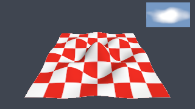
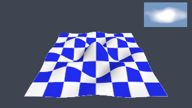
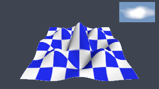
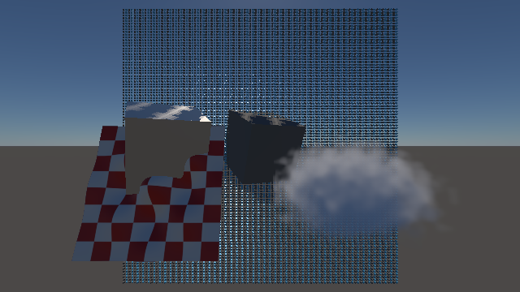
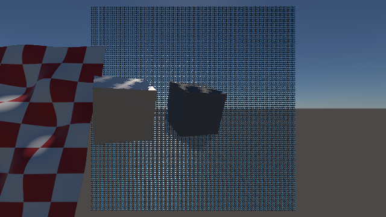
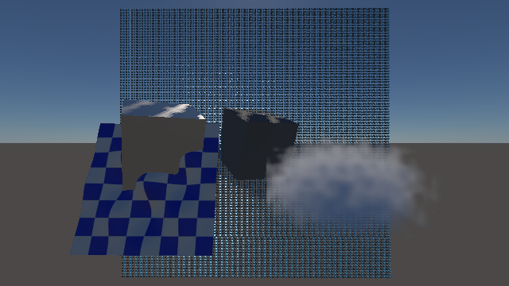

# G5 content-addressed loop — 6 November 2026

Governing design: [G5 decision](../../design/decisions/G5-CONTENT-ADDRESSED-LOOP.md). Measured on an Apple M3 Max
(macOS, Metal) with rustc 1.99.1, release bench, on a machine other agents were using. The timings are tripwires, not
budgets.

## What was built

- **`thrum-asset`** is the shipping runtime. It provides:
  - the CAS layout and the 64-byte `HEAD`;
  - an aligned container with typed zero-copy views;
  - the manifest, a mesh product with meshlets, and a validated KTX2 reader (R8, RGBA8, BC4, BC7, ASTC 4×4; 2D and 3D);
  - `mmap` with an owned fallback on Wasm;
  - `HeadWatcher`.
- **`thrum-cook`** is authoring-only. It provides:
  - a stat cache with the racy-clean rule, plus a BLAKE3 CAS and an action cache;
  - a glTF → meshopt meshlet cooker;
  - a texture cooker: linear-light mips, BC7 (ISPC) and ASTC 4×4 (Arm astc-encoder);
  - a volume cooker: BC4 slices and R8;
  - atomic publication with recovery on open;
  - an FSEvents watcher, a loopback dev server and a `thrum-cook` CLI.
- **`thrum-asset-gpu`** is shipping GPU residency for the game: a loader thread, a budgeted staged upload belt, a GPU
  meshlet cull with indirect draws, and cooked mesh and volume draws inside the scene's forward pass.
- **`examples/asset-loop`** is a shipping-shaped viewer. A loader thread maps and uploads, and the render thread swaps
  the new set without waiting. It chooses profiles from `DeviceCapabilities`.

## Tests (all in `./dev check`)

| Test | Proves |
|---|---|
| `cook_loop` (13) | Every kind and profile is cooked and accepted by the runtime. Unchanged sources are reused without republishing, across process restarts. An edit recooks only its asset, and old readers stay valid. A broken source keeps the previous product, and a deletion is published. Damaged products are removed and recooked on open. An atomic save with the same size and mtime is detected. Seven more tests cover the review findings below. |
| `edit_to_visible` (GPU) | Texture and mesh edits each become resident and visible. Products are mapped, and unchanged products are not re-uploaded (texture-only and mesh-only upload sizes). The image changes as each edit predicts. |
| `serve_and_watch` (2) | `/head` returns 204 then 200; served CAS bytes verify against their hash. Traversal and unknown paths return 404. A long poll is woken by publication. The watcher publishes an edit and a new file in a new directory. |
| `hostile_products` | More than 20k deterministic truncations, word overwrites and byte flips of real products. Every one is rejected or parsed without a panic. The `fuzz_products` example exposes the same parsers to an external fuzzer. |

## Measurements (`cargo bench -p thrum-cook --bench edit_to_visible`, base 614156e plus the G5 change)

**Source scans** use 4 KiB files and are trusted by stamp:

| Files | Cold | Warm, no change (median of 7) | One change | Watcher-targeted |
|---|---|---|---|---|
| 1,000 | 13.5 ms | 2.9 ms | 2.9 ms | 0.04 ms |
| 10,000 | 127 ms | 27.3 ms | 28.2 ms | 0.06 ms |

A full rescan is linear in the number of files. The watcher path re-checks only the named paths.

**Edit to visible.** The run made 12 edits 500 ms apart while the viewer rendered at 120 Hz. The source set is a
129×129-vertex grid, a 1024² texture cooked for three profiles, and a 64³ volume. The drawn profiles were ASTC 4×4 for
the texture and BC4 for the volume. A texture product is 1.3 MiB, so it crosses the 1 MiB upload chunk. Medians:

| Stage | Texture edit (n=8) | Mesh edit (n=4) |
|---|---|---|
| Write → watcher event | 19 ms | 11 ms |
| Event → publish, including 8 ms debounce | 59 ms | 35 ms |
| ↳ Cook (3 profiles, or 1 mesh) | 49 ms | 24 ms |
| Publish → loader sees `HEAD` | 0.6 ms | 0.7 ms |
| Map, validate, upload | 0.56 ms | 0.49 ms |
| Prepared → swapped (waits for next frame) | 5 ms | 7 ms |
| Swapped → GPU completion of first frame using it | 8.4 ms | 8.6 ms |
| **Write → visible** | **93 ms (max 97)** | **62.5 ms (max 67.6)** |

The write → event column is measured from the start of writing, so it includes the PNG encode.

All 12 edits published and swapped, with no loader errors. Uploads were 1,365 KiB per texture edit and 774 KiB per
mesh edit; nothing else was re-uploaded. An earlier run with a 512² texture, entirely under the chunk size, measured
58 ms median.

**Hitch tripwire:**

| Measure | Steady (n=828 / 760) | Swap frames (n=12) or within 50 ms of a swap (n=79) |
|---|---|---|
| Render-thread CPU per frame | p50 0.27, p99 1.23, max 3.44 ms | p50 0.13, p99 0.15, max 0.33 ms |
| GPU completion interval | p50 8.31, p99 10.61, max 13.5 ms | p50 8.30, p99 9.61, max 10.2 ms |

Swap frames cost no more than ordinary frames. The steady maxima came from frames with no swap, which is consistent
with scheduler noise on a shared machine. Limits: the run is offscreen with no present, and the queue's staging copy at
submit falls outside the render-CPU span. The GPU completion cadence covers that copy.

**Startup** to the first resident frame was 23.5 ms with the Metal device warm, and 199.7 ms on the first run of the
session. Most of that is adapter and device creation.

## Shipping excludes authoring

`python3 scripts/g5_shipping_links.py`:

- **Dependency graphs.** The normal graphs of `asset-loop` (71 packages), `v1-game` (85) and `thrum-asset` (13) contain
  no `thrum-cook`, meshopt, intel_tex_2, astcenc-rs, gltf, image or notify.
- **Symbol scan.** Searching the release `asset-loop` binary (12,683 symbols) for those crates' mangled names and C
  entry points finds 0 matches.
- **Positive control.** The same scan finds 2,858 matches in the `thrum-cook` binary.

The architecture registry forbids the dependency edge, and iOS rejects those packages.

## Visual review

Before, after the texture edit and after the mesh edit:
 

To regenerate the stills and an 8-frame orbit sequence, run:
`THRUM_G5_CAPTURE_DIR=<dir> cargo test -p thrum-cook --test edit_to_visible`.

Review status: **agent_reviewed**. Both the author and an independent reviewer agent looked at the three stills and
the 8-frame orbit at native 320×180. These were stills, not video, and no pixel diff was run in review; the test's own
colour and difference checks cover that.

Findings:
- **Each edit changes only what it should.** The texture edit is colour only: the red/white checker becomes blue/white,
  and the geometry and inset are unchanged. The mesh edit is height only: the bumps rise, while the texture and inset
  are unchanged.
- **Colour and filtering look correct.** sRGB is correct, with no seams, mip moiré or visible block artifacts. The texture drawn
  was ASTC 4×4, not BC7 as the brief to the reviewer stated, and at this size the block check is weak.
- **Lighting is consistent across the orbit.** Shading is smooth and the light stays fixed in the world.
- **The inset is plausible.** It reads as a soft cloud-density slice, and its depth animates across the frames.
- **The apparent half-turn repeat is explained.** The reviewer saw frames 0/4, 1/5, 2/6 and 3/7 looking alike. The
  orbit steps 0.4 rad per frame, so those pairs are about 92° apart, and the demo surface cos 6x·cos 6z is 4-fold
  symmetric.
- **There is silhouette aliasing,** because the diagnostic viewer has no MSAA. This is accepted for a loader
  diagnostic and is not a G5 product defect.
- **Motion shimmer remains unreviewed,** because the review covered stills only.

## Independent design review and dispositions

A fresh reviewer agent derived the requirements from the brief and contracts, then read the design, code and bench.
Fixed, each with a regression test:

1. **Action-cache poisoning by a save during a cook.** The cook now reads exactly the hashed bytes, and meshes re-verify
   their inputs. Test: `a_source_edited_during_its_cook_is_not_cached_under_the_old_key`.
2. **Hostile or oversized KTX2.** Size arithmetic now saturates. The runtime rejects partial compressed blocks, and the
   loader checks device limits and formats and records GPU validation errors. Tests: `hostile_products` (wrapped
   extent) and `block_compressed_profiles_refuse_partial_blocks_but_the_portable_product_publishes`.
3. **Two sources for one name.** The asset fails and keeps its previous products. Test:
   `two_sources_for_one_name_fail_and_keep_the_previous_product`.
4. **Planning failure dropped the asset.** It now keeps the previous products. Test:
   `a_planning_failure_keeps_the_previous_mesh_published`.
5. **Damaged action-cache product, and damaged `HEAD`.** Reused products are verified once per process, `put`
   re-verifies an existing file, and a damaged `HEAD` resumes after the newest manifest. Tests:
   `a_damaged_product_behind_an_action_record_is_recooked_not_republished` and
   `a_damaged_head_does_not_restart_generations`.
6. **Two writers.** The store now has an OS file lock. Test: `only_one_cooker_may_write_a_store`.
7. **Watcher accepted hidden files.** It now matches the full walk. Test:
   `hidden_files_named_by_the_watcher_are_not_sources`.
8. **Loader skipped reference validation; the SAFETY comment overstated syncing.** Both are corrected.
9. **Unsupported claims.**
   - The "BC7 drawn" claim was wrong. This Mac draws ASTC/BC4, and the drawn profile is now asserted and recorded.
   - Chunked upload was never exercised. The bench now uses a 1.3 MiB texture.
   - The encoder versions and meshlet limits are now part of the action key.

Recorded rather than fixed:
- Dev server any-origin CORS and per-connection threads.
- No tripwire assertions.
- No preview marking or build binding.
- No device generation on prepared sets.
- No residency admission.

These are in the design record's contract questions and open items.

## In the V1 game (revision, 6 November late)

The loop now runs in the V1 game through public engine APIs. `CookedAssets` (crate `thrum-asset-gpu`) is a
`thrum_render::contribution::SceneContribution`; the window binary attaches it when `THRUM_ASSET_STORE` names a store.
Its upload and cull run in graph-declared passes before forward, and its meshes use the scene's own fragment shader, so
they receive the selected G3s lighting. The root render owner reviewed the first seam (`b953511`) and required
submit-time commit, graph passes with timestamps and submitted motion history; all three are implemented and tested.

### Tests (`examples/v1-game/tests/cooked_assets_gpu.rs`, real Metal device)

| Test | Proves |
|---|---|
| `cooked_edits_become_visible_in_the_game_with_its_lighting` | Mesh, texture and volume drawn in the game scene. A 1.9 MiB first set spreads over 3 frames at a 1 MiB budget, never exceeding it. A texture edit uploads only the texture (0.35 MiB, 1 frame) and a volume edit only the volume; both change the captured image. |
| `off_screen_meshlets_are_culled_and_bc7_is_drawn_where_supported` | A mesh straddling the view edge keeps 192 of 341 meshlets after the GPU cull (read back without waiting). BC7 is drawn when preferred on a BC device. |
| `discarded_frames_leave_no_trace_on_cooked_uploads` | Two presenting hosts on one device and one clock. After one committed frame of a 3.6 MiB upload, one host encodes and discards 12 frames, then discards once before every submitted frame, so the frame recording the final copies is discarded too; the other skips rendering. Neither swaps on a discarded frame. Both swap after the same submitted frames and bytes and capture byte-identical images. |
| `contributed_frames_keep_complete_gpu_timings_and_reset_history_for_new_sets` | With timestamps enabled, every contributed presented frame has no timing fault and complete scene and present times, plus the contribution's compute time once a set is drawn (included in forward). A new set's first frame draws with no motion history, the next with history; a capture in between does not advance it; an edit's new set resets it again. |
| `a_replaced_device_restages_and_draws_the_current_set` | The old device is destroyed and a replacement published; the same generation is staged again and swapped in on the new device with the same bytes. |
| `captures_never_establish_history_and_cull_counts_follow_their_set` | Captures alone upload and swap in a new set; its first normal frame still has no motion history. A mesh edit to fewer meshlets then swaps while counts are in flight; every reported count stays within its own set's total, and the smaller total is reported. |

### Measurements (`cargo bench -p v1-game --bench cooked_edit`)

Release, M3 Max, Metal, 640×360 offscreen, 8 MiB/frame budget, each frame waited for. Other agents were using the GPU,
so tails are noisy. "Latency" is drive plus GPU completion; "render CPU" is the engine's render-thread span.

| Scenario | Edit | Uploaded | Frames | Write → swapped |
|---|---|---|---|---|
| Realistic (256-grid mesh, 1024² texture, 256³ volume; ASTC texture, BC4 volume) | texture | 1.34 MiB | 1 | 44–66 ms |
| | volume | 9.33 MiB | 2 | 212–332 ms (cook ≈ 200–320 ms) |
| Large (512³ R8 volume, portable) | volume | 149 MiB | 19 | 1.7–1.8 s (source write and cook ≈ 1.6 s) |

| Scenario | Frames | n | Latency p50 / p99 / max (ms) | Render CPU p50 / p99 / max (ms) |
|---|---|---|---|---|
| Realistic | steady | 210 | 2.47 / 3.08 / 3.12 | 0.58 / 0.80 / 0.86 |
| | uploading | 16 | 3.48 / 23.7 / 23.7 | 0.91 / 4.93 / 4.93 |
| Large | steady | 90 | 3.61 / 6.15 / 13.8 | 0.66 / 2.14 / 2.23 |
| | uploading | 81 | 3.64 / 21.1 / 22.7 | 0.66 / 1.59 / 4.46 |

- **Copies never exceed the budget:** the largest frame recorded 8.00 MiB in both scenarios.
- **The avoided cost:** a render-thread `write_texture` of the 128 MiB level costs 12.4–14.8 ms of render-thread CPU
  before that frame (1.4–1.9 ms for 16 MiB).
- **Where the upload tails come from** (per-frame trace): the worst frame in each scenario is the first frame after
  attach (cold first use, 4.5–4.9 ms of render CPU), not a copy frame. In the large scenario, frames recording 8 MiB of
  copies mostly take 4–5 ms; a few take 13–21 ms, and frames with no copies while the loader fills a new 150 MiB staging
  buffer take 10–14 ms. Render CPU on those frames stays at 0.5–1.6 ms, so the render thread is not blocked; the time is
  GPU-side or memory-system contention from allocating and writing 150 MiB of shared memory. This is a recorded
  tripwire, and the design's cost account names the fix (a bounded staging ring).
- **Re-checked after the review fixes** (7 November, heavier GPU sharing): largest frame copy still 8.00 MiB; a
  texture edit still uploads 1.34 MiB in one frame; render CPU p99 3.0 ms steady and 5.2 ms uploading (realistic),
  1.1 and 1.7 ms (large). Latency tails rose with contention (realistic steady p99 14.2 ms).
- **Startup** (attach to first set drawn) ranged from 28 to 305 ms across runs for the realistic set; the slow runs
  wait for the scene's first submitted frame.

### Visual review

 
 
 

To regenerate, run `THRUM_G5_GAME_CAPTURE_DIR=<dir> cargo test -p v1-game --test cooked_assets_gpu`. It writes the
stills and a six-frame sequence about 100 ms apart.

Review status: **agent_reviewed**. Two agents reviewed the images: the author, and an independent reviewer who saw
all twelve captures. The reviewer also used 4× crops and thresholded difference images between edit pairs and
between consecutive sequence frames.

Results:
- **The edits are visible and nothing else changed: pass.** The texture edit changes only the mesh's checks. The
  volume edit changes only the cloud's density shape.
- **BC7 and the cull edge: pass.** There are no block artefacts or channel swaps, and no holes or cracks where the mesh
  leaves the view at 4× zoom.
- **Temporal stability: pass, with edge crawl.** Interiors are identical from frame to frame. Check boundaries, the
  outline and the horizon move by one pixel because of camera jitter, and the offscreen capture has no anti-aliasing
  resolve. This is the scene's existing behaviour.
- **The volume composites cleanly: pass.** It is see-through, with no dark fringe and no z-fighting. A discarded and
  retried upload shows no corruption.
- **Lighting consistency: unclear, leaning pass.** The mesh has the scene's sky ambient, and the BC7 capture shows sun
  specular lobes following its waves. Its light checks read dim next to the cube tops, and they show no clear sky
  reflection at roughness 0.55.

Defects:
1. The demo placement lets the wavy mesh pass through the left cube. Depth testing is correct, but the placement
   should move.
2. Aliased silhouettes and edge crawl, as described above.
3. The diagnostic cloud reads flat, with little sense of the sun's direction (single scattering only).
4. The author also sees a straight vertical edge on the cloud's left side, where the demo density reaches the face of
   its box. The reviewer did not see a hard cut-off.

None of these blocks the claim that edits are visible without stalls. Items 1 and 3 belong to the next G3s scene
consumer that root is authoring.

## Independent review of the in-game seam and dispositions

Two independent read-only reviews ran on the seam: a fresh subagent code review, and root's review of `a3d1a7f`
(recorded in `tmp/g5-boundary/NOTES.md`). Every confirmed finding is fixed and, where a test can show it, tested.

| Finding | Disposition |
|---|---|
| High: the `contribution compute` pass broke the renderer's fixed timing sequence, so every contributed frame was a timing fault with no GPU pass times. | Fixed. The collector takes the pass out of the sequence, adds it to forward so totals include it, and reports it alone. The new timestamp test then found a second cause: Metal writes no timestamps for an empty compute pass, so the timed pass is begun only when the contribution dispatches (`SceneContribution::computes`). |
| A capture marked cooked history continued without advancing scene history. | Fixed (`submitted(history_advanced)`); tested. |
| The loader channel was unbounded: repeated edits while no frame encoded kept every staged set. | Fixed with a newest-value mailbox; superseded staging drops at once on the loader thread. |
| Device publication joined the loader thread, which could be inside `prepare` or a poll sleep. | Fixed: drop signals stop and unparks; nothing waits. |
| A volume slice larger than the 1 MiB copy unit was copied whole (2048² R8: 4 MiB in one copy). | Fixed: such slices split into block-row regions; unit-tested. |
| The cull readback could pair an old count with a newly swapped set's total. | Fixed: the total travels with the mapping. |
| A stale recording could be committed after a device-generation mismatch. | Fixed: each recording starts by clearing it. |
| Pipeline compile errors in `rebuild` went unreported. | Fixed: validated in an error scope; an error detaches the contribution with its reason. |
| A failed pass declaration left the contribution attached. | Fixed: attach detaches and restores the graph. |
| The volume's sky term used `E_up/π` though the sky covers only the upper hemisphere. | Fixed to `E_up/(2π)`. The sky term is still not self-shadowed; it is a diagnostic consumer. |
| A retired loader (device replaced mid-preparation) could overwrite the replacement's `staged` or append old-device errors. | Fixed: retirement sets the stop flag under the stats lock and every loader observation checks it under that lock; unit-tested (`a_retired_loader_publishes_no_observation`). |
| Loader errors repeated every poll interval. | Deduplicated and bounded at 64. |
| The discard test was narrower than described and compared within a tolerance. | Strengthened as in the table above; byte-exact. |
| Seam methods were `pub` though no external caller can declare their passes. | Narrowed to `pub(crate)`; the 4-byte token resources are documented as ordering tokens only. |
| Policy: `thrum-cook` is used by `v1-game` and `thrum-asset-gpu`. | Dev-dependency only, for tests and benches; shipping graphs exclude it (see "Shipping excludes authoring"). |

## Open items closed (8 November)

Apple M3 Max, shared GPU. Each check fails when its fix is removed (mutation runs recorded below).

- **Mirrored glTF nodes.** A node whose world transform has a negative determinant now has its triangle corners swapped
  so front faces stay counter-clockwise, and its normals use the cofactor matrix times the determinant's sign so they
  stay outward. `mirrored_nodes_keep_front_faces_counter_clockwise_and_normals_outward` covers plain, mirrored,
  mirrored-parent and doubly mirrored nodes with and without authored normals. In game,
  `a_mirrored_node_draws_with_the_facing_and_lighting_of_its_plain_twin` draws a mirrored, smooth-normalled grid and its
  plain twin with at most 0.1% of pixels changed. Removing the winding swap or the normal sign fails both tests.
- **Partial-block refusal.** A block-compressed profile refuses a texture (or a BC4 volume) whose base size is not a
  multiple of 4 with a named reason, `CookError::Refused`, reported in `CookReport::refused` and by `thrum-cook` as
  `refused`. The asset publishes without that profile, which withdraws a stale compressed product, so the runtime
  falls back to the portable product. The ASTC volume profile is R8 and is unaffected. Test:
  `a_partial_block_source_is_refused_by_compressed_profiles_and_served_portable`.
- **Texture quality.** `cooked_texture_quality` decodes every level of each compressed product on the GPU (BC4 on the
  CPU) and compares it with the same level of the portable product. The floor is 30 dB for levels of at least 16
  texels a side; smaller levels are recorded only.

  | Product | Base level | Levels of 16+ texels |
  |---|---:|---:|
  | Fast BC7 | ~48 dB | ≥ 34.3 dB |
  | Fast ASTC 4×4 | ~49 dB | ≥ 34.1 dB |
  | Final BC7 / ASTC 4×4 | 49–53 dB | — |
  | BC4 volume | 44.4 dB | — |

  Levels of 4×4 texels measure 21–29 dB. The test also checks that substitutes fail: a red/blue swap scores
  15.6–16.8 dB and the other colour-space label 11.8–13.2 dB. Mutating the cooker to swap the BC7 colour-space label
  fails at 11.8 dB; swapping red and blue before encoding fails at 15.6 dB.
- **Chrome page run.** `sh scripts/check_g5_browser_dev_client.sh` serves the Node check's body as a browser test
  (`crates/thrum-asset/tests/dev_server_browser.rs`) at `http://127.0.0.1:8000` against `thrum-cook watch --serve`.
  In Chrome the page logged `E2E_READY generation 1 opened 3`, the driver edited one volume, and the page logged
  `E2E_DONE generation 2 shared 2 replaced 1`; the test passed in 12.9 s. The cross-origin requests succeeded because
  the server echoed `Access-Control-Allow-Origin: http://127.0.0.1:8000` with `Vary: Origin`; a foreign `Origin` got
  403. A second run with the hardened driver passed in 10.1 s and released port 8000. The run is manual: interactive
  mode reports only in the page, so the watcher triggers the edit and the stop. It is not in `./dev check`.

Independent review of these four changes found nothing blocking. Fixed:

- The mirrored-node fix changed mesh bytes without changing action keys, so a store cooked earlier would keep serving
  the old winding from its action cache. `COOKER_VERSION` is now 3.
- The quality test skipped everything on an adapter missing BC or ASTC. Each colour format is now skipped alone,
  and the CPU-decoded BC4 volume is always checked.
- Level pairing stopped at the shorter chain. Every compressed product must now have the portable product's level
  sizes.
- The driver script could leave `wasm-bindgen-test-runner` holding port 8000, carried on without a server, and ran
  to its limit regardless. It now stops the runner, refuses a busy port or a missing server, and stops on request.

Recorded: alpha-cutout PSNR counts hidden texels, the reference measures encoder loss rather than mip generation, the
swap check shows the floor's discrimination rather than the cooker's channel order (the floor covers that), the
test's BC4 decode truncates where hardware rounds, and refusals are remembered within one process only.

## Open items and contract questions

These are reported plainly, and the design record tracks them:

- **Not built:**
  - EAC iPhone volume products (draft parked on `claude/g5-parked-eac-layered` with a recorded selection defect).
  - Cooked shadow casting (meshes receive shadows but cast none).
  - Depth-aware volume (the diagnostic raymarch ignores scene depth inside its box).
  - A bounded staging ring for very large publications.
  - CAS garbage collection (draft with reader leases parked on `claude/g5-parked-gc-leases` with two recorded defects).
- **Not measured:** Chrome performance (the dev-server client's Chrome run is functional only), physical iPhone, sustained runs, and physical residency during overlap.
- **Contract questions for C05/T1, recorded with recommendations in the design:**
  - Preview versus admitted publication of a partially written multi-file change set: preview-only default in force,
    proposal recorded for the owners.
  - Moving GPU residency to the renderer: resolved as the `SceneContribution` seam.
  - Device ownership in the game: resolved; the contribution uses the host's device and never submits.
  - Retention leases.
