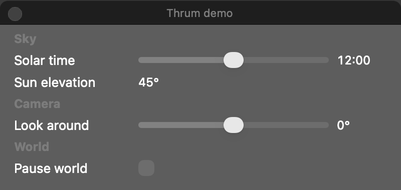
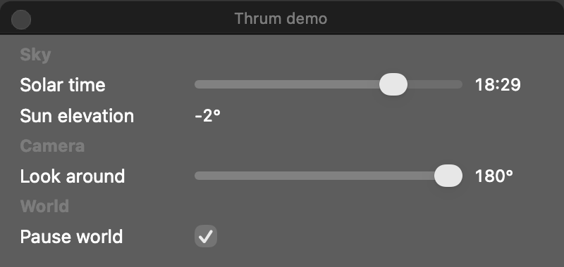
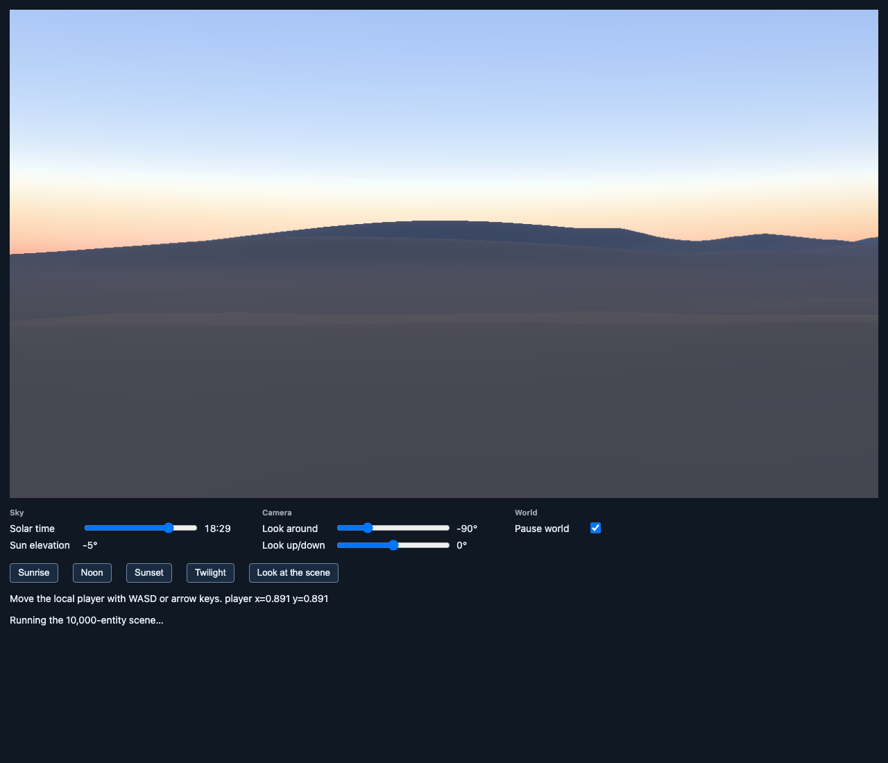
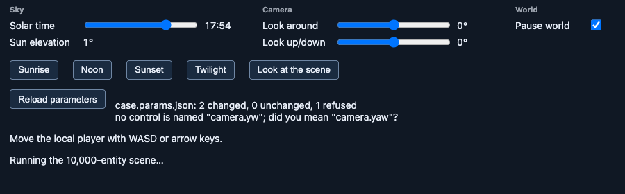
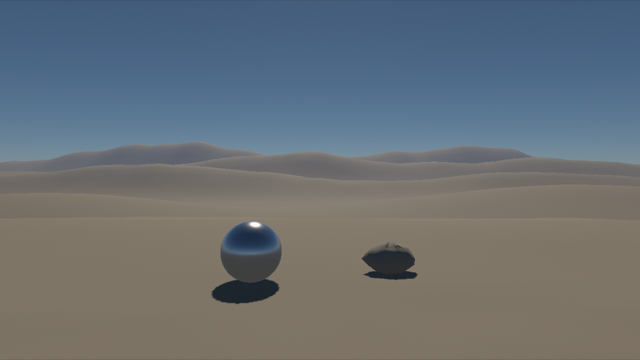
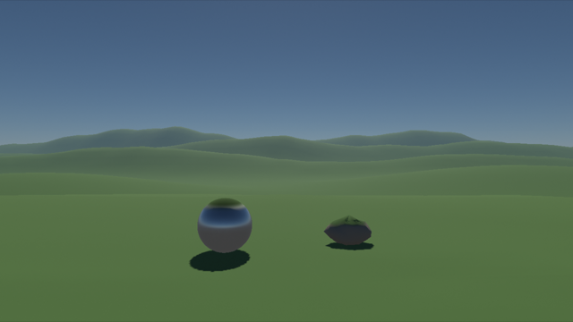
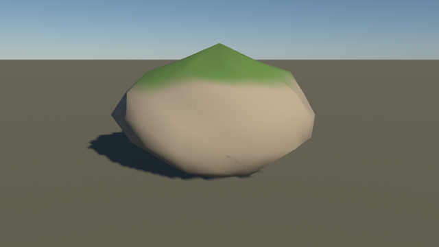
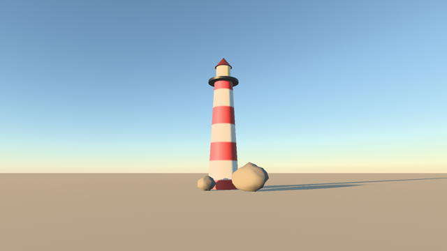
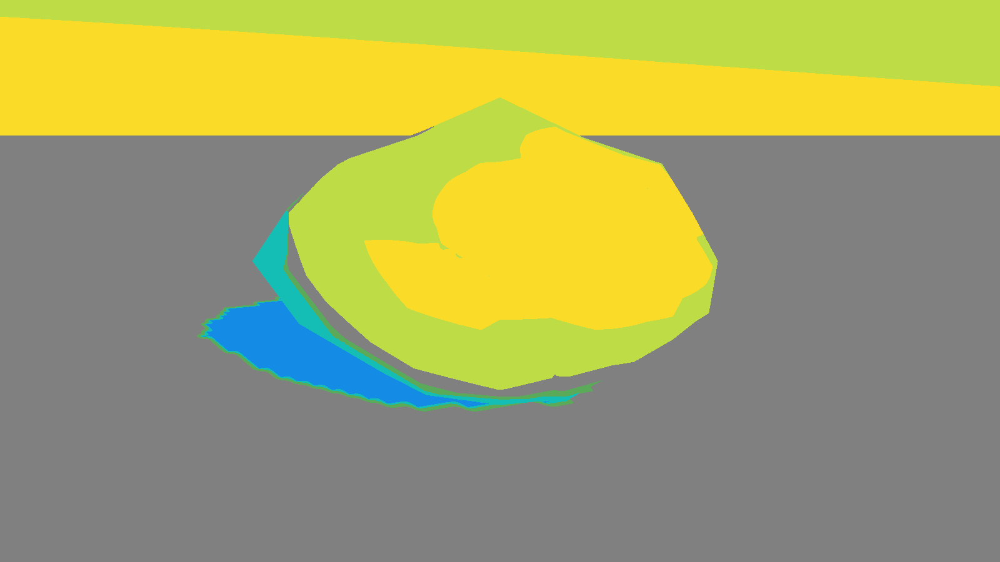
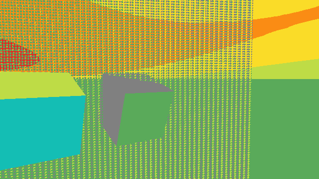

# G6 creator experience — 7 November 2026

Governing guide: [creator experience](../../design/ENGINE-EXPERIENCE.md). Build-plan item: G6 in the
[build plan](../../BUILD-PLAN.md). Work runs on an Apple M3 Max (macOS 26.6, Metal) and headless Chrome 156 WebGPU on the
same machine, which other agents were also using. Slices 1 and 2 make no timing claims; slice 3's reload timings are
contended observations, not budgets.

## Slice 1: typed demo controls (native panel and browser page)

### What was built

- **`thrum-controls`** (engine crate, no game schema, no I/O):
  - a typed model of sliders, toggles, text fields and readouts with stable dotted keys (`sky.solar_time`), labels,
    canonical engine values and a `Display` mapping (day fraction shown as `HH:MM`, radians as degrees);
  - revisions per control, so consumers apply only what changed since they last looked;
  - people's edits snap, clamp and are counted; code edits and parameter files refuse invalid values with a
    message that names the control, the cause and a next step, including the nearest key for a typo;
  - parameter files (`apply_file`): a JSON object of keys to display values, valid entries applied, each refusal
    explained;
  - two views of the same model: an AppKit HUD panel (`macos::MacPanel`, `objc2-app-kit`, one narrow target/action
    class) and a DOM builder (`web/thrum-controls.js`).
- **V1 game binding** (`examples/v1-game/src/controls.rs`, game-owned): solar time, camera yaw and pitch, the world
  pause and a Sun-elevation readout. Edits travel through the game's existing checked setters and pause path; what the
  host shows is written back without being mistaken for an edit, and a pending edit survives an observation.
- **Wiring:** the Mac window creates the panel and its Q/E/R/F/[ ] keys edit the same model; Chrome's sliders and pause
  toggle are generated from the model with their previous element ids, and the presets edit the model.

### Checks

| Check | Result |
|---|---|
| `thrum-controls` unit tests and doctest | 12 pass: declaration refusals, code-edit refusals, snapping and clamping, revisions, repeated person edits, parameter files with suggestions, JSON in display units, grouping. |
| `v1-game` binding tests | 4 pass: edits reported once, observations are not edits, pending edits survive observation, keys wrap and stop, the readout follows clock and edits. |
| `panel_check` example (AppKit, offscreen) | The real `controlChanged:` action path moves solar time to 18:29, yaw to its 180° stop and sets pause; the model applies all three with no repairs. |
| Chrome `controls`, `sky-reflections`, `valley`, `valley-recovery`, `device-recovery`, `device-recovery-retry` | Pass on the built page (see below). Paused edits, presets, keyboard stepping on a focused slider, device replacement and the cooked valley all drive the generated controls. |

### Visual review

The native panel, rendered offscreen through AppKit before and after the simulated edits:

The Chrome page, generated from the same model, on the cooked valley at the twilight preset (`valley` case, paused):

Review notes. Labels, units and grouping match the native panel. The readout reads −5° at 18:29, which matches the
day cycle at 45° latitude (asin(cos 45° · cos 97.2°) ≈ −5.1°); the first build showed 45° here because the readout
only refreshed on clock observations, and that was fixed before these runs. Groups follow first declaration, so the readout sits with its sky group; this fixed a repeated "Sky"
header in the first render. Values use tabular digits and the clock reads `HH:MM`. The HUD material renders grey
offscreen; on screen it is translucent dark.

### Limits

- The Mac window itself could not present during this session because the Mac was locked and the display link was idle.
  The panel was verified offscreen only; **on-screen use of the Mac panel remains open** (a person dragging it in the
  running window, with the scene responding).
- Field overlays are readouts only in this slice; a GPU overlay slot will be proposed before touching the graph.

## Slice 2: parameter files (game layer)

### What was built

A parameter file is one JSON object of control keys and display values, such as
`examples/v1-game/params/sunset.params.json`. It is applied through the same checked edits as the panel and the page:
- valid entries apply;
- each refused entry is explained with its key, its cause, the nearest key and a next step;
- a file that cannot be read or parsed leaves every control unchanged.

Reload is explicit, because G5's watcher does not carry parameter files yet. Whether it should is recorded for the
owner in the G6 boundary notes.
- **Mac:** `THRUM_PARAMS=<path>` is applied once rendering starts and again when you press `L`. A one-line summary
  (`1 changed, 0 unchanged, 2 refused`) and each problem print to the terminal.
- **Chrome:** `?params=<url>` is fetched after the controls mount. The summary and problems appear under the
  controls, with a **Reload parameters** button. Without `?params` these stay hidden.

### Checks

| Check | Result |
|---|---|
| `thrum-controls` and `v1-game` unit tests | The example file applies cleanly. A typo names the nearest key. An out-of-range pitch reports `-34–34` rather than f32 noise. |
| Mac window, `THRUM_PARAMS` with a typo and an out-of-range pitch | The window presented. The terminal showed `1 changed, 0 unchanged, 2 refused` with both explanations, and the run completed normally. |
| Mac window, paused apply | Applying `{"world.paused": true, "sky.solar_time": 17.9}` committed 2 world ticks over 240 presented frames. The example file without a pause committed 739 ticks over 240 frames. A paused apply holds the world clock. |
| Chrome `params` case (new) | The page loads with `?assets=…&params=case.params.json`, so the cooked valley is drawn as well. The served file moved solar time to 17:54 and paused the world, and the page explained the `camera.yw` typo. After the served bytes were rewritten, **Reload parameters** set 06:30, and the game clock matched within 1e-6. `#status` never showed a parameter problem. |
| Chrome `controls`, `sky-reflections`, `valley`, `valley-recovery`, `device-recovery`, `device-recovery-retry` | Pass on the same build. |

**Review notes.** The page shows the summary and the explanation as two lines under the reload button. The
Sun-elevation readout of 1° at 17:54 matches the day cycle at 45° latitude.

### Limits

- Parameter edits reload on request, not on save.

## Slice 3: cooked material hook (shader reload)

### What was built

A game-authored WGSL hook, `cooked_surface`, changes the cooked meshes' surface factors and reloads explicitly into
the running scene. The [G6 decision](../../design/decisions/G6-CREATOR-EXPERIENCE.md#shader-edits-the-cooked-material-hook-built)
records the API and the lifecycle.
- **Mac scenes:** the sky kit reads `THRUM_MATERIAL` when the window opens and again on `L`.
- **Chrome:** v1-game's development page (`web/build.sh --dev`) takes `?material=<url>` and has a **Reload
  material** button. The default page is built without it.

The page fix below also makes slice 2's claim true: the parameter row is now hidden without `?params`. Before, the
`.params` display rule overrode the `hidden` attribute.

### Checks

| Check | Result |
|---|---|
| No-hook pixels, v1-game `THRUM_CAPTURE_SCENE` | Plain, diagnostic-store and valley captures (13 files each) are byte-identical to captures from `ed64db0`. |
| No-hook and identity-hook pixels, starter `THRUM_CAPTURE_PNG` | The default capture and an identity-hook capture are byte-identical to the `ed64db0` starter. |
| Mac GPU tests, `examples/v1-game/tests/cooked_material_gpu.rs` (6) | **Valid reload:** the banded hook visibly changes only the cooked terrain. Motion history restarts on the promoting frame and continues on the next. **Refused hook:** a misspelt identifier is rejected at `hooks/misspelt.wgsl:3:21`, and the pixels do not change. **Superseded:** of three back-to-back requests, the first two are superseded and the last is drawn. **Burst during a compile:** one request starts the compile and three more replace one another while it runs. The three are superseded at once, before they compile, and the outstanding compile is superseded when it finishes. The newest is drawn, and each request has exactly one outcome. **Empty hook:** refused with line 0. **Identity hook:** draws the built-in material with zero differing bytes. **Non-finite hook:** a hook that makes every factor infinite or NaN at run time draws the placement's material with zero differing bytes; without the glue's fallback it changes 64,461 bytes. **Contended run (7 Nov):** one verification of 882f1eb4 accidentally ran beside a second copy of itself (two GPU test processes and two Chrome sequences at once). There `material_hooks_reload_visibly_and_invalid_hooks_keep_the_last_pixels` failed once, and its message was lost to the interleaved log. Run alone it then passed in the full suite and 3 of 3 times more. That one contended failure is recorded, not explained. **Device replaced during a reload:** the outstanding request is retired. Right after the replacement the hook reports `restoring`; frames are captured until it no longer does, and the replacement device then draws the hook's pixels byte-identically. A new request then draws. **Requests before the first frame:** the newer one is prepared once the assets build their pipelines, and it draws. |
| Mac starter capture with a typo | Exits 1 with `hooks/typo.wgsl:17:21: no definition in scope for identifier: \`roughnes\``. |
| Chrome `material` case (new, development page) | **Valid reload:** the page loads the valley with an identity hook. The **Reload material** button then draws the shipped moss hook, made unique per run, and changes 56% of the canvas pixels. **Refused hook:** the misspelt hook is refused as `case.material.wgsl:3:21: unresolved value 'roughnes'`, and the screenshot is byte-identical to the moss one. **Device destroyed with a request outstanding:** a request and `GPUDevice.destroy()` run in one JavaScript task. The request is retired. The page then reports that the accepted hook is restoring and the built-in material draws, and later that the hook draws again. Only after that is the restored device's screenshot taken, and it is byte-identical to the moss one. **Reload on the replacement device:** it draws. Passed 5 runs. A sixth failed on a check race (the restore button had not yet appeared), since fixed. After the restore moved onto the compile queue and the reload moved behind the `dev-material` feature, it passed 3 of 3 runs on the development page. On the default page the case stops at once, naming the development build it needs. |
| Chrome `material-disabled` case (new, default page) | The default page is loaded with `?assets` and `?material=case.material.wgsl`. It draws the cooked valley, exports neither `reload_material` nor `material_report`, keeps the material controls hidden, and never requests the hook file. Its frame shows the valley with no material panel. As a control, the same case on the development page fails: it finds both methods, visible controls and one request for the hook. The development page compiles into its own Cargo target folder, so a concurrent build of the other page cannot hand wasm-bindgen its Wasm. Default and `--dev` builds run at once (finishing within a second, warm caches) produced their expected Wasm hashes, and this case and `material` then passed on the two outputs. |
| Chrome `controls`, `params`, `sky-reflections`, `valley`, `valley-recovery`, `device-recovery`, `device-recovery-retry` | Pass on the same build, and again on the gated default page. `controls` also mounts the browser view on its own: a step-0 slider is continuous (`step="any"`, 0.37 holds), and every element id a control emits is reserved: two keys mapping to one id, a slider's `<id>-value` against a control with that id (in both declaration orders) and an id already on the page are each refused once through `onError`, and the clashing control is not drawn. |
| `thrum-asset-gpu` material state tests (7, no GPU) | **Compile queue:** one compile at a time, and only the newest request waits. **Burst:** the queued requests are superseded before they compile, with no second compile. **Restore behind an old-device compile:** with a compile in flight for the old device, a replaced device starts no second compile and queues the accepted hook's restore. The new device draws the built-in material; the old job is retired when it finishes, the restore compiles next, and an unvalidated restore still draws nothing. **Spawn failure:** a compile thread that fails to start rejects that job and the waiting request, reports the queued restore `Dropped` (it answers no request), leaves the queue idle, and drops the accepted hook. **Unconsumed candidate:** one replaced by a newer candidate is reported superseded. **Invalid replacement:** an accepted hook that fails on a rebuilt surface is reported `Dropped` with its diagnostic, not as a second outcome for its promoted request, and the built-in pipeline draws. **Retained intent:** an unresolved restore never draws, and the hook stays accepted across another rebuild. |

**Review notes:**
- **Chrome moss hook.** The dunes turn green. The chrome sphere and the rock gain green tops where they face the sky.
  The sky, the shadows and the sphere's reflection band are unchanged.
- **Starter moss hook.** The rock's upper faces are green and its sides keep the sandstone texture. It sits on the
  kit's lit ground and casts its shadow there. This capture was retaken after the kit gained the ground.

### Reload timing (contended, observations only)

The figures come from a shared machine, and nothing here is a budget.
- **Mac.** `cargo bench -p v1-game --bench material_reload`: 1280×720, each frame waited for, six distinct hooks per
  run, three runs.
  - The compile thread took 0.66–2.2 s per hook, usually 0.7–1 s.
  - The request call took 0.02–0.35 ms.
  - The hook was drawn within 2 ms of becoming eligible.
  - Frames kept running during each reload, 37–127 per reload.
  - Quiet frames before the reloads had worst-case latencies of 22–39 ms across runs.
  - The worst frame during a reload was usually within that spread, but 3 of the 18 reloads had a 75–118 ms
    frame. This is not explained; it may be contention or interference from the compile.
- **Chrome.** The page's call measured 0.3 ms. It creates the pipeline through synchronous WebGPU, and the
  stall below is that work. With a hook that had not been compiled on the machine before:
  - the moss hook became eligible after 577–880 ms;
  - one animation-frame interval during the compile was 300–750 ms (5 runs);
  - frames before and after stayed at a 16.8 ms worst.
  - **This is a stall.** Pinned wgpu 30.0.1 calls the synchronous `createRenderPipeline`, and an asynchronous
    wrapper cannot move that work. Moving it would need `createRenderPipelineAsync`, which wgpu 30 does not expose.
    It stays open under G6, so the reload is a dev-only control.
- **Cached compiles.** A hook already compiled on the machine came back in 3–60 ms without a stall, on both
  platforms.

### Limits

- **Reload trigger.** Reload is explicit, not on save.
- **Compile cost.** Each hook recompiles the whole scene fragment shader.
- **Coupling.** The seam depends on one line of `thrum-render`'s scene shader. It is guarded by a count check that
  refuses with a diagnostic.
- **Temporal history.** Only the meshes' motion history restarts on promotion.
- **Inputs.** The hook gets no time input.
- **Starter size.** The kit wires the reload for any scene with cooked meshes, so it adds no game lines.

## Slice 4: one-command starter and fresh-agent scenes

### What was built

- **`./dev starter`** builds the [starter](../../../examples/starter/README.md) and the cooker. It cooks the
  starter's `assets/`, keeps G5's watcher cooking edits, and opens the window with the parameter file and material
  hook set.
- **`./dev scene <folder>`** does the same for any workspace member with exactly one binary. The member and its
  binary are resolved from `cargo metadata`, not by scanning text. A folder that is not a member, does not build
  exactly one binary, names a binary that another member builds or a folder Cargo keeps in `target/release`, or
  whose package name would share another member's `target/scenes` store is refused before the lockfile changes.
  Names are compared as macOS does, ignoring case and Unicode normalization.
- **The starter** is one rock on lit ground under the physically based sky, with a camera, two Sun sliders and a
  reloadable material, in 42 game lines that name no engine game types. The sky kit (`thrum_app::sky`) supplies:
  - the typed controls;
  - placed cooked meshes (`MeshPlacement`: rigid, uniformly scaled, refused by name when out of range or turned
    about no axis, which normalizes in f64 so any finite nonzero axis turns);
  - the lit ground;
  - the material hook;
  - the window;
  - an offscreen capture.

### Fresh-agent runs

Each run was a fresh agent given only the task and the repository's creator docs, and told not to read engine
source or design documents. Every run kept a friction log, and each later run started from a tree with the earlier fixes in place. Run 3 started from main at 55da12a9.

| Run | Scene | Game lines | Engine items | Friction | What changed |
|---|---|---|---|---|---|
| 1 (11:27) | Stone circle at dawn, now [examples/stones](../../../examples/stones) | 114 | `thrum_app`, `thrum_controls`, `thrum_asset_gpu` | 14 items, about 13 min | The starter reached main and the README; `./dev scene` and the copy steps; `MeshPlacement` with `on_ground` and refusals; the kit's status mapping; the lit ground; `Config::new`. |
| 2 (12:15) | Sunset over rocks, three sliders | 76 | `thrum_app::sky`, `thrum_app::Config` only | 11 items, all minor | README answers: toggles, what controls can drive, `toward_sun`, `L`-only reload, rename steps, the build, format and lint lines, and the uncompressed PNG. |
| 3 | Lighthouse with its own generated mesh and material, four sliders, now [examples/lighthouse](../../../examples/lighthouse) | 74 | `thrum_app::sky` and `thrum_app::Config` only | 14 items, about 25 min; 2 were praise | Run 3 changes below. |

Run 3 worked with the Mac screen locked throughout. The window never presented a frame, so the agent reviewed every
change through offscreen captures:
- a parameter file per slider setting;
- a material file per hook edit;
- a capture after the watcher had re-cooked its edited mesh.

**Run 3 changes.**
- **Fixed in code.**
  - A window that the display never drives now says why, naming a locked or sleeping screen, and points to the
    offscreen capture. Before, the run ended with only zeroed counters.
  - A capture refuses a parameter file with a refused entry and exits 1, as a broken material already did. Before,
    it wrote the default value into the picture and exited 0.
  - Both are unit-tested. The refusal was checked against the lighthouse's real binary.
- **Answered in the [starter README](../../../examples/starter/README.md):**
  - one material hook runs on every placement and is not told which one it shades;
  - the observed emission scale, and that there is no bloom;
  - the screen must be unlocked, and what happens when it is locked;
  - `--locked` builds only after the first `./dev scene`;
  - the type of `sky.camera`;
  - glTF material factors are ignored;
  - a new "Bring your own mesh" section on the glTF subset the cooker reads;
  - judging sky gradients at 1:1.
- **Recorded, not built** (each changes an API or seam and needs its own review):
  - a reload trigger that is not a key press, such as on save or by a signal, and periodic or region captures;
  - the placement's identity inside the hook;
  - control values in the hook;
  - an orbit-camera helper.

**Renderer observations, passed to the render owner.** These are from run 3's captures and confirmed in my own
review of them.
- Noon shadow edges are jagged and scratchy, like an unfiltered low-resolution shadow map.
- There is no anti-aliasing on silhouettes.
- Lit rock faces at a 6° Sun show dark speckles that look like shadow acne.
- The flat ground meets the sky at a hard horizon without haze.
- Emission has no bloom.

The sky gradients are smooth at 1:1: banding seen in scaled-down views is not in the pixels.

### Checks

| Check | Result |
|---|---|
| `scripts/test_scene_package.py` (14) | Resolution from metadata, refusals before the lockfile, and bin names compared exactly, ignoring case, and ignoring Unicode normalization. Binaries named like Cargo's own `target/release` folders and package names that would share a scene store are refused, and a failed offline lock update names `cargo fetch --locked`. The tests failed before each fix. |
| Live `./dev scene` probes | A member whose binary is `thrum-cook`, or `Thrum-Cook`, is refused, and `Cargo.lock` is unchanged. |
| `thrum-app` unit tests | Include the never-drawn hint and the strict capture of a parameter file. |
| `./dev check` | Builds, formats and lints `examples/starter`, `examples/stones` and `examples/lighthouse` as workspace members, so the creator API they use keeps compiling. |

## Slice 5: ExposureZones display overlay

### What was built

`DisplayOverlay::ExposureZones` is a per-view option on the synthetic renderer's display pass. It reads the exposed
scene colour before the SDR tone scale and writes one of 13 exact, undithered palette codes for whole stops from −6 to
+6. The reference is an 18% grey Lambertian card lit at the metered illuminance with zero compensation. The overlay
travels in bits 8–15 of the existing tone-map word in the exposure policy, so no binding or buffer changed. With the
overlay off, the word equals the tone-map value. Games reach it through the `display.exposure_zones` toggle in the v1
game (Mac panel, Chrome page and parameter files) and `Sky::exposure_zones` in the creator kit, which the starter
exposes as a toggle. The clipping overlay is still held.

### Checks

| Check | Result |
|---|---|
| Off identity | 132 valley capture PPMs (`THRUM_CAPTURE_SCENE`, cooked valley, every pose and sequence) from the branch are byte-identical to those from the pre-overlay release build. Repeated after rebasing onto the authored ground material (80e519ec, `ground.png` `ff297966…`): main and branch captures of a freshly cooked store are byte-identical. |
| `overlay_uses_only_its_selector_bits_and_off_keeps_every_policy_byte` | The overlay changes only bits 8–15, and Off packs every policy byte as before. |
| `gpu_exposure_zones_band_exposed_luminance_for_every_tone_map_and_gain` | Float inputs at each stop from −8 to +8 (±0.3 stop), black and two tints, at three storage gains, give the expected palette code under both SDR tone maps, with byte-identical output. |
| `destroyed_gpu_replacement_keeps_the_exposure_zones_overlay` | With the overlay set during detached preparation, a destroyed device's successor redraws the paused view with zero code difference, and the frame uses only palette colours. |
| Chrome, in-app browser pane (WebGPU) | `zones.params.json` applied ("3 changed, 2 unchanged, 0 refused"). The cooked valley drew in zones at noon, and unticking the toggle restored the tone-mapped view live. Observation only; no capture kept. |
| `./dev check` | Passes. |

### Visual review

The sunlit ground reads grey (zone 0), as a metered mid-grey surface should. The lit rock reads +1 to +2, its shadow
side and cast shadow −2 to −3, and the sky +1 to +2. With the Sun at 3°, the incident meter still holds the
horizontal ground at zone 0, while the rock face turned to the Sun reads +3 to +4 and the sky +3 to +4, as expected when
horizontal illuminance falls faster than light on a Sun-facing surface.

The test fixture's grid and lit boxes after device replacement, at 640×360.

### Limits

- The Mac window panel toggle has not been used on screen; the native proofs are offscreen.
- The bands follow luminance only. A clipped channel inside a band is not shown; that is the held clipping overlay.
- Cascade index and the other planned field overlays are not designed yet.

## Saved files reload without a key press (8 November)

The design is in the G6 decision under "Saved files reload". Apple M3 Max, shared GPU, release starter.

### Checks

| Check | Result |
|---|---|
| `thrum-app` unit tests (`./dev check`) | 11 new: the watch (in-place save, rename-save, five-write burst, touch and identical rewrites, delete-then-create, a lasting absence, a file created late, two kinds coalescing, stop without waiting for a tick, nothing to watch) and the delivery body (parameter-only skips the game, game-only leaves the parameter file unread, `L` does both in order, a save during shutdown is dropped). Repeated five times without a failure. |
| `python3 scripts/check_starter_live_reload.py <out>` | Pass, 8 saves on the real starter (`./dev starter` in live capture mode on copies of its files). |

Starter run, each save and its outcome. Pixels changed are counted against the previous capture.

| Save | Report | Pixels changed | Save to report |
|---|---|---:|---:|
| Valid parameter edit | 1 changed, 1 unchanged, 0 refused | 40.8% | 380 ms |
| Malformed JSON | kept, with the parse error | 0 | 297 ms |
| Refused key beside a valid one | 1 changed, 1 unchanged, 1 refused | 12.9% | 378 ms |
| Five writes 4 ms apart | one report: 2 changed, 0 refused | 43.8% | 433 ms |
| Touch and identical rewrites | no reload within 1.5 s | — | — |
| Valid material (moss) | material drawn; prepare 674 ms | 4.0% | 1,156 ms |
| Material with a compile error | refused; the previous material keeps drawing | 0 | 446 ms |
| Parameter rename-save | 2 changed, 0 refused | 46.4% | 285 ms |

Save-to-report times include the watch's settle tick and writing a 1600×900 PNG. They come from one run on a shared
machine and are not a budget.

### Visual review

Agent, pass. After the moss save, the rock's upward faces turn green and the sides keep their sand colour. The capture
after the broken material is unchanged from the moss capture, as is the capture after the malformed parameter file
from its predecessor.

### Limits

- The witness runs the shared reload body offscreen. The window's event path (the `FilesSaved` wake and its guard) is
  covered by code review and the unit-tested body, not on glass.
- Pause ordering through `controls_edited` is the path `L` already uses. It has no new test, because `App` needs a
  main-thread event loop; the sky kit never requests a pause.
- The manual Chrome page still reloads parameters and the material by button.

## Refused asset edits and material installation (8 November)

Daily review C-L1 and C-L3, landed in `9c044160`. The design is in the G6 decision (Installing, `ready()`, live
capture). Apple M3 Max, shared GPU.

### Checks

| Check | Result |
|---|---|
| `thrum-app` unit test | A loader failure after the first draw is reported once with the generation still drawn. Nothing is reported before the first draw, or for a failure that came before the first swap. The bounded list rotating does not repeat or hide entries. |
| v1-game `a_material_ready_before_content_is_drawn_only_with_the_first_mesh` | A material requested against a store with no HEAD becomes `ready()`. Three live frames and a capture are submitted without a mesh, and none produces an outcome. After cooking, `Promoted` arrives no earlier than the first swap. 10 of 10 repeats. |
| v1-game `a_skipped_frame_never_promotes_a_ready_material` | With a mesh resident, frames encoded and skipped (`advance`, `encode_scene`, `skip`) record the held material, submit nothing and promote nothing. The next submitted frame promotes it exactly once. 10 of 10 repeats. |
| `python3 scripts/check_starter_live_reload.py <out>` | Pass, 10 steps: the 8 above plus two asset renames on a copy of the starter's assets (`THRUM_SCENE_ASSETS`). |
| `node scripts/check_v1_browser.mjs --case material` (dev page) | Pass with the `installed` outcome text. |

| Save | Report | Pixels changed | Save to report |
|---|---|---:|---:|
| `rock.gltf` renamed away from its placement | `content: kept 1 (generation 2: malformed cooked product: asset unavailable in the requested profiles)` | 0 | 90–101 ms |
| Name restored | `content: drawn N` | 0 | 88–106 ms |

The window logs the same refusal as `thrum-starter: content generation 1 kept: …`. A material outcome now reads
`material N (name) installed: …`. Installation means the first submitted frame that recorded draws of a resident
cooked mesh with it; the GPU cull may still draw nothing visible, and visible meshlets are reported separately.

### Limits

- Save-to-report times for the content steps run from the rename to the report line, including the cook. They come
  from one run on a shared machine and are not a budget.
- The window event path is still not qualified on glass.

