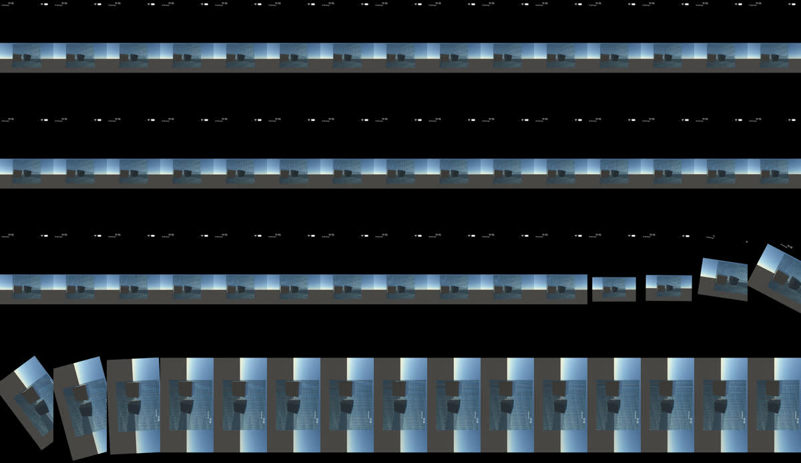
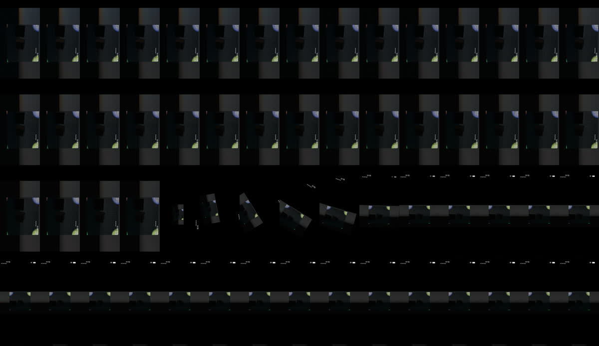
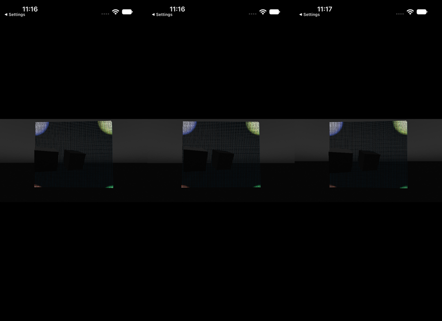

# G3b iOS simulator rotation and device loss

8 November 2026, branch `claude/g3b-ios-rotation` on main `d063f2e8`. Xcode 27.2. Each run creates and deletes a
fresh iPhone 18 Pro / iOS 27.2 simulator through `examples/v1-game-ios/ios/check-simulator.sh`. The Apple M3 Max
host was shared with four other sessions; its load average was 110–237 during the passing run and up to 455 in an
earlier one. **Simulator function evidence only.** Wall times are host-scheduled and carry no device timing claim.
Plan: [PLATFORM-RUNTIME-IOS-PLAN](../../design/modules/PLATFORM-RUNTIME-IOS-PLAN.md) M5 and M6. Earlier rows:
[G3B-IOS-SIM-ROUTE-2026-11-07](G3B-IOS-SIM-ROUTE-2026-11-07.md).
Raw data:
- the passing full route after the close review, `tmp/g3b-ios-rotation/route-full7/` (log `tmp/g3b-ios-route-full7.log`);
- the reviewed run, `route-full6`;
- the device-row development runs, `m6-dev1..6`;
- the race at load 455, `route-full5`.

## How it runs

There are no manual steps. One launched app (`THRUM_V1_ROUTE=1`, one PID) walks every M1–M4 row (see the 7 Nov record),
then rotation, then device loss.

Route commands now arrive as files dropped into the app container's `tmp/thrum-v1-commands/`. A route-only
`DispatchSource` watches that directory. Under load averages of 150–250, `simctl spawn notifyutil` could hang past
90 s, so the file drop replaced it for the route; the Darwin notifications remain.

Orientation changes are real `XCUIDevice.orientation` changes from the self-hosted XCUITest runner. Each rotation is
recorded with `simctl io recordVideo` and cut to 20 fps frames, starting 1 s before `Resized` and ending 2 s after.

Device loss is `wgpu::Device::destroy` on the render owner, followed by non-blocking polls until wgpu's real
lost-device callback fires.

## Rotation (M5)

| Row | Witness |
| --- | --- |
| Portrait → landscape | no extent change from any install before it (0 resize events); extent 1206×2622 → 2622×1206; epoch 16 → 17 (one bump); first new-extent present 2 replies after `Resized`; 0 reconfigure waits; 0 stale or extent drops; 0 raced; 0 old-extent presents; ticks advanced; committed actor moved 0.000000 m; same window, lease and PID |
| Landscape swipe | committed actor +9.725 m (screen-up is forward) |
| Landscape → portrait | extent back to 1206×2622; epoch 17 → 18; gap 2 replies; 1 reconfigure wait; 0 raced; 0 old-extent presents; actor 0.000000 m |

The surface extent is the view's full bounds (winit `outer_size`). The safe area (`inner_size`, 1206×2334) was
configured until this milestone. The layer stretched it to the bounds, so the 7 Nov record's "1206×2622 surface"
was really a 1206×2334 drawable stretched to fill.

The Metal sublayer's gravity is `resizeAspect`, so the compositor scales any drawable without distortion while UIKit
animates the bounds.

**Residual race, named.** At load 455 (`route-full5`), one section passed its final epoch and extent check just before
`Resized` landed and presented once at the old extent. This is the same one-present race bound as revocation. Closing
it would need UIKit to wait on the owner. The route now allows at most one such present per rotation, and requires it
to be the only old-extent present. Its strip shows no distorted frame.

Strips. The frames are cut in the capture's native canvas (`-display_rotation 0`), so one orientation is upright and the
other sideways, and every tile has the same size:

Review (mine). Between the bounds change and the first new-extent present, the compositor shows the previous drawable
scaled down with its aspect kept. It shows no squeeze or stretch. In dev run 1, before `outer_size` and
`resizeAspect`, the landscape drawable was squeezed into the still-portrait bounds. After the first new-extent
present, every frame fills the new bounds.

## Device loss (M6)

| Row | Witness |
| --- | --- |
| Plain loss | wgpu lost callback for generation 1; lease revoked (epoch 18 → 20); one recovery on the render owner (89 ms, host-loaded); presents on generation 2 at 1206×2622; ticks 24129 → 24205 across the row; actor 0.000000 m; same window and PID |
| Stale generation | the owner sends a generation-1 loss through the lost-callback wake and the shell sends one request carrying generation 1. Both are refused (`stale_loss_wakes` 1, `stale_generation_refusals` 1) and generation 2 keeps presenting |
| Loss inside a held section | the drawable held across `destroy` drops as `DeviceLost`. Its surface is replaced (window and wgpu surface): wgpu-core cannot discard a destroyed device's drawable, so the old surface stays "acquired" for every device. Generation 2 → 3; no raced present. The recorded frame is abandoned with `EncodedFrame::abandon_lost_device` (no queue call). A recheck counted 1 abandoned frame and 0 empty submits on lost frames, against 3 healthy skips that flushed with an empty submit |
| Loss during rotation | the recovery is held after preparation. A landscape rotation lands, then the candidate is refitted with `resize_surface` before its one publication; it presents at 2622×1206 |
| Loss across background | recovery released while suspended returns `Deferred`, with no publication in the background; one publication after foreground. A discarded candidate keeps its generation number, so generations skip (→ 6) but only increase |
| Swipe after recovery | committed actor +9.725 m on the recovered device |

No recovery failed. The shell refused no stale recovery reply, and no candidate was lost.

The UIKit handler maxima under the route's load (~210) were 0.88 s for a frame or input event outside stalls and
38 ms during stalls and recovery (`route-full6`, before the close-review fix: 1.64 s and 0.53 s). The world
overloaded 5 times and refused 1252 ticks. As on 7 Nov, this is host scheduling
on the shared Mac, not a wait: no handler blocks on the owner. These timing rows are judged against a quieter rerun.

The frames after recovery match the frames before loss: the synthetic grid and the fixed-aspect portrait band, the
known defects in the 7 Nov record.

## Limits

- `destroy` exercises recovery, not detection. wgpu-hal's Metal backend maps no command-buffer error to a device loss,
  so the physical-iPhone row must first show that a real GPU fault or watchdog loss is detected at all, then run the
  same recovery. That row stays open.
- Simulator only: no physical-device, thermal or timing claim.
- `./dev check` passed on the same tip.
- The close review (plan `Reviews:` line) found that winit's creation and layout `Resized` events revoked and
  reconfigured every new window at a transient extent (two per install in `route-full6`). `Resized` now reads the
  layer extent, and the route checks that no install changes the extent.
