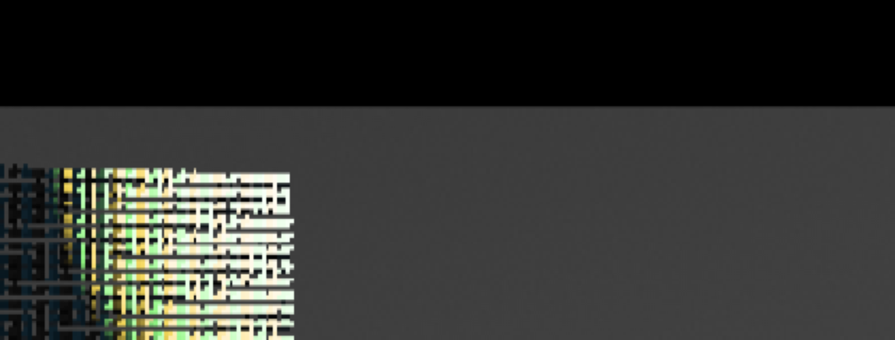
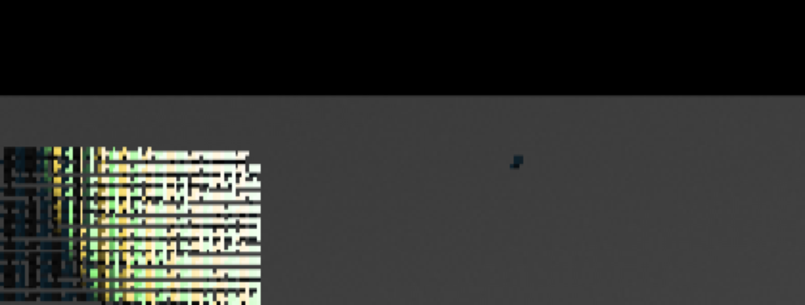

# G3b iOS simulator function route

7 November 2026, revision `5e3bb208` (code) / `ccce4402` (main, comments and docs only after it). Xcode 27.2, fresh
iPhone 18 Pro / iOS 27.2 simulator created and deleted by `examples/v1-game-ios/ios/check-simulator.sh`, Apple M3 Max
host shared with other sessions. **Simulator function evidence only.** Wall times are host-scheduled and carry no
device timing claim. Plan: [PLATFORM-RUNTIME-IOS-PLAN](../../plans/PLATFORM-RUNTIME-IOS/PLAN.md).
Raw: `tmp/g3b-ios-lifecycle/route-fresh-8/` (also `route-fresh-7/`, `dev-run9/`, `dev-run10/`).

## How it runs

There are no manual steps. One launched app (`THRUM_V1_ROUTE=1`, one PID throughout) walks every row. Revocation and
stall commands are Darwin notifications (`simctl spawn … notifyutil -p org.thrum.v1.<command>`). Background is a real
Settings launch, and foreground is `simctl launch` of the running app. Touches are real simulator HID gestures from a
self-hosted XCUITest runner that attaches to the running app. Each row fails on a timeout or a missing witness.

## Rows (route-fresh-8)

| Row | Witness |
| --- | --- |
| Startup | 714 presented, 712 GPU-complete, ≤2 pending; display/touch/lifecycle on UIKit main, prepare and frames on `thrum-v1-ios-render`, ticks on `thrum-world` |
| 5 s stall inside the lease section | 301 display callbacks and 300 world ticks during it; slowest UIKit handler 626 µs |
| Hidden view (denied) | 120 denied, 0 acquired, 0 presented, 120 ticks; missing stays 0 |
| Surface replacement | epoch 2 → 4, presents on epoch 4, same PID, no live detached window |
| Replacement during a held section | release deferred, the drawable dropped stale, presents resume on epoch 6 |
| Revocation after the section's final check | exactly one raced present onto the still-attached old layer, release deferred, detach after release |
| Background / foreground (also during a stall) | world epoch 1 paused and resumed at the same tick; new surface epoch; same PID |
| Nudge | committed actor +0.412 m right; it appears alone past the grid edge (crops below) |
| Swipe | committed actor +9.725 m |
| Background while held | held input cleared, axes at rest |
| Replacement while held | 2 events on the detached window id counted stale, both before the first position sample; no moving axes sent after the clear; the actor then stayed put (0.000000 m between samples) |
| Swipe after recovery | committed actor +9.713 m |

Every UIKit handler during the stalls stayed under 12.7 ms. The 1 s gate tests whether a handler waited on a 5 s
section. Outside stalls, one display-target callback took 1.6 s and the world lane recorded 3 overloads with 799
refused ticks. The disposition is host load on the shared Mac: the fixed clock refuses the backlog and drains it before
resume. Both are reported, not gated.

`./dev check` and `./dev check-web` passed on the same code.

## Observed defects (outside the function claim)

Overseer and agent review of these captures found four visual defects. None changes a function row, and none is a
V1 visual acceptance.

1. **Portrait band.** The game fills about 26% of the portrait screen's height, and the rest is black. The iOS shell
   renders a fixed 640×360 (16:9) source, unchanged from before G3b, and `thrum-render`'s presenter letterboxes it into
   the 1206×2622 surface. Fix direction: size the render extent, or the camera aspect, to the surface.
2. **Screen-door pattern on the entity grid.** The presenter copies the 640×360 source with `textureLoad` (unfiltered)
   into about 1206 px, a non-integer scale of about 1.9×. The 100×100 grid puts an entity about every 3.3 source
   pixels, so nearest sampling aliases it into a strong moiré at native size.
3. **The actor is a speck.** The controlled actor is one 10k-grid entity, a few pixels across at this source size.
   The +0.412 m committed witness carries the touch claim; a player would barely see the nudge.
4. **Dark frames with coloured discs.** The world's day cycle advances with ticks, so captures minutes apart change
   from day to night. The nudge pair is at night. The discs are the grid fixture's four coloured local point lights at
   its corners (red, green, blue and yellow, radius 0.6 m), and they dominate once the Sun is down.
