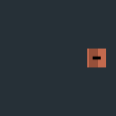

# M2 two-cascade Sun shadow diagnostic — 4 November 2026

**Scope.** The 10k-entity/1.5k-moving offscreen Metal host prepares two 1024² D32 reverse-Z Sun maps (8 MiB logical depth texels), renders both from its shared instance buffer, then samples them in the clustered forward pass. The graph and GPU timestamps include both shadow passes. A zero-irradiance Sun or disabled shadow profile prepares no maps or passes. This is a synthetic spatial diagnostic; live camera/light refitting, per-cascade caster lists, masked materials, Chrome/iPhone execution and V1 visual/device qualification remain open.

The opt-in Metal pixel test places a caster outside the camera frustum while its shadow falls on a visible receiver. Near and far receivers darken by at least 25 output levels relative to the same direct-Sun scene. Separate receiver tests at depths 5.5, 5.732 and 5.95 keep occlusion through the split overlap. A CPU test checks reverse light depth and unchanged shadow XY after a sub-texel camera translation. A first near capture showed self-shadow striping; a world-space constant/slope bias of 0.006/0.06, converted by each map's depth span, removed it in the selected near capture. The small far card proves occlusion, not edge quality or seam tolerance.

| Receiver | Direct Sun | Two cascades |
| --- | --- | --- |
| Near, off-camera caster |  |  |
| Far, off-camera caster |  |  |

**Update/lifetime check.** A target rejects a prepared view with different shadow matrices/split/bias. A changed caster outside the prepared depth envelope keeps its prior valid GPU pose in both forward and shadow passes and increments `dropped_shadow_envelope`; it is not silently clipped. The running host had zero such drops, but unrestricted moving-caster support needs refitting with a new view/target lifecycle.

| Apple M3 Max/Metal, final guarded 600-frame process | Observed |
| --- | ---: |
| Committed ticks / catch-up frames / host calls over 16.67 ms | 629 / 18 / 39 |
| GPU near shadow p50/p95 | 0.061 / 0.065 ms |
| GPU far shadow p50/p95 | 0.058 / 0.061 ms |
| GPU forward p50/p95 | 0.164 / 0.169 ms |
| GPU display p50/p95 | 0.082 / 0.087 ms |
| Host wall p50/p95/max | 2.998 / 18.656 / 70.283 ms |

Three preceding corrected-cascade process runs had 64, 83 and 2 over-deadline host calls respectively; pass tails also varied sharply. A 12-sample Divan whole-frame probe under this variable load reported median 7.79 ms with timestamps (138 benchmark-thread allocations) and 5.24 ms without (79 allocations). These are **adverse observations**, not a qualified frame budget or a clean incremental-cost comparison. The zero steady-allocation guarantee remains scoped to the authoritative tick. Further paired measurement, representative tails, split-edge visual review and live cascade refitting are open.
