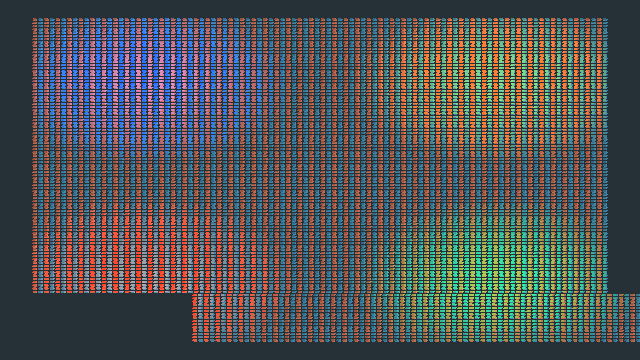

# M2 fixed-view clustered local lights — 4 November 2026

Selected mechanism: [M2 clustered-light decision](../../design/decisions/M2-CLUSTERED-LIGHTING.md). Build: `codex/m2-clustered-lighting` branch, source as committed with this record. Apple M3 Max, Metal, 640×360 offscreen, 10,000 hecs entities/1,500 moving, four static local lights, directional Sun, two prepared HDR/display passes, one fixed-step host callback per paced presentation. The screenshot is a synthetic cube-grid diagnostic, not accepted V1 art.

The renderer builds a 32×18×16 compact cluster table once for the held fixture. The 72 KiB header and compact u32 indices are read only by the forward shader; 32 references per cluster is the current desktop cap. Overflow keeps a deterministic highest-estimated-contribution subset and exposes dropped-reference telemetry. Empty, zero-intensity and offscreen light sets use minimal inactive bindings. The unit tests cover those cases, overlap/overflow and malformed source. On Metal, an opt-in pixel test proved a local source lights the cube center, near-field coincidence stays lit, and a disabled source matches the zero-light image; the prior directional/material/HDR GPU test still passes. `RUSTC_WRAPPER= ./dev check` is the required repository gate; `cargo check` also passed for Wasm and iOS simulator targets, which are compile checks only. GitHub Actions is intentionally disabled by the owner.

| 600 paced frames, one process | Result |
| --- | ---: |
| Committed ticks / catch-up / calls over 16.67 ms | 600 / 0 / 0 |
| CPU tick p50/p95 | 97.0 / 159.2 µs |
| CPU extract p50/p95 | 232.0 / 1424.0 µs |
| CPU upload p50/p95 | 185.3 / 687.0 µs |
| CPU encode p50/p95 | 4.4 / 28.6 µs |
| GPU forward p50/p95 | 0.139 / 0.167 ms |
| GPU display p50/p95 | 0.062 / 0.079 ms |
| Host wall p50/p95/max | 2.464 / 5.014 / 12.479 ms |
| Dropped presentation / cluster references | 0 / 0 |

This is the final optimized source build. Its captured PPM bytes matched the pre-review capture exactly (SHA-256 `f7d5c342b002e5bce021d510f6c77978898c386283862d315e5dd7f8384290c6`). It is one process and an offscreen serial host that waits for GPU completion. The previous directional-only frame-host runs had very different tails under changing machine load, so the figures do not establish the incremental cost of clustered lighting or sustained frame pacing. The authored camera/light set is static; no per-frame cluster rebuild, perspective projection, CSM, source/cook handoff, Chrome or iPhone runtime is qualified. The paired comparison below isolates the held-light cost; named-target measurements remain needed before performance acceptance.

**Paired same-build cost follow-up.** `cargo bench -p thrum-render --bench clustered` prepared the same 10k static cubes twice, with zero and four local lights. On M3 Max/Metal at 640×360, three ABBA runs each used 400 completion-wall samples and 200 GPU timestamp samples per variant, after 50 warmup submissions per variant. Each block's delta is the mean of its two four-light samples minus the mean of its two zero-light samples. Completion-wall p50 was 0.525–0.532 ms; block-delta medians were 0, +4 and −1 µs, with p05/p95 as wide as −69/+63 µs. Forward GPU-pass p50 was 0.131–0.135 ms; all three block-delta medians rounded to 0 µs, with p05/p95 within −4/+6 µs. At this load, an incremental four-light cost is below the resolution of this experiment; this is not a zero-cost claim. The benchmark does not move lights, rebuild clusters, include simulation/uploads or establish a Chrome/iPhone budget.
