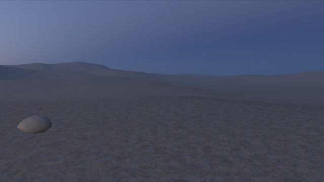
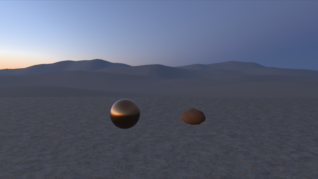
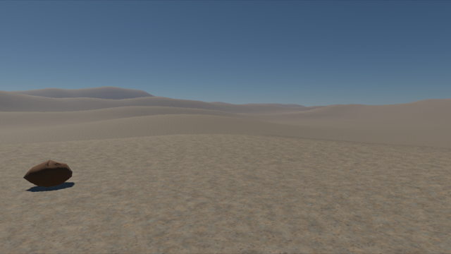

# G3b loss gates and witnesses on the V1 browser facade (8 November)

First work item of the [web shell plan](../PLATFORM-RUNTIME-WEB/M1-record.md#m1-engine-web-shell-carries-the-v1-page-unchanged-done).
Before the engine extraction, the V1 browser facade stops making GPU calls on a lost device. The Chrome checker gains
witnesses that the extraction must then pass unchanged.

## Change

- **Material reload** (`dev-material` page): `reload_material` refuses with `graphics device is lost` while the device
  is lost. Today it compiled synchronously on the lost device, and the candidate was retired at publication.
- **Cooked valley attach:** `attach_cooked_valley` holds the contribution while the device is lost, with no GPU call.
  It attaches right after the replacement device is published, before the first encode. A refusal there goes into
  `cooked_status` errors. A later attach replaces a held one.
- **Unchanged:** time, camera, input, parameters, overlay, pause and visibility stay usable while lost, as before.

## Witnesses added to `scripts/check_v1_browser.mjs`

- **No GPU calls on the lost device.**
  - Once a loss is observed, the checker wraps the actual destroyed `GPUDevice`'s `create*`, `import*` and error-scope
    methods, and its queue's `submit` and `write*` methods, through CDP.
  - From then until the replacement device is published, the count must be zero.
  - wasm-bindgen calls WebGPU through instance methods, for example `arg0.createShaderModule(arg1)` in the built
    `v1_game.js`, so own-property wrappers see every call on that device.
- **Retained view**, in every round of `device-recovery`, `device-recovery-retry` and `valley-recovery`:
  1. Before loss, solar time is set to 12 h.
  2. While lost, the camera is turned 40° through the real `#camera-yaw` control. The game's own yaw reading must
     follow at once.
  3. After recovery, with the world paused at the retained tick, six states are rendered: A, A′, B1 (pre-loss yaw),
     B2 (pre-loss time), C and C′.
  4. Each state presents until two consecutive canvas screenshots match, then records a canvas screenshot and a
     capture-oracle readback hash from the new generation.
  5. For both image kinds: A = A′, C = C′, A = C, A ≠ B1 and A ≠ B2.
- **Material reload after loss** (`material`): a reload after the observed loss is refused, the lost device sees no
  call, and the next reload on the replacement takes serial 5.
- **Attach after loss** (new `valley-late-attach` case, included in `--case all`):
  1. The cooked valley's request is held with CDP `Fetch` until an actual `GPUDevice.destroy` is observed.
  2. The attach while lost makes no call: `cooked_status` reads `drawn: null` with no errors.
  3. After the real restore button, the valley draws on the replacement with one swap.

## Results

These ran on this Mac's Apple M3 Max with Metal, in headless Chrome. The GPU was shared.

| Run | Result |
|---|---|
| `--case all` on the gated default page | 30 of 30 pass, Wasm `72402c0f…`. That includes all six route stops and the field-oracle byte equality |
| `--case material` on the gated development page | Pass, Wasm `3c6da88c…`. The reload after loss was refused with `graphics device is lost`, with zero lost-device calls and material 5 drawn |
| Retained view: device-recovery (2 rounds), retry (1), valley-recovery (2) | Every round passes for both the oracle and the presented screenshots. The edited yaws were 40° and 80°. Every round had zero lost-device calls |
| `valley-late-attach` | 1 request held. Zero calls while lost and zero until publication. Then `drawn: 2`, 1 swap and 2,930,688 bytes uploaded |
| After rebasing onto main 06a08028: `device-recovery`, `device-recovery-retry`, `valley-recovery`, `valley-late-attach`, `device-loss`, and `material` on the development page | All pass. The default Wasm is `2dedaf30…` and the development Wasm `6c87c049…`. `./dev check` passes |
| Retained-view correction (Thrum Core's hold), rebased on main 65d0c011 at d991e9fc: A and A′ observed with no view edit on the replacement device; B1, B2 and C edit explicitly | `device-recovery`, `device-recovery-retry`, `valley-recovery`, `valley-late-attach`, `device-loss` and `material` (development page) pass, and `./dev check` passes. In all five rounds the oracle and the presented screenshots both pass (`presented: pass`; none unqualified). Default Wasm `9f7aef86…`, development `9e63bec1…`. These replace the retained-view rows above, which took A after re-sending the edited values |
| **Control:** today's facade (gates reverted), `valley-late-attach` | **Fails as intended**: 78 calls reached the lost device. Among them were 25 `createBuffer`, 18 `createTexture`, 14 `createBindGroup`, 3 `createShaderModule`, 3 `createRenderPipeline` and 3 `writeTexture` |
| **Control:** today's facade, `material` | **Fails as intended**: the reload after loss was accepted |

Valley-recovery round 1 states from the corrected witness, downscaled. A is the retained view: the edited yaw at 18.48 h. B1 has the pre-loss yaw
and B2 the pre-loss time:

 

## Scope

These are function witnesses, not timing claims. The screenshots are compositor captures of the presented canvas, not
physical display output. Camera pitch, parameter files and overlay go through the same CPU edit path while lost, but
no case exercises them during loss. Raw runs are in `tmp/g3b-web-shell/` (not committed).
