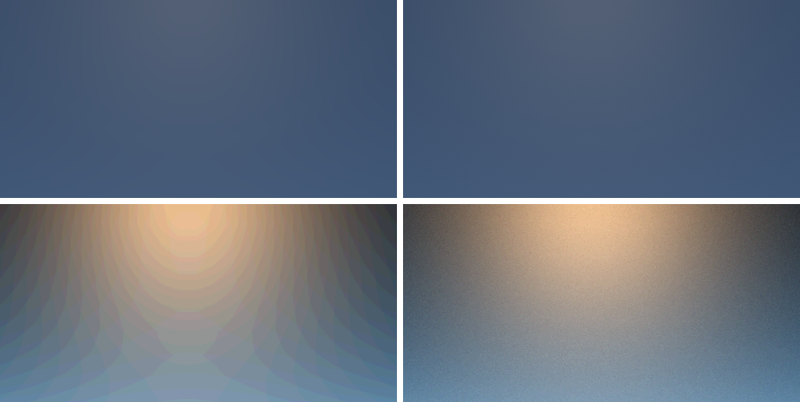

# G3s display dither — 7 November 2026

A reviewer of the Chrome valley found faint column banding in the noon sky. This was 8-bit contouring. The display pass
quantised scene colour straight to `Rgba8Unorm`, so the slow gradients near the Sun glow and on dark twilight
ground broke into rings and spokes. Each step was less than one code value, and the same banding appeared on native
and in Chrome.

## Change

- **Dither.** The SDR display encode adds triangular-PDF dither of one 8-bit step after sRGB encoding. Each pixel's
  dither is a fixed integer hash of its position (PCG2D, Jarzynski and Olano 2020), so captures stay deterministic.
- **Black and white.** The amplitude is zero for values that round to black or white, so both stay exact. Night stays
  exactly black.
- **Test.** The display ramp test now allows one code against the undithered legacy pipeline, and requires black and
  white to stay exact.

## Checks

- **Chrome noon.** Every changed channel moves by exactly one code. Mean RGB moves by at most 0.02 codes.
- **Native.** Noon pixels change by at most one code with the same mean. The night capture is still entirely black.
- **Chrome check.** The `valley` case passed with Wasm SHA-256 `31c61defc0a5e460f1c3dbd7511f15fdece1325575af6b3d120e13656b8d4640`.
- **Repository.** `./dev check` passed.

## Independent review

A fresh-context reviewer saw only unlabelled before and after Chrome stills at noon, twilight and sunset. It preferred
the dithered version in every pair:
- **Removed.** Rings and spokes around the noon Sun glow, stair-steps in the twilight sky, and wavy, slightly hue-shifted
  bands on the dark twilight ground.
- **Unchanged.** Brightness, colour and highlights.
- **Grain.** Visible only after contrast enhancement.
- **Regressions.** None. The PNGs are larger because noise compresses poorly.

## Also checked

- **Ridge fringes.** The reviewer noted these at noon. They are a smooth fall-off from crest to slope, from 126 to 100
  over 15 pixels, with no overshoot. That is consistent with crest normals facing the noon Sun and with extra aerial
  distance at the crest, so it is not treated as a defect.

## Open

- **Other paths.** The EDR and HDR present paths (G3b) do not use this encode.
- **Spatial versus temporal dither.** The dither is spatial only, which is fine for stills. A temporally varying,
  blue-noise dither could reduce grain further once frames are reconstructed.
