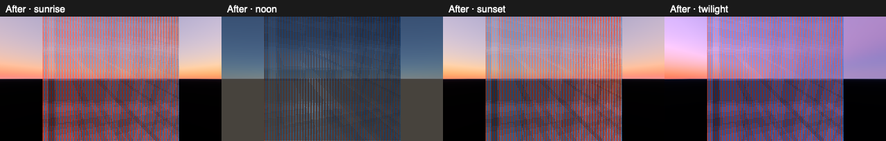

# G3s first light — open

6 November, M3 Max Metal. Functional camera/storage checkpoint; no imported spectral data or new speed claim.
Performance figures are history; correctness, spectral tolerance and visual review remain required.

| Row | Evidence | Status |
| --- | --- | --- |
| Half-float storage/units | Six-angle readbacks finite; production diffuse integrates known πL × Sun | Scoped pass |
| Physical incident camera | Two real-GPU calibration/history tests; Fixed pixel oracles; full `./dev check` | Pass |
| Spectral radiance | Independent all-orders CPU spectral oracle absent | Open |
| Sunset/twilight | Readable colour; SDR channel flattening and grid aliasing remain | Partial |
| Live presentation/cost | Latest window run: zero display-link callbacks; [earlier figures](../render/V1-BOUNDED-FRAMES-2026-11-04.md) remain history | Unqualified |

 · [1080p setting Sun](g3s-first-light/sun-facing-1080p.png) · [96-frame solar sweep](g3s-first-light/solar-sweep.mp4)

LUT gains (multiple 65536, sky 1024) preserve faint model radiance without changing transport. At −9° horizontal light
changed 0.296578→0.309882 lux; −12° 0.018674→0.033424 lux; daylight is unchanged. This proves storage, not Earth
accuracy. Raw inputs: `tmp/g3s-storage/`.

The outdoor camera now meters physical horizontal sky plus attenuated Sun, with C250 calibration and authored EV0–18;
no runtime readback. Fixed exposure retains reciprocal bits. One GPU resolve feeds tone; submitted-history sides
survive cancellation/capture.
Q/E turns the camera; R/F tilts; brackets change time. Full checks caught and fixed missing timestamp capacity.

Actual adjacent-tick dawn/dusk probes pass; a coarse 34-tick brightness comparison was not a frame-flash oracle.
Twilight is visible, but 36.6% of clear-sky side pixels reach a channel maximum (Sun-facing: 100%) under the existing
SDR gamut normalization. Improve its shoulder separately from transport; directional ambient and spectral truth remain
open. Captures, pixel observations, source hashes and logs: `tmp/g3s-exposure/`.
