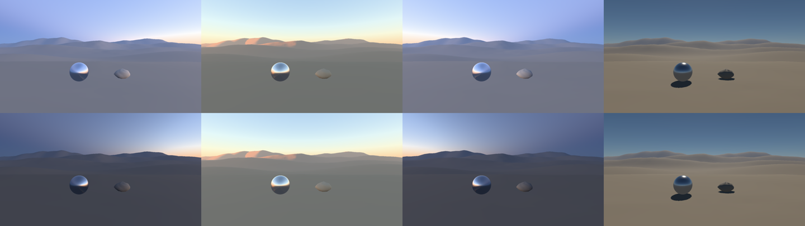

# G3s low-light exposure key — 7 November 2026

The dawn and twilight valley read flat and bright against the CC0 Kiara dusk photograph. The colour was right:
blue upper sky and a warm horizon. The camera was the problem. The incident meter scaled every illuminance back
to mid-grey, so a 10 lux twilight floor rendered as bright as noon. This is [the build plan](../../BUILD-PLAN.md)'s
G3s twilight item.

## Change

- **Opt-in key.** `SyntheticView::with_low_light_adaptation` gives the incident meter a target key that falls
  with light level. It uses the key-value curve of Krawczyk, Myszkowski and Seidel (2005),
  `1.03 − 2/(2 + log10(L + 1))`. Here L is the mid-grey luminance `0.18·E/π` of the metered illuminance E.
- **Normalisation.** The curve is normalised at 1,000 lux and only ever darkens, so daylight is unchanged. The
  shift is 0.63 stops at 100 lux, 2.06 stops at 10 lux and 3.1 stops at the 2.5 lux meter floor.
- **Where it applies.** The game turns it on for atmosphere-lit views. Physical light, scene storage and the
  colour pipeline are unchanged. Only camera EV moves, and the GPU meter remains the single exposure authority.

## Checks

- **GPU meter test.** The Metal test checks that 100,000 and 1,000 lux keep their EV bit-for-bit within
  tolerance, and that 100 and 10 lux shift by the computed stops with unchanged flags.
- **Captures.** Native Metal captures have the same floor mean at noon (113) and sunset (112). Dawn falls from
  120 to 70 and twilight from 121 to 70. The 97-sample solar crossing matches main frame for frame until the
  meter drops below 1,000 lux. After that the floor eases from 119 to 110 with no step.
- **Continuity.** The key is a smooth function of the metered illuminance, which already varies continuously
  with the Sun. It adds no temporal state.

## Independent review

A fresh-context reviewer saw only unlabelled before and after stills, a sunset sequence tile, and the Kiara dawn and
dusk photographs. It found:
- **Dawn and twilight.** It preferred the candidate. Main read as overcast daylight. The candidate reads dim, with
  slate upper sky, a peach Sun-side glow and dark blue-grey terrain.
- **Noon and sunset.** No regression.
- **Sequence.** Smooth. A slope change in floor brightness around tile frame 13 is not visible.

The reviewer also raised three points:
- **Dawn equals twilight.** Their brightness is identical. That is expected: the captures at 5.52 h and 18.48 h
  have the same Sun depression.
- **Foreground brightness.** The foreground is still brighter and flatter than in the photographs, which expose
  for the sky.
- **Horizon band.** The warm horizon band is narrower than the photographs' pink-to-violet gradient.

## Open

- The sky-to-ground balance is still a camera choice. A sky-weighted meter, or a stronger key, would move
  further toward the photographs. Neither is tuned here.

- Absolute Earth radiance is still uncalibrated, so the lux values that drive the key are model values.
- There is no Purkinje (rod-vision) hue shift or night desaturation. Under the sole-Sun model, night stays black.
