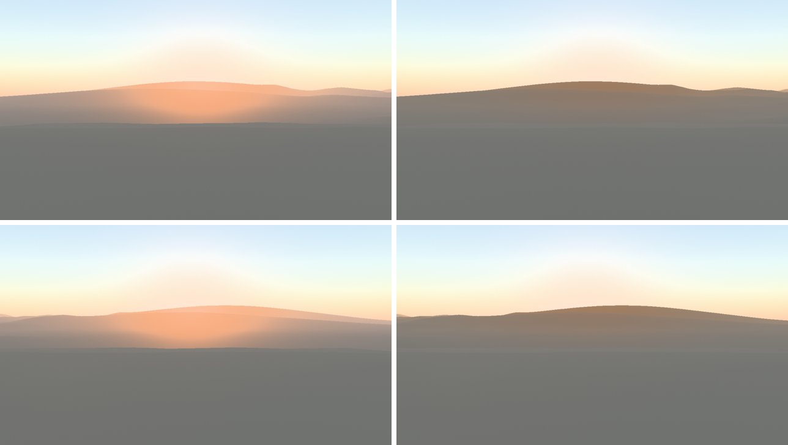

# G3s shadowed aerial in-scatter — 7 November 2026

Looking toward a low Sun hidden behind the ridge, the distant valley glowed saturated orange and stopped at a hard
step on the near-floor silhouette. The aerial volume lit every air sample with the Sun, including air in the
terrain's shadow. Native and Chrome showed the same glow.

## Change

- **Sun shadow-height map.** A new pass, *Sun air shadow heights*, builds a 512² map over the same footprint as
  the top-down caster height map, after the caster passes.
  - For each column it marches toward the Sun's azimuth and stores H, the height below which caster terrain hides
    the Sun's centre, together with the distance to that caster.
  - It is a fullscreen render pass. A compute version read the freshly drawn height layer nondeterministically on
    Metal (see below).
- **Single-scatter split.** The aerial volume's alpha now carries cumulative single-scatter luminance.
- **Shadowed aerial colour.** For each surface pixel, the ray to the surface is split into 8 intervals in
  √distance. Only the Sun's single-scattered share of each interval is attenuated, by soft solar-disk visibility
  against H at the interval's midpoint. Multiple scattering, from sky light, is kept, and transmission is
  unchanged.
- **Scenes without the recipe.** Scenes without shadows or atmosphere use the previous shader unchanged.
- **Receivers.** Receivers still use their own horizon march.

## Checks

- **Native Metal captures** compared with the previous commit:
  - Toward the Sun at sunset and sunrise, the shadowed ridge goes from about RGB 229 167 131 to 137 123 111
    (maximum change 109 codes), and the near-floor step disappears.
  - The authored sunset and sunrise framings change by at most 25 and 17 codes.
  - Noon and dawn change by at most 1 code. Twilight and night are unchanged.
- **Determinism.** The cooked-asset GPU tests require byte-identical frames after discarded frames. When the
  pass was a compute dispatch, they failed (7 pixels, 1–4 codes; intermittently in the fetched-store test).
  - Pass order, inputs and coverage were all correct, and forcing visibility to 1 made the tests pass.
  - As a fullscreen render pass, all 9 tests passed 5 runs out of 5 serially, and 3 out of 3 in parallel under GPU
    contention.
  - Root cause, not proved: a compute read of the depth layer right after the render pass that drew it is not
    reliably ordered on wgpu's Metal backend.
- **Chrome.** The `valley` and `sky-reflections` cases passed with Wasm SHA-256
  `39d29bc919a098144affba8d50f893515a869931b7f5bce0df865128c41d82a1`.
- **Repository.** `./dev check` passed.

### Mac cost, shared load

1080p offscreen cooked valley, starting at 17.8 h, 200 threaded callbacks per run. The interleaved
comparison uses the parent `9b4bea6` and `2db5039`. Values below are the two run results per variant.

| Metal GPU time | Before p50 / p95 (ms) | After p50 / p95 (ms) |
|---|---|---|
| Scene pass-sum | 4.99 / 8.56, 5.32 / 8.09 | 6.66 / 9.49, 6.66 / 9.76 |
| Shadow bucket | 0.161 / 0.649, 0.161 / 0.539 | 0.524 / 1.061, 0.544 / 1.017 |
| Forward and sky | 1.91 / 3.44, 2.00 / 3.36 | 2.42 / 3.75, 2.44 / 4.04 |

Scene median rose about 29%. One-minute system load ranged from 69.6 to 100.0, with another
Metal test running and even unchanged GPU passes taking longer in the candidate runs. The
comparison trips investigation. The shadow bucket includes the map build and cannot isolate it.
Raw logs and executable hashes are in `tmp/handback-review/aerial-cost/`.

## Independent review

A fresh-context reviewer saw only unlabelled pairs: toward the Sun at sunset and sunrise, the authored sunset, and
noon. In every pair it chose the shadowed version as more plausible:
- **Toward the Sun.** The orange bloom over hidden terrain is gone. The shadowed terrain is muted grey-brown,
  warming slightly with distance.
- **Authored sunset.** Contrast between lit and shadowed slopes is better.
- **Noon.** Identical.
- **Artefacts.** No new banding, seams, blockiness or halos.

Unchanged items it noted:
- A faint lighter strip just below the near silhouette.
- Hard shading terminators on the lit ridges in the authored sunset.

## Open

- **Sky pixels.** These are not shadowed. Light shafts in the visible sky need the same visibility applied to
  the sky-view path.
- **Cost.** The new pass runs every frame, with up to 96 height-map loads per texel, and adds 8 intervals per
  shaded pixel. First remove the repeated receiver march in the fade band. Using the air map for surface
  visibility needs a geometric oracle because its stored caster maximises occlusion at the disk centre.
- **Interval count.** 8 intervals in √distance can under-resolve thin shadow bands over long rays.
- **Compute ordering.** If confirmed, it affects any compute pass that samples a just-rendered depth target.
