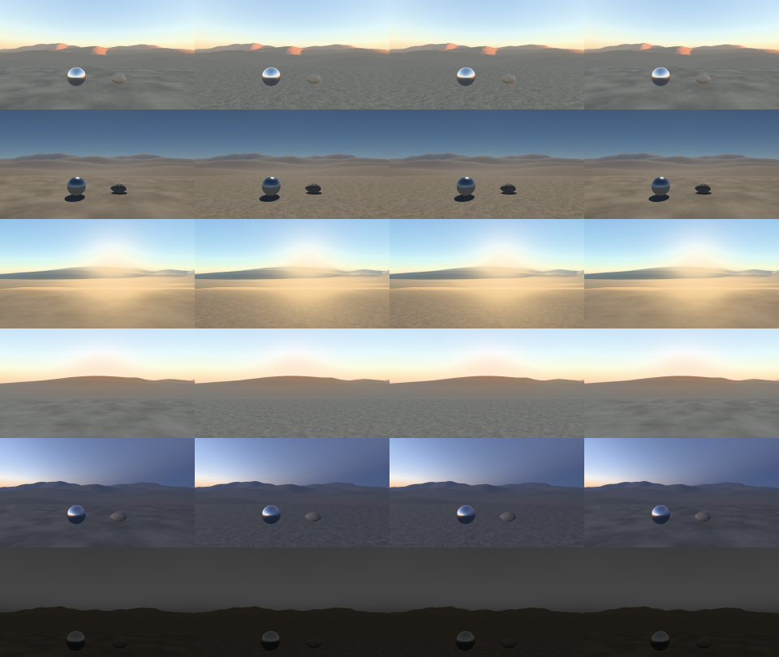

# G7 cooked valley in Chrome — 7 November 2026

Chrome now draws the authored cooked valley, not only the diagnostic scene. This is the first slice of
[the build plan](../../plans/BRIEF.md)'s G7 item: native and web share the scene. The page fetches one
publication from the G5 dev server and draws it with the same placements, camera, sky, shadows and exposure as
native. Chrome fetches Portable products. The native store can select compressed variants.

## Change

- **Product source.** `thrum-asset-gpu` takes a `CookedSource`. It is either a store path, followed by the native
  loader thread as before, or one `RemoteGeneration` fetched by G5's `DevClient`.
- **Browser preparation.** The browser has no loader thread. A fetched generation is prepared on the calling
  thread when the contribution starts, then posted to the same mailbox. Staging, the per-frame copy budget,
  swap, culling, draw and Sun casting are unchanged. A new device generation prepares it again.
- **Game.** `fetch_cooked_valley(origin)` and `BrowserGame::attach_cooked_valley` load and attach the embedded
  showcase recipe. `index.html?assets=<origin>` does both before the first frame. The showcase recipe and
  `serde` now build for wasm32. The environment product stays native.
- **Check.** `scripts/check_v1_browser.mjs --case valley` cooks `examples/v1-game/assets/showcase` into a fresh
  store with `thrum-cook watch --serve`. It then runs the sky-reflections procedure against it (seven held
  phases and 24 camera and Sun samples) and requires the cooked generation to be drawn with no loader errors.
  This is the dev server's first Chrome run with an `Origin` header, so its CORS path is now exercised.

## Checks

- **Midnight baseline.** The Ground E star and exposure refresh passed the old route on
  `check-20261107-231121`. Celestial handedness fix `9c1021bb` changed star placement afterward.
  A clean `67503c79` run (`check-20261108-123520`) reproduced the old baseline's Metal/Chrome
  night maxima of 2.470/2.452 codes. The other ten grids stayed within 0.005 codes.
  Compared to the old Metal frame, 11,931 pixels changed, all within the old/new
  stars-on support relative to the same-build stars-off control. Both current night
  captures match the pre-extraction reference run pixel for pixel. Refresh only the
  two night grids, with the Ground E root, route and thresholds unchanged. The
  `check-20261108-123835` repeat passes all 12 comparisons and both controls at the
  one-code threshold, with at most 0.005 codes of baseline drift. Raw route artifacts
  are under the worktree's `tmp/g7-showcase/runs/` and the offscreen control is in
  `tmp/g7-night-baseline/`.

- **Equivalence.** A Metal test fetches a generation from `DevServer` over loopback HTTP. It draws that
  generation at the same world time as the mapped store with Portable selected. No pixel differs by more than
  12 codes in any RGB channel. The fetched path uses the device's default preferences with BC compression enabled.
- **Handback recheck.** The Metal fetched-generation and edit cases passed. Chrome's `valley` and
  `valley-recovery` passed with Wasm SHA-256
  `172060dec8af3d7c432e5597ff81bb75e39e35f84f47905374b8adb5e81f3427`. The edit uploaded 5,376 bytes
  after the initial 1,523,712-byte upload. Two real device replacements each restaged the valley.
  The first valley run passed its scene assertions and timed out during Chrome shutdown. The repeat exited cleanly.
- **Chrome.** The `valley` case passed: generation 1 drawn after one swap, 1.52 MB uploaded, no loader errors.
  Wasm SHA-256 `81dba38fab05cf39e26f58e94eeb63dde7545d9be05f1c0c720f96a6c720df12`. The existing
  `sky-reflections` case passed with the same Wasm.
- **Repository.** `./dev check` passed.

## Live edits

- **Feed.** `CookedSource::Remote` now takes a `RemoteFeed`. `RemoteFeed::publish` hands in a newer fetched
  generation, and the contribution prepares it on the render thread at its next upload. It reuses every product
  the drawn set already holds and swaps in the new set through the same staging. A replacement device prepares
  the newest generation.
- **Page.** It long-polls the dev server with `CookedValley::next_publication`. Overlapping polls are refused,
  and failures are logged and retried after one second.
- **Chrome check.** The `valley` case now watches a copy of the showcase source. After its captures it retints
  `white.png` and requires generation 2 to be drawn with no errors, after exactly one more swap, uploading
  less than the first set. Result: 5,376 bytes uploaded against 1,523,712, with the watcher publishing 43 ms
  after the edit. The swap happened with the world paused.
- **Metal test.** A second publication through the feed swaps in with a smaller upload than the first, the
  dev client reuses the unchanged mesh, and the edit is visible.

## Device recovery

`check_v1_browser.mjs --case valley-recovery` runs the existing device-recovery procedure with the valley
attached. It destroys the actual `GPUDevice` twice and restores it with the real button, on the same world.
Each replacement must prepare the fetched generation again. Result: generation 1 still drawn, swaps 1 → 3, each
restage a full 1,523,712-byte upload, frames submitted 2 → 107, and no loader errors. `cooked_status` now
reports submitted frames. With Wasm SHA-256
`150993227878c5f7cd05d0f2af06a7ea1d2d41639f918ed9cd5f6be8992e5ae4`, the `valley`, `sky-reflections` and `device-recovery`
cases also passed, as did `./dev check`.

## Independent review

A fresh-context reviewer saw only Chrome and native stills and a 24-sample Chrome motion tile. It found:
- **Parity.** Chrome matches native at the authored framing: terrain, sphere, rock, sky colour and haze. There
  is no missing geometry and no corrupt region.
- **Lit floor turning grey in one step (samples 4–5).** The samples are 17.67 h and 17.73 h, 3.4 minutes of
  solar time apart. Native half-minute captures show the ridge shadow crossing the floor between 17.67 h and
  17.70 h, so this is sparse sampling of a real crossing, not a Chrome defect.
- **Saturated orange glow and a hard step at the near-floor silhouette (Sun-facing presets).** Native
  `sunset-sun` at the same time and direction shows both identically. They were shared look items: in-scatter
  over shadowed distant terrain. Fixed by [shadowed aerial in-scatter](G3S-SHADOWED-AERIAL-2026-11-07.md).
- **Noon preset.** It pitches up to the sky. The reviewer read it as dull and noted faint column banding and
  ridge fringes. The banding was 8-bit contouring, now dithered
  ([evidence](G3S-DISPLAY-DITHER-2026-11-07.md)). The fringes are a smooth crest fall-off, not a defect.

## Edit and replacement timing

Instrumented headless Chrome WebGPU on the shared M3 Max, with the paused cooked valley.
Preparation runs from the fetched-generation handoff to filled staging. Callback time is
`game.frame` wall time. Values are ranges from repeated cases.

| Swap | Bytes uploaded | Prepare (ms) | Game callback (ms) |
|---|---:|---:|---:|
| Initial set | 1,523,712 | 2.1–2.8 | 4.8–5.3 |
| Shared texture edit | 5,376 | 0.2–1.6 | 0.6–2.2 |
| Terrain mesh edit | 1,457,968 | 0.7–1.0 | 1.2–1.9 |
| Replacement restage | 1,523,712 | 0.6–0.8 | 4.3–6.0 |

The next animation callback came after 16.6–16.7 ms at every sampled swap. Keep the
current scheduling for this workload. End-to-end startup, edit-to-visible time and
physical presentation cadence remain open. Raw timestamps, load and harness are in
`tmp/handback-review/browser-prepare/`.

## Showcase launch and fixed review route

[The showcase route decision](../../design/decisions/G7-SHOWCASE-ROUTE.md) adds a local launch and a fixed route
for reviewing the cooked valley. Six paused presets in `examples/v1-game/params/showcase-*.params.json` hold the
stops. `scripts/run_v1_showcase.py` launches either target at one stop. Its `check` command proves both targets
drew the cooked valley rather than the diagnostic scene, and compares each stop with a checked-in baseline. Since M2
each stop's frame comes from applying its preset on both targets: native capture with `THRUM_CAPTURE_PARAMS`, and
Chrome through the checker's `route` case, one fresh page per preset.

**Build and input.** Each check run cited below built its own binaries from a clean tree (`built_by_this_run`,
`dirty: false` in each `run.json`). All are in `tmp/g7-showcase/runs/`.
- **M2, preset-driven frames:**
  - check-163503 at c2e1ff45 saved the current baseline.
  - check-163650 at 4101c3a5, the baseline commit, compared against it.
  - check-164639 rebuilt after the rebase on 6fa34365 and the review fixes, at dbcde616, and compared against it.
  - These local commits were later rebased, and the commits after them change only the checker's preset
    expectation, the script's baseline handling and documentation, not game, cook or web code.
  - Binaries: release `v1-game` `d8986d4f…` (with the capture seam) in all three, `thrum-cook` `e2fbdcfd…` and
    default-page Wasm `46d3eb04…`.
  - The drift demonstration (check-164805, -164859 and -164948) ran with `--no-build` on those binaries from the
    clean dbcde616 tree.
  - Not cited: check-163312 ran on a dirty tree before the seams were committed, with an earlier game binary
    (`ff8fa6f0…`).
- **M1, matched poses:** check-161058, check-161243 (the first baseline), check-161350 (against it), mac-161439 and
  chrome-161454.
  - These used `v1-game` `6855e94d…` and the same cook and Wasm.
  - Their `run.json` files name local commits from before M1 was squashed and rebased. Between those and the landed
    M1 commit, only this script, its baseline and documentation changed.
  - check-161940 reran with `--no-build` while the source-root guard was an uncommitted edit, and passed.
  - Not cited: check-160935 was the calibration run, and check-161144 ran with an uncommitted script edit.
- **Source:** the valley with the authored ground from 80e519ec (`ground.png` `ff297966…`). Its generation-1 root is
  `59f0484f…` in every run.

The M3 Max GPU was shared with other agents throughout.

| Check | Result |
|---|---|
| Chrome against native | At all six stops, the Chrome frames differ from native by at most 0.027 (median), 0.061 (95th percentile) and 0.160 (maximum cell). These are mean absolute 8-bit RGB values over a 32×18 grid. The thresholds are 1.0 each, unchanged: the comparator and source root are the same, and the numbers did not move. The 17.4 h clear-Sun stop, Mac-only in M1, reads 0.026, 0.039 and 0.092. At full size it shows a crisp Sun disc, about 10 pixels across, above the ridge on both targets; the disc is too small to see in the contact sheet. |
| Same input | The native store's generation-1 root is in both checker stores. Every page's loaded Wasm equals this run's build. Each Chrome stop's preset hash equals the repository's. The page reported nothing refused, and the native capture accounted for every preset key. Every pose equals its preset on both targets, and every Chrome stop held one paused tick through its capture. |
| Negative control | The diagnostic scene differs from native by 9.2–39 (median), 30–70 (95th percentile) and 92–117 (maximum) at the five stops with a diagnostic phase: more than ten times a threshold at each. The checker has no diagnostic phase at 17.4 h, so that stop has no negative control. |
| Positive control | The checker's frames before and after its texture retint, cropped to the canvas, differ by 34.4 in the maximum cell. The retint now reaches only the sphere and rock, because the ground has its own texture, so the median and 95th percentile stay at 0. The maximum cell is the statistic that catches a missing or wrong object. A wrong ground texture is caught by the Chrome-to-native comparison, not by this control. |
| Repeatability and baseline | The three clean M2 runs pass with byte-identical stop frames on both targets. Each differs from the baseline by at most 0.005, the stored rounding, over all 12 frames. M1's three clean runs, on the matched poses, agreed in the same way. |
| Drift is reported | Against a scratch baseline with one 8-cell patch of Chrome noon raised by 6 levels, `check --baseline` fails and names `chrome/noon` (maximum 6.002). `--save-baseline` then replaces that scratch baseline, recording the drift it replaced, and the next run passes within 0.005. The checked-in baseline was not touched. |
| Native capture seam | Tested on the committed, rebased binary `d8986d4f…` (`tmp/g7-showcase/seam/rebased/`). Without `THRUM_CAPTURE_PARAMS`, all 134 output files are byte-identical to the pre-seam binary's capture of the same store. With it, the other 133 files are unchanged too, and `captures.json` differs only by its `route` key. With the six presets, four route frames byte-equal the matched-pose captures. The 17.4 h and 18.48 h frames differ by at most 28 levels on about 1,000–2,600 pixels near the Sun. That comes from the controls snapping solar time to the 0.01 h slider stop (17.4 h becomes 17.400002 h), which Chrome applies too. Each of these fails the capture with its reason: a missing file, a file that is not JSON, a refused key (the message names it and suggests the right one), a preset that does not pause the world, two presets with one output name, and an empty list. |
| Checker route case | Each of the six checked-in presets launches a fresh page with `?assets` and `?params`, and the six pass in 7–12 s per run. The web build must ship each preset byte for byte and no others: a missing, a stale and an extra built preset each fail before any page loads. A typo in a checked-in preset is not shown on the current code: before the hold, a built preset with a typo failed its stop on the page's 0-refused check, which is unchanged, and the script's own key check refuses such a preset before any capture. G3c's 16-view field oracle, rerun after both changes, is byte-equal across Direct and Frustum. |
| `mac --stop sunset-clear-sun --frames 240` | Exit 0. The preset applied (4 changed, 0 refused) and the window presented 240 frames with no surface faults. The window was briefly occluded (5 occluded, 5 dropped surface frames). `run.json` records the store and scene. The window was not watched on screen. |
| `chrome --stop twilight --no-open` | The printed URL, opened in the desktop app's browser pane, showed the paused twilight valley with the authored ground (`pane-observation.jpg` and `.json` in the run). The preset applied (3 changed, 1 unchanged, 0 refused). The server's `requests.log` shows the page fetching the preset, the scripts and the Wasm, and the Wasm the page served equals the build. Stopping the launcher stopped both servers. |

**Comparator.** The first comparator assigned whole pixels to grid cells. That moved cell edges by up to a pixel
between Chrome's 1252-pixel and native's 1280-pixel frames, and it produced most of the measured difference: a
maximum of 2.15 against 0.148 with exact area coverage on the same frames. The independent review found that a
one-pixel shift brought the first comparator within 5% of failing. Comparator 2 weights each pixel by its exact
area share. A one-pixel shift of native now matters: shifted diagonally, it reads up to 1.24 (95th percentile)
and fails, and shifted vertically it fails at every stop. Shifted horizontally only, it fails at noon (maximum 1.94)
but passes at the sunset and night stops (maximum 0.60 and 0.53), where little detail runs across the view.
Thresholds were recalibrated by the design's rule for comparator 2 on this source
root, and every value fell to the 1.0 floor. The script refuses those thresholds on any other source root, so a
content change brings a reviewed recalibration rather than silently absorbing a parity change.

**Baseline.** `g7-showcase-baseline.json` (52 KB) holds the per-stop grids for both targets. Each grid is stored as
uint16 hundredths of an 8-bit level. The file also records:
- the identity: comparator version, frame-source version, source root and preset hashes;
- the build;
- the thresholds;
- how to reproduce and replace it.

`check` compares against the baseline only when its identity matches. Otherwise it reports the mismatch.
`check --save-baseline` replaces it, after a passing run whose frames have been reviewed. The first baseline was
run `check-20261107-161243`, on the matched poses. M2 replaced it with `check-20261107-163503`, reviewed frame by
frame, because the frames now come from the presets. That is recorded in the identity as frame source 2, so the old
baseline reported a different identity rather than a drift. The new baseline gains the Chrome 17.4 h stop. The
thresholds are unchanged.

**Texture profiles.** Chrome fetches Portable products. Native uses the device's preferred profile, Apple ASTC on
this GPU, by `texture_profiles`. That is read from the code; the run does not log it. Root kept this intended
difference, and parity holds across it.

**Timing, kept apart.** These are proxies on a contended GPU, not windowed startup. The ranges cover the ten cited
check runs: M1's 161058, 161243, 161350 and 161940; M2's 163503, 163650 and 164639; and the drift runs 164805, 164859
and 164948. Build time covers only the six that built.
- Cook: 0.06–0.60 s with warm binaries.
- Native capture launch to its first capture file: 0.11–2.73 s, offscreen, including one readback.
- Chrome navigation to the first observed cooked draw: see M3 below.
- Build time (warm, incremental): 1.2–8.1 s.
- Scripted capture cost: the native capture run took 1.5–6.1 s. The route case took 7.1–11.8 s for six fresh pages,
  over the six M2 runs. The valley and diagnostic checker cases took 15–31 s each. This is harness time, not frame
  time.

**Still open for G7.**
- The on-screen walk of the route on the Mac waits on screen control.
- Renderer findings from the review are listed in the design's "Still owed for final G7".
- Both stay with root. The Chrome startup proxy and the edited-source run are M3, below.

### M3: Chrome startup proxy and a route run from edited source

Root commissioned these two screen-independent proofs. Every run below is on commit f38166f0, which is main
6459379d plus the M3 commits; a later main commit, 00d34bfb, changed only documentation. The tree was clean in each
run. These runs record `origin_main`, the main ref at run time, which reads 00d34bfb in all but the first. Their
main revision is the merge base, 6459379d; the script now records it as `main_base`.

The commits after f38166f0 change only documentation and three script details. The startup scope wording is fixed.
`--recalibrate` now refuses the calibrated root, and a refused canonical save no longer leaves a run directory. The
checker's scope and usage wording is fixed too. These details do not change any number below, and the integration
runs at the end reproduce the proofs on current main. The canonical control check built the binaries, and the other runs used them with `--no-build`:
- release `v1-game` `5c0b7953…`;
- `thrum-cook` `e2fbdcfd…`;
- default-page Wasm `9405ae36…`.

The game binary and Wasm differ from M2's because main changed simulation code. The M3 Max GPU was shared with other
agents throughout, so the timings are contended. All runs are in `tmp/g7-showcase/runs/`, and the checker seam tests
are in `tmp/g7-showcase/m3/seam-final/`.

**Canonical control.** check-174420 passes on the checked-in valley and baseline:
- root `59f0484f…` and the fixed thresholds;
- all 12 frames within 0.005 of the baseline;
- every stop frame on both targets byte-identical to M2's check-165459.

**Chrome startup proxy.** `startup --runs 5` (startup-175135) ran the checker's route case five times.
- **Launch:** each launch is a fresh headless Chrome process and profile on hardware WebGPU (Metal). The game is
  already built, and the cook server serves generation 1 before navigation.
- **Cache:** the HTTP cache is disabled for each page. Every page transferred the full 2,056,659-byte Wasm.
- **Pages:** each launch opens the six stops in turn. The first page is the cold one: a fresh browser process and
  profile.
  - The OS file cache and any GPU shader cache outside the profile stay warm.
  - The route order makes the cold page always the night stop, so cold and stop are confounded.
  - The other five pages share the browser and GPU process and are warm.
  - The observer's polling and its search for the game object add to every bound.
- **Clock and interval:** each page is timed on its own clock, `performance.now()` from navigation start. The first
  cooked draw lies between the last observation that proves no draw and the first that sees one. A proof of no draw
  is either the page's exact pre-loop label (`Starting WebGPU…`, `Fetching the cooked valley…`) or a present
  `cooked_status()` with no generation drawn. An observation that proves neither leaves the lower bound absent, and
  navigation start is then the only bound.

Lower–upper bound in ms, raw:

| Page (order) | Launch 1 | Launch 2 | Launch 3 | Launch 4 | Launch 5 |
|---|---|---|---|---|---|
| 1 night-upslope (cold) | 157–169 | 117–162 | 112–152 | 137–173 | 127–175 |
| 2 noon | 116–124 | 106–122 | 113–128 | 63–123 | 104–114 |
| 3 sunrise | 63–130 | 70–169 | 36–164 | 112–122 | 78–131 |
| 4 sunset-clear-sun | 116–129 | 112–138 | 114–130 | 63–118 | 114–125 |
| 5 sunset-sun | 108–120 | 126–134 | 76–124 | 84–124 | 65–122 |
| 6 twilight | 107–120 | 62–108 | 126–140 | 100–116 | 55–113 |

- Cold upper bound: 152–175 ms, median 169 (n 5). Warm: 108–169 ms, median 124 (n 25).
- Granularity (upper minus lower): 8–128 ms, median 31. Every page had an observed lower bound.
  - The gap is widest at the third page (sunrise) and wherever the page's main thread was busy attaching the valley.
    Each observation goes through CDP and waits for that thread.
  - The checker's seam tests show both bound shapes. A normal run's six pages had gaps of 15–61 ms. A test run with
    the first observation delayed by 3 s recorded all six lower bounds as absent, with no granularity.
  - Earlier during review, one undelayed page was first seen already at Running and was recorded as absent.
- Where the time went (medians over the 30 pages):
  - navigation response at 2 ms;
  - Wasm loaded by 21 ms;
  - `Fetching the cooked valley…` first seen at 66 ms, over the 27 pages where it was observed;
  - the cooked products fetched from 65 to 78 ms;
  - `Running…` first seen at 116 ms.

  The cooked server is cross-origin and sends no Timing-Allow-Origin, so its transfer sizes are hidden. The page
  reports 1,882,112 bytes uploaded.
- **Same artifacts:** every page loaded this build's Wasm and the repository's preset bytes, and all five launches
  cooked root `59f0484f…`.
- **Kept apart, not counted:**
  - build: 22.3 s, in check-174420, after main's simulation change;
  - cook: 0.4 s in that check;
  - each launch's checker run, with its own cook and six pages: 6.7–7.6 s.
- **Scope:** a headless CDP polling proxy for navigation to the first observed cooked draw, from one contended
  session. It is not physical first-paint latency.

**Edited source.** `tmp/g7-showcase/m3/retint.py` copies the valley and scales the ground albedo `ground.png` by
(1.0, 0.55, 0.45), turning the ground red-brown (`ff297966…` to `e732b3ff…`). Nothing else changes. The checked-in
scene, assets and baseline are the control and were not touched.

The sheet is built from check-174420 (canonical) and check-174724 (edited) by `tmp/g7-showcase/m3/sheet_edit.py`,
with rows in route order: sunrise, noon, the 17.4 h clear Sun, 17.9 h sunset, twilight and night upslope.

| Check | Result |
|---|---|
| New source identity | `check --source tmp/g7-showcase/m3/edited-source` cooks generation-1 root `49041ec0…`, found in the native store and both checker stores. |
| Fixed thresholds refused | Without `--recalibrate`, check-175035 fails: the thresholds were calibrated on `59f0484f`, not `49041ec0`. |
| Recalibrated parity | With `--recalibrate`, check-174724 passes. The binding facts are that the rule lands on the 1.0 floor again (three times the worst valley is below 1), the same values as the fixed thresholds, and that both controls pass. Chrome differs from native by at most 0.033 (median), 0.175 (95th percentile) and 0.281 (maximum). The controls: the diagnostic scene differs by 7.3–27 (median), 28–71 (95th percentile) and 85–132 (maximum) at the five stops with one, and the positive control's maximum cell reads 34.4. |
| Canonical baseline refused | The checked-in baseline reports `other identity ['source_root']` and is not compared. |
| Changed region, both targets | As information only, the edited frames differ from the canonical baseline at each stop by up to 4.9–20.7 (median), 23–32 (95th percentile) and 25–35 (maximum). At night the median is 0.004 and the 95th percentile 9.2, because the ground is dark. Native and Chrome agree on these numbers to within 0.12. In the sheet the ground is red on both edited columns, and the sky, sphere and rock match the canonical frames. |
| Scratch replacement | check-174832 saved `tmp/g7-showcase/m3/edited-baseline.json` after a passing run, with its frames reviewed in the sheet. The rerun, check-174940, compares against it: all 12 frames within 0.005. |
| Canonical save refused | `--recalibrate --save-baseline` aimed at the checked-in baseline refuses before any work. |

**Checker seam.** Root reviewed the route-specific startup observation in five rounds and approved 10ea0392
(`tmp/g7-boundary/m3-checker-startup-v5.diff`); the rebase did not change it. On f38166f0:
- the `route`, `params`, `controls` and delayed-observer runs passed;
- G3c's `field-oracle` was 16/16 byte-equal.

`route` and `field-oracle` first failed after every page and view had passed: Chrome exited with code 2 during the
checker's shared cleanup, with display-link errors in its log. Both passed on rerun. The failed runs are kept beside
the passing ones.

**Integration on main 935ddd14.** Main then gained G3c's culling-count changes, which touched the browser and
window hosts and the shared checker. The M3 commits were rebased onto them, and the checker seam's own lines are
unchanged. Root approved the rebased patch (`m3-checker-startup-v6-on-935ddd14.diff`). On the rebased commit 01cb799d,
with a clean tree and `main_base` 935ddd14:
- check-180843 built the binaries (`v1-game` `e5ae52df…`, Wasm `cd2bdb81…`) and passed against the canonical
  baseline. Its 12 stop frames are byte-identical to check-174420's.
- check-181018 ran the edited source with `--recalibrate` and passed. Its 12 frames are byte-identical to
  check-174724's.
- startup-181110 (one launch) passed: cold upper bound 159 ms, warm 103–121 ms.
- The checker's `route`, delayed-observer, `field-oracle`, `params` and `controls` cases passed, and `./dev check`
  passed (`tmp/g7-showcase/m3/integrated/`).
- Smoke runs on 002865b7 showed the new refusals: `--recalibrate` on the calibrated root fails after the cook,
  and a refused canonical save leaves no run directory.

### M4: continuous valley ground material

Root commissioned this after M3 (G7 NOTES "Root commission after G7 M3: continuous valley ground material"). The
canonical valley ground was a soft, low-frequency albedo with a visible material edge and a flat band on the far
hills. M4 replaces only the ground albedo and the terrain UVs. Root approved the exact source and the recalibrated
root (NOTES "Root verdict on ground variant E and its baseline"). This change lands on its own, with main's night
exposure as it was. Root's star and exposure candidate refreshes the night baseline later, as a separate change.

**What changed.** `examples/v1-game/assets/showcase/generate.py` now:
- gives the terrain world-space UVs that repeat every 16 m around the camera's foot at (0, 16), growing gently
  (factor 0.5) beyond 40 m, so far slopes do not alias;
- builds a tileable albedo from isotropic spectral noise (k ≥ 6 per tile), per-texel grit and gravel clasts at
  1024², fits each channel's linear mean to the old neutral (0.701), and box-filters it 2×2 in linear light to the
  shipped 512² tile (3.1 cm per texel).

| File | Before | After |
|---|---|---|
| `generate.py` | | `0161e0b7…` |
| `ground.png` | 53,744 B | 484,682 B, `4dd5c486…` |
| `terrain.bin` | 1,306,400 B | 1,306,400 B, `204713d6…`; only the TEXCOORD_0 view differs |
| `terrain.gltf`, `scene.json`, other assets | | byte-identical |
| Cooked source root | `59f0484f…` | `70d2baf8…` |

`tmp/g7-showcase/m4/geometry_identity.py` proves positions, normals, indices, winding, placement and silhouette
unchanged: only the UV block, `ground.png` and `generate.py` differ, no file is added or removed, and the compared
blocks cover the whole buffer. The first reviewer re-ran it on C and regenerated all nine files byte for byte; the
second confirmed that E's `terrain.bin`, `terrain.gltf` and `scene.json` equal C's.

**Variants.** A (value-noise octaves) printed a lattice on the far slopes. B (spectral grain only) left the far
ground flat. C, a 1024² tile at 1.56 cm per texel, passed review with changes. Root then asked for a 512² tile at the
same repeat before any canonical change. E is C's linear field box-filtered to 512², so it is C's mip 1 and isolates
resolution. A second review chose E and advised against an 8 m repeat, which would add stamp risk inside the 40 m
radius.

**Look.** In offscreen Metal at native size, against C:
- far (rows 400–445) and mid (445–560) detail is equal within 5%, as C samples its mip 1 there;
- near (rows 560–720) horizontal gradient energy drops 27% (noon 2.13 → 1.56; 17.4 h 1.58 → 1.17; 17.9 h
  2.17 → 1.57), about 50% in the bottom 80 rows.

E loses the per-texel grit, the crisp edges of the smallest clasts and the hard contact shade in the nearest
ground. At 1:1 it still reads as mineral gravel with discrete clasts at noon and 17.9 h, and into the Sun at 17.4 h.
Root accepted this loss of near crispness.

**Scope of "edge and flat band removed".** It covers noon, 17.9 h, and 17.4 h below the lip. At 17.4 h the bright
lip stripe on the near ridge stays flat: it is root's renderer item (NOTES "Root sunset lip diagnosis"), not the
material. The noon crease near row 435 sits at the same rows before and after; it is a floor-to-slope depth boundary
in the geometry.

**Motion.** Slow pans from the real game (release `v1-game`, offscreen Metal, scratch store), in 1° steps because the
game snaps yaw to its slider step: noon −30…30°, and 17.4 h and 17.9 h −110…−70°. Consecutive PNG frames track the
same clasts. Neither reviewer saw sparkle, moiré, stamp or band. `shimmer.py`'s shift-compensated near residual is
lower for E than for C (×1e5: 10.2/3.6/8.0 against 12.8/4.7/10.6), with far and mid identical. The stacked mp4s
understate E's grain, so the review judged from the PNG frames.

**Cost.** Chrome Portable is uncompressed RGBA8 with mips. Native picks ASTC 4×4 or BC7.

| | Canonical | E | C |
|---|---|---|---|
| Portable ground product | 349,912 B | 1,398,536 B | 5,592,840 B |
| gzip −9 of that product | | 0.76 MB | 3.00 MB |
| Chrome bytes uploaded, route page | 1,882,112 | 2,930,688 | 7,124,992 |

Paired cold startups, ABBA (C, E, E, C), three fresh Chrome launches each, with the M3 startup proxy and its scope:
- cold upper bound: C 177–270 ms (median 240), E 152–176 ms (median 165);
- cooked fetch end: C 129–200 ms, E 103–118 ms.
- Runs: startup-20261107-191052 (C), -191125 (E), -191200 (E), -191223 (C).

This was localhost with a shared GPU, n = 6 per source: indicative, not a claim. A real network would add C's extra
2.24 MB gzipped, which nothing here measured. **Upgrade path:** once the cook emits compressed textures for Chrome,
C's 1024² tile costs about what E's RGBA8 does now. Its source stays at `tmp/g7-showcase/m4/vd/source` until then.

**Route on both targets.** These runs are on commit 959e57ff, which is main 85a7c281 plus the M4 commits, with a
clean tree. check-20261107-224619 built the binaries:
- release `v1-game` `c6d8c193…`;
- `thrum-cook` `e2fbdcfd…`;
- default-page Wasm `eaaf3aac…`.

It cooked root `70d2baf8…` through the normal cook and passed under the fixed thresholds:
- **Cross-target parity:** the worst valley difference was 0.027 (median), 0.052 (95th percentile) and 0.148
  (maximum).
- **Controls:** both passed, and the positive control's maximum cell read 34.4.
- **Baseline:** it saved the new canonical baseline. Its difference from the old baseline is information, not a
  failure: up to 6.9 (95th percentile) and 14.7 (maximum) at sunrise and noon, and 1.3 and 3.0 at night. That is the
  new grain, at the same scale on both targets.

check-20261107-224747 then reran `check --no-build` against the saved baseline and passed, with all 12 frames within
0.005. Against E's pre-landing check-20261107-191252, built from older main, every stop frame on both targets is
within one 8-bit code, and fewer than 1 in 100,000 channel values differ. `./dev check` passed on the same tree.

The sheet's canonical columns come from M3's integration check-20261107-180843, at root `59f0484f…`.

**Calibration.** E's first route check (check-20261107-191252, `--recalibrate`) put the worst valley at 0.027
(median), 0.052 (95th percentile) and 0.148 (maximum). The rule lands on the 1.0 floor again, so the thresholds stay
`[1, 1, 1]`. Root approved `CALIBRATED_ROOT = 70d2baf8…`. Root's composed scratch route with its star candidate on E
(check-20261107-193208) also passed at that root, with no baseline written.

**Reviews.**
- C at 6015e4e5, brief `tmp/g7-showcase/review/M4-REVIEW-BRIEF.md` (local): accept with changes. Taken: the band
  claim is scoped, the identity proof extended, low-Sun canonical pan controls added, and the PNG written with Up
  filters (same pixels).
- C against E, brief `tmp/g7-showcase/review/M4-512-REVIEW-BRIEF.md` (local): E becomes canonical, skip 8 m. Taken:
  the accepted near loss, the mp4 caveat, the cost and the upgrade path above.

### G7 Mac screen walk and G6 M1 panel check

The owner granted screen control at 19:40 for a renamed copy of the release build, "Thrum Review Window"
(`com.thrum.v1.review-window`). The old bundle id held a stored deny. This ran before E landed, on the canonical
source `59f0484f…`, with the release `v1-game` `e5ae52df…` (the bundle copy is `f183ad5d…` after its ad-hoc
re-sign; with signatures removed, they differ in one Mach-O header byte). Runs: `tmp/g7-showcase/runs/mac-20261107-194009` and
`-194151` through `-194342`.

- **G6 M1 panel:** the solar time slider, exposure zones, both camera sliders and pause each changed the running
  window as expected.
- **Held views:** all six route stops were seen in the live window, re-applied with `L` or a fresh launch.
- **Transitions:** time ran from 17.4 h to 18.7 h, and yaw swept from −90° to 146° on the panel. The frames seen
  showed no hitch, loss of view or panel mismatch. Bursts left gaps of about 15 s unseen, so this claims no
  continuity, cadence or latency.
- **Defects:** the 17.4 h lip stripe (root's), and the panel window covering the game window's right 36 px.
- **Not observed:** the surface recipe. The window title truncates before it, and the game log does not record it.

Root accepted the six held views and the observed control transitions (NOTES "Root verdict on the G7 live screen
walk"). Captures: `tmp/g7-showcase/screen/walk-20261107/` (local).

### Mac presentation cadence on glass (8 November)

**Setup.** The owner was present with the display unlocked and the machine otherwise quiet: Codex threads holding, CM1
solvers paused, on AC power in the normal power mode. The shipped V1 game ran windowed on the built-in Liquid Retina
XDR display (120 Hz ProMotion) at its shipped configuration:
- surface `Bgra8Unorm`, 1920×1080;
- cooked valley at root `70d2baf8…`, the 17.4 h `sunset-clear-sun` preset, paused world;
- runs from `run_v1_showcase.py mac --frames N`, on main e6bd0eff, clean;
- release `v1-game` `c71f7c83…`, built by the first run.

**Method.** Runs of 600 and 3000 frames alternated (600, 3000, 600, 3000) and were timed externally. Differencing
the paired wall times cancels the build check, the cook and window startup, leaving steady-state presents per second.
The rest comes from the game's own exit summary. No frames were kept.

| | Pair 1 | Pair 2 |
|---|---|---|
| Wall time, 600 / 3000 frames | 5.66 / 25.53 s | 5.58 / 25.54 s |
| Presents/s, steady state (2400 frames ÷ wall difference) | 120.8 | 120.2 |
| 3000-frame run: presented / display-link callbacks | 3000 / 3004 | 3000 / 3002 |
| Occluded, unavailable, surface faults, dropped surface or views | 0 | 0 |
| Late target evaluations | 0 | 0 |
| Drawable acquire wall, p50 / p95 | 0.043 / 0.423 ms | 0.214 / 0.580 ms |
| Render worker wall, p50 / p95 | 1.02 / 1.86 ms | 1.17 / 1.92 ms |
| Scene / forward / surface GPU, p50 | 1.95 / 1.30 / 0.06 ms | 1.93 / 1.26 / 0.06 ms |

**Findings.**
- **Cadence:** the game presented on every display tick at the panel's 120 Hz. Over 3000 frames, 2–4 display-link
  ticks had no present, all at startup or shutdown, since presented equals frames.
- **Median display interval:** 8.3 ms. This is inferred from 120 presents/s on a 120 Hz link, not timed per frame.
  The game does not record per-present intervals.
- **Acquire-to-display latency: not measured.** wgpu hides the drawable's presented time (`APPLE-PRESENTATION.md`,
  governor inputs), so the shipped game cannot observe when a frame reaches glass. Only the acquire wall above is
  observed. Closing this needs G4's presentation work, not another screen window.

**Limits.** The world was paused, so the camera and Sun were static while the game still rendered and presented every
tick. This is one machine on a 120 Hz panel, with runs of 5–25 s. The thermal state was not recorded. These figures
make no claim about Chrome or iOS.

**Moving world (rerun in the same window).** The overseer asked for the shipped workload in motion. The same
binary (`c71f7c83…`, main 6db05c87) ran the default 1920×1080 window with the world unpaused from the 17.4 h preset,
so solar time advanced and the Sun, sky and shadows moved every tick. It ran directly with a fresh cook of root
`70d2baf8…` (`tmp/g7-showcase/cadence2/run.py`), timed in the same 600/3000/600/3000 order. No frames were kept.

| Run | Wall | Presented / display-link ticks | Committed world ticks | Dropped surface / views | Acquire wall p50 / p95 | Scene GPU p50 / p95 |
|---|---|---|---|---|---|---|
| 600 (first, cold) | 6.25 s | 600 / 606 | 328 | 2 / 2 | 0.024 / 0.053 ms | 4.92 / 5.78 ms |
| 3000 | 25.38 s | 3000 / 3004 | 1509 | 1 / 1 | 0.029 / 0.390 ms | 4.48 / 5.32 ms |
| 600 | 5.30 s | 600 / 603 | 306 | 1 / 1 | 0.114 / 0.526 ms | 4.47 / 5.88 ms |
| 3000 | 25.31 s | 3000 / 3004 | 1507 | 1 / 1 | 0.083 / 0.609 ms | 3.98 / 4.95 ms |

- **Presents/s, steady state:** 119.5 and 119.9, each 3000-frame run measured against the warm 600-frame run (2400
  frames ÷ 20.08 s and ÷ 20.01 s). The first 600-frame run started about 1 s slower than the second, so pairing it
  would overstate the rate (125.5) and is not used.
- **Cadence:** every display tick but four presented in each 3000-frame run. The world committed about 60 ticks/s,
  so it really moved. Each run dropped one or two surfaces or views, where the paused runs dropped none, and the
  game's summary does not say when. Late target evaluations were 0–1.
- **Display interval:** a median of 8.3 ms, inferred from the rate as before. Acquire-to-display latency is still
  unobservable through wgpu.
- **Cost of motion:** scene GPU time roughly doubles over the paused runs (p50 about 4–4.9 ms against 1.9 ms), as
  shadows and sky update each tick. It still sits well inside the 8.3 ms interval.
- **Limits:** the camera stayed fixed, since the shipped game turns it only from input. These are short runs on one
  machine.
